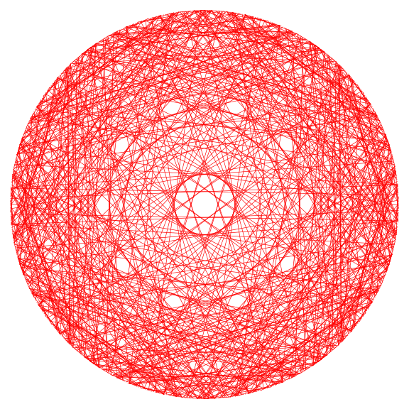

Sin duda el título de esta nota es bastante pomposo, como la Danza Pomposa de Tansman, pero es en esencia una extensión muy natural e ingenua de lo que se conoce como **residuos cuadráticos**, con $k=2$, a exponentes superiores $k \ge 3$, por supuesto con su morfismo $\pi_p$ de reducción módulo un primo $p$. Como mucho de lo que escribo por aquí, el título proviene de los números figurados.

> Es opcional instalar mi librería [FigurateNum ](https://pypi.org/project/figuratenum/) para leer esta nota, salvo quieras reproducir la imagen en `svg`.

```shell
pip install figuratenum[figurate-viz]
```

La teoría matemática es conocida ya, pero le aporto esta **reinterpretación casi trivial**. Para especificarte, diré cosas sobre **teoría de grupos** (simétricos, alternantes, grupos multiplicativos de cuerpos finitos) con unos cuantos corolarios sobre isomorfismos y tablas para comparar.

También llevo mucho tiempo pensando en este tipo de cuestión, que tiene que ver con lo multiplicativo, noción que he estado viendo constantemente incluso en objetos geométricos como la hipérbola, o analíticos, como la función Gamma $\Gamma$.

## Sobre los números figurados

En más notas he ido puliendo mi definición de número figurado, por ejemplo en esta [nota sobre series de Dirichlet generalizadas](https://edelveart.github.io/blog/dirichlet-series-of-figurate-numbers-and-riemann-zeta-functions/) con $\lambda(n) = \int_{1}^{n} \frac{1}{u}du$. El espacio $\mathbb{D}_{\log}$ que contiene expresiones  $\sum_{n\ge 1}\mathfrak{f}(n) n^{-s}$ es, bajo el sol estival, el $\mathbb{Q}$-espacio vectorial generado por las funciones zeta desplazadas $\zeta(s-j)$; es decir, cada elemento es una combinación lineal finita de ellas con coeficientes en $\mathbb{Q}$.

Retomo lo expuesto, los números figurados son polinomios $\mathfrak{f} \in \mathbb{Q}[X]$ de grado $k \ge 2$. Los que llamo clásicos, los que toman $\mathfrak{f}: \mathbb{N} \rightarrow \mathbb{N}$, tienen una interpretación geométrica de puntos.
Una primera propiedad que considero interesante en todos ellos, es que forman sucesiones estrictamente crecientes (generalizados no tienen porqué satisfacer esto), y les puedo asociar la sucesión unilateral

$$
 (\mathfrak{f}(n))_{n \in \mathbb{N}} = \left(\sum_{j=0}^k a_jn^j \right)_{n \in \mathbb{N}},
$$
siempre que $\mathfrak{f}(\mathbb{N}) \subseteq \mathbb{N}$, donde $k \ge 2$ es la dimensión en la que vive el número figurado.

Los números generalizados, por su parte, están amparados en cuestiones primariamente algebraicas $ \mathfrak{f}: \mathbb{Z} \rightarrow \mathbb{Z}$ y tienen asociada una secuencia bilátera idéntica, pero en el dominio de integridad por excelencia.

### La secuencia

> Los números cuadrados son de la forma $n^2$, los cúbicos $n^3$ y, en general, los hipercúbicos son $C^k(n) = n^k$, con $k \ge 2$.

Al respecto, los cuadrados (números figurados planos), y en general los hipercúbicos, son para mí la forma primigenia de función bien comportada en el sentido de las funciones aritméticas $f: \mathbb{N} \rightarrow \mathbb{C}$. Es decir, son completamente multiplicativos y, por consiguiente, multiplicativos, es decir, $f(mn)=f(m)f(n)$ cuando $\gcd(m,n)=1$.

Por otra parte, aunque muy evidente de computar sus valores, con lo siguiente puedes calcular los números cuadrados o multidimensionales hipercúbicos de $k=8$ dimensiones muy rápidamente.

```py
from figuratenum import FigurateNum

seq = FigurateNum().square()
print([next(seq) for _ in range(8)])
#[1, 4, 9, 16, 25, 36, 49, 64]

seq2 = FigurateNum().k_dim_hypercube(k=8)
print([next(seq2) for _ in range(8)])
#[1, 256, 6561, 65536, 390625, 1679616, 5764801, 16777216]
```

Lo bonito es que, si pienso en la base canónica de $\mathbb{Q}[X]_{\le k}$, cuya dimensión es $k+1$, tengo la siguiente proposición.

> $\textbf{Proposición}$. Sea $k \ge 2$. Cualquier sucesión de números figurados generalizados $\left(\mathfrak{f}(n)\right)_{n \in \mathbb{Z}}$, asociada a un polinomio $\mathfrak{f}$ de grado a lo sumo $k$, es posible expresarla como una combinación lineal con coeficientes en $\mathbb{Q}$ de las potencias $C^j(n) = n^j$, con $0 \le j \le k$ (es decir, de los números hipercúbicos generalizados junto con $n^0=1$ y $n^1=n$).

En efecto, es álgebra lineal.

### Los residuos

Listo, es momento de ir a la especialidad de la nota. He tenido interés en esto desde el año pasado que desarrollé parte de **FigurateNum** para graficar formas simétricas o asimétricas en el plano discreto.

Pero primero, pienso en el conjunto de clases de equivalencia, para cada $r \in \mathbb{Z}$,
$$
[r]_p = \{ m \in \mathbb{Z} \mid m \equiv r \pmod p \},
$$
y en aquellas clases que contienen alguna potencia $C^k(n)$.

Que la congruencia módulo $p$ sea una relación de equivalencia conlleva tres axiomas: reflexividad ($a - a = 0$), simetría (si $p \mid (b-a)$, entonces $p \mid (a-b)$) y transitividad (si $p \mid (a-b)$ y $p \mid (b-c)$, entonces $p \mid (a -c)$).
Por curioso que parezca en este sempiterno estío 2026, la dimensión $k=2$ de los cuadrados coincide con el caso prototipo.

> Obviaré, por abuso de notación, el denotar las clases $[r]_p$ a cada momento.


## Primer grupo Q

Según el conjunto que quiero estudiar, empiezo por los números cuadrados y el exponente $k=2$, se verá medio repetido, pero así es la notación.

$$
C^2(n) \equiv a \pmod p
$$

> Ahora tengo la pregunta de cajón, ¿cuál es el primo $p$ para el que debo plantear el primer ejemplo?

Comenzaré con el morfismo de reducción $\pi_7 $. En efecto, si reduzco $C^2(n)$ para $p=7$ (con $n \not\equiv 0$), los únicos residuos que quedan son $Q_7 = \{1,2,4\}$. Te preguntarás para qué me interesó esto. Pues si armamos una **Tabla de Cayley**, pero usando $(Q, \star)$, entiéndase la estrella por multiplicación modular en $\mathbb{Z}/7\mathbb{Z}$.

| $\star$ |  $1$  |  $2$  |  $4$  |
| :-----: | :---: | :---: | :---: |
|   $1$   |  $1$  |  $2$  |  $4$  |
|   $2$   |  $2$  |  $4$  |  $1$  |
|   $4$   |  $4$  |  $1$  |  $2$  |

Las operaciones convierten los residuos en un objeto algebraico que fue lo que me motivó a estudiar matemáticas: un **grupo**. Tengo el siguiente corolario que se desprende de la teoría de grupos abstractos.

$\textbf{Corolario}$. $Q_7$ es un grupo multiplicativo de residuos cuadráticos módulo  $7$. Además, cumple

$$
Q_7 \cong \mathbb{Z}/3\mathbb{Z} \cong A_3.
$$

Antes de dar la demostración, recuerdo que escribí hace un tiempo [sobre paridad y grupos alternantes](https://edelveart.github.io/resources-files/misc-alternating-groups-cycles.pdf).
En ese $\LaTeX$ denoté como $\Sigma_n$ al grupo simétrico y $A_n$ al grupo alternante, que aparece en el isomorfismo de arriba y solo contiene las permutaciones pares.

### Grupo simétrico y alternante

Cuando dije $\Sigma_n$ me refería a todas las permutaciones de  $n$ elementos. Las permutaciones son funciones de ida y vuelta, biyectivas, me gusta denotarlas por $\sigma$.
Cada permutación se puede expresar como producto de ciclos disjuntos, y un ciclo se escribe
$$
\sigma = (a_1 a_2 \cdots a_\ell),
$$
que es un **ciclo de longitud** $\ell$.

Bien, ahora viene el porqué de la dicotomía.
El partir entre el simétrico y el alternante es sin duda, **cómo agrupamos las transposiciones**, que son ciclos de longitud $\ell= 2$.

Cada ciclo de longitud $\ell$ se **descompone naturalmente como el producto** de $\ell - 1$ **transposiciones**,

$$
\sigma = \prod_{j= \ell}^{2} (a_1 a_j).
$$

> Es menester aclarar aquí que voy por derecha primero en las operaciones.

El ejemplo para entender esta productoria que, incluso tiene los índices al revés, es primero ver que se expande en forma

$$
(a_1a_2 \cdots a_\ell) = (a_1a_\ell)\cdots (a_1a_3)(a_1a_2).
$$

Ese es el motor (sin arrancar) y motivo de $a_1$ fijo. Ahora, si tomo el siguiente ciclo (me gusta representarlo como matriz, pero por ahora está bien sin ello).

$$
(1234) = (14)(13)(12)
$$

Aquí hay agrupadas **tres transposiciones** en el producto, así que este ciclo es **impar**. Por el contrario, si tomamos el ciclo
$$
(124) = (14)(12),
$$
que tiene en su descomposición únicamente **dos transposiciones** ($1 \mapsto 2$, luego $2 \mapsto 4$ y finalmente $4\mapsto 1$). Y como sabemos, dos es **par**.
Cito lo que escribí hace un tiempo,

> Diremos que un ciclo de longitud $\ell$ es una permutación par si $\ell$ es impar y será impar si $\ell$ es par.

Con una yapa de formalidad, es equivalente a considerar el signo,

$$
\operatorname{sgn}(\sigma) = (-1)^{\ell -1}.
$$

El ciclo de arriba, $(1234)$, pertenece a $\Sigma_4$ (pero no a $A_4$) porque tiene longitud $\ell=4$ pero, el segundo, $(124)$, sí es un elemento del grupo alternante $A_4$. Por cierto, el orden con la espléndida gamma del grupo alternante es  $|A_n| = \frac{\Gamma(n+1)}{2}$, así que $|A_4| = 12$.

### Demostración

Vuelvo a la prueba que faltaba. En $A_3$ están $\{e, (123), (132)\}$, estos ciclos de **longitud tres** son permutaciones pares, por ejemplo, $(123) = (13)(12)$, porque, en el fondo, se pueden escribir como un producto de dos transposiciones. Suficiente.

$\textit{Demostración}$. Como observas de la tabla, el producto de dos elementos de $Q$ vuelve a estar en $Q$, tiene el neutro $1$, cada elemento tiene su inverso en $Q$ y la operación es conmutativa, porque la tabla es simétrica con respecto a la diagonal principal (la asociatividad se hereda de la multiplicación en $\mathbb{Z}/7\mathbb{Z}$).

El isomorfismo cíclico nace del elemento generador $\langle 2 \rangle$, y el isomorfismo con el grupo alternante (simetrías pares), es establecer la biyección $1 \mapsto e$, $2 \mapsto (123)$ y $4\mapsto (132)$. $\square$

Antes de pasar a lo siguiente, el generador de $A_3$ es $\langle (123) \rangle$ (sí, era innecesario).

## Pregunta concéntrica y cuerpos finitos

Ya probé con $p=7$, pero es muy natural preguntarme qué pasa con $p=5$ o con $p=3$. ¿Hay más grupos alternantes o hay un grupo $G$ isomorfo al que pueda asignarle directamente por este morfismo de reducción?

Puesto que $Q_p^k$ resultará  cíclico de cualquier modo, los únicos grupos alternantes que pueden hacer su presentación en esta sala son los triviales y $A_3$, así que conviene preguntar por todos los $G$.

Previo a la respuesta, tuve que pensar en una notación adecuada. Para seguir con la idea de residuo, usaré $Q$ con subíndice $p$ (por la reducción módulo $\pi_p$) y superíndice $k$ para el exponente. Así que el ejemplo  que desarrollé puede reescribirse como $Q_7^2$. Entonces mi pregunta es saber el siguiente **isomorfismo**

$$
  Q_p^k \cong G.
$$

La teoría para resolver esta cuestión ha sido ya estudiada, porque es muy natural y necesitamos el grupo multiplicativo del cuerpo finito, $\mathbb{F}_p^{\star}$, que será nuestro $G$. Se sabe que $G$ tiene orden $p-1$ y es, además, cíclico, como ya vimos en mi ejemplo. Usaré $x$ en lugar de $n$ en lo que viene y asumiré que todos estos resultados han sido ya probados.

Necesito ahora el morfismo de grupos $f_k:G\rightarrow G$, que enviará  $x \mapsto x^k$. Podemos probar mediante la cadena de igualdades (**para esto sirvieron las leyes de exponentes**, y que $G$ es abeliano) que,

$$
f_k(xy)=(xy)^k=x^ky^k=f_k(x)f_k(y).
$$
Esto podría reinterpretarlo como hipercúbicos $C^k: G \rightarrow G$. Bien, finalmente tengo la definición que busqué  en la que preciso que los elementos también sean no nulos.

$\textbf{Definición}$. El conjunto de residuos $k$-ésimos no nulos módulo $p$ (subgrupo multiplicativo) es la imagen del morfismo

$$
Q_p^k=\operatorname{Im}(f_k) =\{x^k \mid x\in\mathbb{F}_p^{\star}\}.
$$

### Núcleo de la célula y núcleo de la foto

Como en casi todo tema de álgebra, el núcleo y la imagen dan suficiente información para responder a muchas preguntas, y muy en especial, a mi pregunta sobre a qué se parece, o, mejor dicho, a qué es isomorfo abstractamente $Q_p^k$.

En ese sentido, el orden del núcleo es $|\ker(f_k)| = \gcd(k, p-1)$. Al respecto, en cualquier libro de álgebra encuentras que en  un grupo cíclico de orden $n$, la ecuación $x^k=1$ tiene exactamente $\gcd(k,n)$ soluciones. Sigo. Mediante el **primer teorema de isomorfía** (Noether y las simetrías de la física),

$$
\frac{G}{\ker(f_k)} \cong \operatorname{Im}(f_k).
$$

El orden de $Q_p^k$ queda entonces como $|\operatorname{Im}(f_k)| = \frac{p -1}{\gcd(k, p -1)}$, así que llego naturalmente a la definición general que hacía falta.

$\textbf{Proposición}$. El grupo $Q_p^k$ es isomorfo al grupo cíclico de orden $\frac{p - 1}{\gcd(k, p - 1)}$,
$$
Q_p^k \cong \mathbb{Z}/{\frac{p - 1}{\gcd(k, p - 1)}}\mathbb{Z}.
$$

$\textit{Demostración}$. Por lo mostrado, $Q_p^k \cong G/\ker(f_k)$, y todo cociente de un grupo cíclico es también cíclico. Como además $|G/\ker(f_k)| = \frac{p - 1}{\gcd(k, p - 1)}$, el único grupo cíclico que cumple dicho orden es $\mathbb{Z}/\frac{p - 1}{\gcd(k, p - 1)}\mathbb{Z}$. $\square$

## Figuras con mi librería
A mitad de esta nota, quiero hacer un interludio y mostrarte una figura que produce mi librería **FigurateNum**; te compartiré el código hacia el final, porque encaja mejor con el asunto. La imagen representa los números hipercúbicos de la forma $C^{21}(n) = n^{21}$, cuyos primeros términos son

$$
1, 2097152, 10460353203, 4398046511104, 476837158203125, 21936950640377856, 558545864083284007, 9223372036854775808, \ldots
$$



## Ejemplos con Fermat

Recuerdo que Gauß pudo con  $p=17$ hacer un polígono regular de $p$ lados con una regla y un compás no musical (es un primo de Fermat $2^{2^2} +1$). Bien, en nuestro caso $Q_{17}^2$, $ \frac{17-1}{\gcd(2, 16)} = 8.$
Con un poco de Python, que no pondré más abajo porque lo interesante es hacer unas prácticas a mano, primero.

$$
Q_{17}^2 = \{1,2,4,8,9,13,15,16\}
$$
Y por ende, es isomorfo a $\mathbb{Z}/8\mathbb{Z}$. Su generador es $(9)$.

> En un momento vuelvo con la idea de generador $\langle g \rangle = (g)$ de cualquier grupo.

Incremento pues el exponente y pienso en $Q_{17}^3$, pero, aunque ni tú ni yo lo esperamos, la imagen son todos los elementos de partida

$$
Q_{17}^3 = \{1, 2, 3, 4, 5, 6, 7, 8, 9, 10, 11, 12, 13, 14, 15, 16 \}
$$

y es isomorfo a $\mathbb{Z}/16\mathbb{Z}$. Su generador es el elemento $(10)$.  Este pequeño juego que hice me lleva a un corolario aritmético elemental, pero bastante ilustrativo.

$\textbf{Corolario}$. $Q_p^k = \mathbb{F}_{p}^{\star}$ si, y solo si, $\gcd(k, p-1) = 1$.

$\textit{Demostración}$. Hace falta llamar a Bézout y Fermat para el lonche. ($\Leftarrow$) Primero, como $\gcd(k, p-1)= 1$, existen $a,b \in \mathbb{Z}$, tales que $ak + b(p-1) = 1$. Luego, por el pequeño teorema de Fermat, $x^{p-1}\equiv 1 \pmod p$, para todo $x$ no congruente con cero módulo $p$, y así (con $a$ posiblemente negativo, pues $x$ es invertible)
$$
x \equiv x^{ak+b(p-1)} \equiv (x^a)^k \pmod p.
$$
Por lo que todo residuo $[r]_p$  no nulo es una potencia $k$-ésima. ($\Rightarrow$) Recíprocamente, si $d=\gcd(k, p-1) > 1$, entonces $|\ker(f_k)| = d > 1$ y $f_k$ no es inyectiva; como $G$ es finito, tampoco es sobreyectiva, es decir, $|Q_p^k| = \frac{p-1}{d} < p-1$. Lo que demuestra el corolario. $\square$

## Raíz primitiva

Una raíz primitiva módulo $p$ es un entero $g$ cuya clase genera todo el grupo, $\mathbb{F}_p^{\star} = \langle g \rangle$, es decir tiene orden multiplicativo $p-1$, que como acostumbro a citar a Euler llega en breve la función totiente evaluada en un primo, $\varphi(p) = p-1$. Por ende, también puedo reescribir el isomorfismo con el generador que crea cada elemento, así que
$$
Q_p^k = \langle g^k \rangle \cong \mathbb{Z}/\frac{\varphi(p)}{\gcd(k, \varphi(p))}\mathbb{Z}
$$

En los números figurados hay algo parecido a lo que voy a hacer aquí, a saber, la **iteración de la misma operación**, y también algo de la idea de Euler.
La **cantidad de generadores** de $Q_p^k$ (raíces primitivas del subgrupo imagen), se computa equivalentemente desde la fórmula que plasmé más arriba

$$
\# \operatorname{Gen}(Q_p^k ) =  \varphi\left(\frac{\varphi(p)}{\gcd(k, \varphi(p))}\right).
$$

Nota que cuando $k=1$ se reduce a $\# \operatorname{Gen}(\mathbb{F}_p^{\star}) = \varphi(\varphi (p))$.

## Tabloides para hoy

A continuación colocaré varias tablas para cotejar algunos de sus valores en un rango no muy alto $k \in \{2, 3, \ldots, 21\}$. Las coloco en desorden, como las observé por primera vez.

### Grupos isomorfos a Q_17

|  $Q_{17}^k$   | Grupo isomorfo  | Generador |  $Q_{17}^k$   |  Grupo isomorfo  | Generador |
| :-----------: | :-------------: | :-------: | :-----------: | :--------------: | :-------: |
| $Q_{17}^{2}$  | $\mathbb{Z/8Z}$ |    $9$    | $Q_{17}^{3}$  | $\mathbb{Z/16Z}$ |   $10$    |
| $Q_{17}^{4}$  | $\mathbb{Z/4Z}$ |   $13$    | $Q_{17}^{5}$  | $\mathbb{Z/16Z}$ |    $5$    |
| $Q_{17}^{6}$  | $\mathbb{Z/8Z}$ |   $15$    | $Q_{17}^{7}$  | $\mathbb{Z/16Z}$ |   $11$    |
| $Q_{17}^{8}$  | $\mathbb{Z/2Z}$ |   $16$    | $Q_{17}^{9}$  | $\mathbb{Z/16Z}$ |   $14$    |
| $Q_{17}^{10}$ | $\mathbb{Z/8Z}$ |    $8$    | $Q_{17}^{11}$ | $\mathbb{Z/16Z}$ |    $7$    |
| $Q_{17}^{12}$ | $\mathbb{Z/4Z}$ |    $4$    | $Q_{17}^{13}$ | $\mathbb{Z/16Z}$ |   $12$    |
| $Q_{17}^{14}$ | $\mathbb{Z/8Z}$ |    $2$    | $Q_{17}^{15}$ | $\mathbb{Z/16Z}$ |    $6$    |
| $Q_{17}^{16}$ | $\mathbb{Z/1Z}$ |    $1$    | $Q_{17}^{17}$ | $\mathbb{Z/16Z}$ |    $3$    |
| $Q_{17}^{18}$ | $\mathbb{Z/8Z}$ |    $9$    | $Q_{17}^{19}$ | $\mathbb{Z/16Z}$ |   $10$    |
| $Q_{17}^{20}$ | $\mathbb{Z/4Z}$ |   $13$    | $Q_{17}^{21}$ | $\mathbb{Z/16Z}$ |    $5$    |

### Grupos isomorfos a Q_5

|  $Q_{5}^k$   | Grupo isomorfo  | Generador |  $Q_{5}^k$   | Grupo isomorfo  | Generador |
| :----------: | :-------------: | :-------: | :----------: | :-------------: | :-------: |
| $Q_{5}^{2}$  | $\mathbb{Z/2Z}$ |    $4$    | $Q_{5}^{3}$  | $\mathbb{Z/4Z}$ |    $3$    |
| $Q_{5}^{4}$  | $\mathbb{Z/1Z}$ |    $1$    | $Q_{5}^{5}$  | $\mathbb{Z/4Z}$ |    $2$    |
| $Q_{5}^{6}$  | $\mathbb{Z/2Z}$ |    $4$    | $Q_{5}^{7}$  | $\mathbb{Z/4Z}$ |    $3$    |
| $Q_{5}^{8}$  | $\mathbb{Z/1Z}$ |    $1$    | $Q_{5}^{9}$  | $\mathbb{Z/4Z}$ |    $2$    |
| $Q_{5}^{10}$ | $\mathbb{Z/2Z}$ |    $4$    | $Q_{5}^{11}$ | $\mathbb{Z/4Z}$ |    $3$    |
| $Q_{5}^{12}$ | $\mathbb{Z/1Z}$ |    $1$    | $Q_{5}^{13}$ | $\mathbb{Z/4Z}$ |    $2$    |
| $Q_{5}^{14}$ | $\mathbb{Z/2Z}$ |    $4$    | $Q_{5}^{15}$ | $\mathbb{Z/4Z}$ |    $3$    |
| $Q_{5}^{16}$ | $\mathbb{Z/1Z}$ |    $1$    | $Q_{5}^{17}$ | $\mathbb{Z/4Z}$ |    $2$    |
| $Q_{5}^{18}$ | $\mathbb{Z/2Z}$ |    $4$    | $Q_{5}^{19}$ | $\mathbb{Z/4Z}$ |    $3$    |
| $Q_{5}^{20}$ | $\mathbb{Z/1Z}$ |    $1$    | $Q_{5}^{21}$ | $\mathbb{Z/4Z}$ |    $2$    |

### Grupos isomorfos a Q_23

|  $Q_{23}^k$   |  Grupo isomorfo  | Generador |  $Q_{23}^k$   |  Grupo isomorfo  | Generador |
| :-----------: | :--------------: | :-------: | :-----------: | :--------------: | :-------: |
| $Q_{23}^{2}$  | $\mathbb{Z/11Z}$ |    $2$    | $Q_{23}^{3}$  | $\mathbb{Z/22Z}$ |   $10$    |
| $Q_{23}^{4}$  | $\mathbb{Z/11Z}$ |    $4$    | $Q_{23}^{5}$  | $\mathbb{Z/22Z}$ |   $20$    |
| $Q_{23}^{6}$  | $\mathbb{Z/11Z}$ |    $8$    | $Q_{23}^{7}$  | $\mathbb{Z/22Z}$ |   $17$    |
| $Q_{23}^{8}$  | $\mathbb{Z/11Z}$ |   $16$    | $Q_{23}^{9}$  | $\mathbb{Z/22Z}$ |   $11$    |
| $Q_{23}^{10}$ | $\mathbb{Z/11Z}$ |    $9$    | $Q_{23}^{11}$ | $\mathbb{Z/2Z}$  |   $22$    |
| $Q_{23}^{12}$ | $\mathbb{Z/11Z}$ |   $18$    | $Q_{23}^{13}$ | $\mathbb{Z/22Z}$ |   $21$    |
| $Q_{23}^{14}$ | $\mathbb{Z/11Z}$ |   $13$    | $Q_{23}^{15}$ | $\mathbb{Z/22Z}$ |   $19$    |
| $Q_{23}^{16}$ | $\mathbb{Z/11Z}$ |    $3$    | $Q_{23}^{17}$ | $\mathbb{Z/22Z}$ |   $15$    |
| $Q_{23}^{18}$ | $\mathbb{Z/11Z}$ |    $6$    | $Q_{23}^{19}$ | $\mathbb{Z/22Z}$ |    $7$    |
| $Q_{23}^{20}$ | $\mathbb{Z/11Z}$ |   $12$    | $Q_{23}^{21}$ | $\mathbb{Z/22Z}$ |   $14$    |

### Grupos isomorfos a Q_11

|  $Q_{11}^k$   | Grupo isomorfo  | Generador |  $Q_{11}^k$   |  Grupo isomorfo  | Generador |
| :-----------: | :-------------: | :-------: | :-----------: | :--------------: | :-------: |
| $Q_{11}^{2}$  | $\mathbb{Z/5Z}$ |    $4$    | $Q_{11}^{3}$  | $\mathbb{Z/10Z}$ |    $8$    |
| $Q_{11}^{4}$  | $\mathbb{Z/5Z}$ |    $5$    | $Q_{11}^{5}$  | $\mathbb{Z/2Z}$  |   $10$    |
| $Q_{11}^{6}$  | $\mathbb{Z/5Z}$ |    $9$    | $Q_{11}^{7}$  | $\mathbb{Z/10Z}$ |    $7$    |
| $Q_{11}^{8}$  | $\mathbb{Z/5Z}$ |    $3$    | $Q_{11}^{9}$  | $\mathbb{Z/10Z}$ |    $6$    |
| $Q_{11}^{10}$ | $\mathbb{Z/1Z}$ |    $1$    | $Q_{11}^{11}$ | $\mathbb{Z/10Z}$ |    $2$    |
| $Q_{11}^{12}$ | $\mathbb{Z/5Z}$ |    $4$    | $Q_{11}^{13}$ | $\mathbb{Z/10Z}$ |    $8$    |
| $Q_{11}^{14}$ | $\mathbb{Z/5Z}$ |    $5$    | $Q_{11}^{15}$ | $\mathbb{Z/2Z}$  |   $10$    |
| $Q_{11}^{16}$ | $\mathbb{Z/5Z}$ |    $9$    | $Q_{11}^{17}$ | $\mathbb{Z/10Z}$ |    $7$    |
| $Q_{11}^{18}$ | $\mathbb{Z/5Z}$ |    $3$    | $Q_{11}^{19}$ | $\mathbb{Z/10Z}$ |    $6$    |
| $Q_{11}^{20}$ | $\mathbb{Z/1Z}$ |    $1$    | $Q_{11}^{21}$ | $\mathbb{Z/10Z}$ |    $2$    |

### Grupos isomorfos a Q_47

|  $Q_{47}^k$   |  Grupo isomorfo  | Generador |  $Q_{47}^k$   |  Grupo isomorfo  | Generador |
| :-----------: | :--------------: | :-------: | :-----------: | :--------------: | :-------: |
| $Q_{47}^{2}$  | $\mathbb{Z/23Z}$ |   $25$    | $Q_{47}^{3}$  | $\mathbb{Z/46Z}$ |   $31$    |
| $Q_{47}^{4}$  | $\mathbb{Z/23Z}$ |   $14$    | $Q_{47}^{5}$  | $\mathbb{Z/46Z}$ |   $23$    |
| $Q_{47}^{6}$  | $\mathbb{Z/23Z}$ |   $21$    | $Q_{47}^{7}$  | $\mathbb{Z/46Z}$ |   $11$    |
| $Q_{47}^{8}$  | $\mathbb{Z/23Z}$ |    $8$    | $Q_{47}^{9}$  | $\mathbb{Z/46Z}$ |   $40$    |
| $Q_{47}^{10}$ | $\mathbb{Z/23Z}$ |   $12$    | $Q_{47}^{11}$ | $\mathbb{Z/46Z}$ |   $13$    |
| $Q_{47}^{12}$ | $\mathbb{Z/23Z}$ |   $18$    | $Q_{47}^{13}$ | $\mathbb{Z/46Z}$ |   $43$    |
| $Q_{47}^{14}$ | $\mathbb{Z/23Z}$ |   $27$    | $Q_{47}^{15}$ | $\mathbb{Z/46Z}$ |   $41$    |
| $Q_{47}^{16}$ | $\mathbb{Z/23Z}$ |   $17$    | $Q_{47}^{17}$ | $\mathbb{Z/46Z}$ |   $38$    |
| $Q_{47}^{18}$ | $\mathbb{Z/23Z}$ |    $2$    | $Q_{47}^{19}$ | $\mathbb{Z/46Z}$ |   $10$    |
| $Q_{47}^{20}$ | $\mathbb{Z/23Z}$ |    $3$    | $Q_{47}^{21}$ | $\mathbb{Z/46Z}$ |   $15$    |


> Sí, a primera vista, en las tablas $Q_{17}, Q_5, Q_{23}, Q_{11}, Q_{47}$,  hay variados generadores $\langle g \rangle$, pero los grupos no son muchos. Para cada $p$ solo pueden aparecer a lo sumo los grupos cíclicos $\mathbb{Z}/d\mathbb{Z}$ con $d \mid \varphi(p)$, y a veces aparece el grupo trivial $G = \langle e \rangle$.

## Cerradura compuesta

Por otra parte, quería cerrar cuestionándome qué ocurre si calculamos la teoría para el morfismo de reducción $\pi_n$ con $n$ compuesto, verbigracia $n= 9$, en lugar de uno primo.
Entonces, aunque no estemos ya con cuerpos finitos, el grupo de unidades $(\mathbb{Z}/9\mathbb{Z})^{\star}$ es cíclico e isomorfo  $\cong \mathbb{Z}/6\mathbb{Z}$ y tiene seis elementos $\{1,2,4,5,7,8\}$. Cada uno de ellos es invertible.

Para suerte mía, la **función totiente sigue perfecta, es decir, válida para hallar el orden** $|Q_9^1|= \varphi(9) = 6$. Si pienso en una potencia duodécima, a lo musical, $f_{12}(x)=x^{12}$, tengo que $|\operatorname{Im}(f_{12})| =\frac{6}{\gcd(12, 6 )} = 1$.

Así que la teoría funciona por el teorema de isomorfía como

$$
Q_9^{12} \cong \mathbb{Z}/|\operatorname{Im}(f_{12})| \mathbb{Z} \cong \{e\}.
$$

> Es menester decir que las cosas funcionan aparentemente bien porque $(\mathbb{Z}/9\mathbb{Z})^{\star}$ es cíclico; para un $n$ compuesto cualquiera el grupo de unidades no tiene por qué serlo, y entonces la fórmula del orden de la imagen deja de valer.

### Caso módulo ocho y general

Con $(\mathbb{Z}/8\mathbb{Z})^{\star} \cong \mathbb{Z}/2\mathbb{Z} \times \mathbb{Z}/2\mathbb{Z}$, un poco de algoritmo invertible muestra que tiene los elementos $\{1, 3, 5, 7\}$. Si lo elevo al cuadrado, todos los elementos se vuelven el neutro,

$$
Q_8^2 = \{1^2, 3^2, 5^2, 7^2\} = \{1\}.
$$
pero, como dije con  mi fórmula $\frac{ \varphi(8)} {\gcd(2, \varphi(8))} = 2$, lo que no cuadra con el orden real del grupo. La forma más general está bastante cercana (Noether nuevamente) y la escribo algo explícita para recordarla.

$\textbf{Proposición}$. Sea $G = (\mathbb{Z}/n\mathbb{Z})^{\star} $ un grupo abeliano finito y el morfismo $f_k: G \rightarrow G$, definido por $x \mapsto x^k$. Entonces

$$
|Q_n^k| = \frac{\varphi(n)}{d},
$$

donde $d = |\ker(f_k)| = |\{ x \in G \mid x^k = 1  \}|$.

$\textit{Demostración}$. Basta un teorema de isomorfía, el primero.  $\square$

Ya que estamos en el apartado de compuestos, y como prometí, la imagen de arriba, basta poquísimo código para generar esas cuerdas en la circunferencia de los números hipercúbicos de alta dimensión $k=21$.
```py
from figuratenum.figurate_viz import DiscreteViz

d = DiscreteViz()
d.visualize_multidim(
    "k_dim_hypercube", k=21, n_terms=710,
    circ_color="r", bg_color="none", rotate=-1,
)
```

En la [documentación oficial de FigurateNum](https://edelveart.github.io/figuratenum/fundamentals/) escribo $\mathfrak{f}_j \equiv r_j \pmod n$ y el respectivo algoritmo de trazado en el caso general. Aquí tenemos $C^{21}(j) \equiv r_j \pmod {710} $. Sí, es cierto que es un compuesto $n$, pero puedes probar por tu cuenta con números primos.

Saludos desde la actual temporada estival sin fin.
