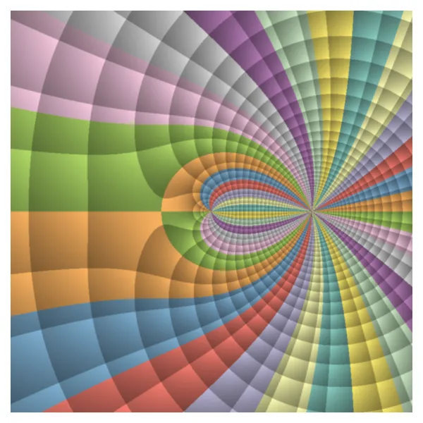
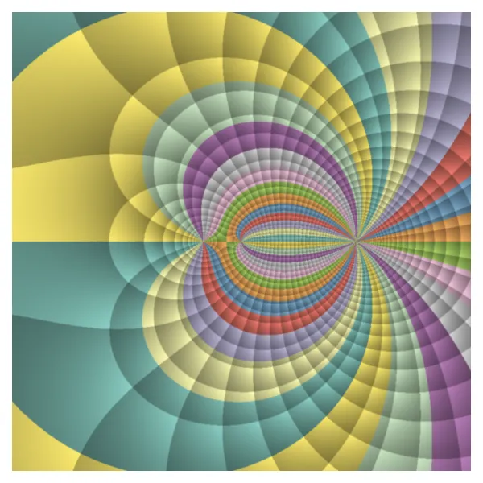
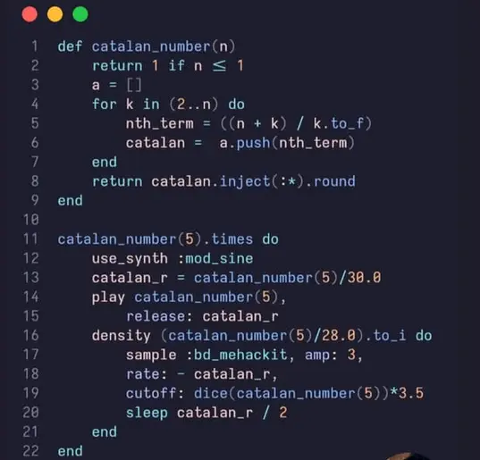
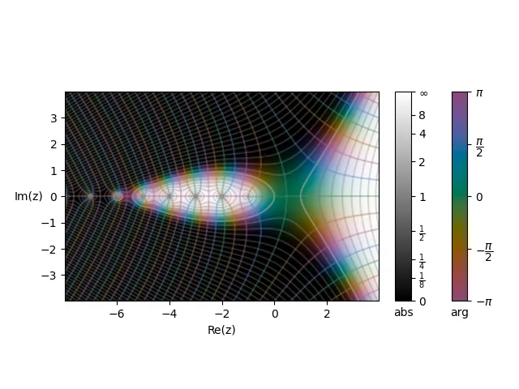
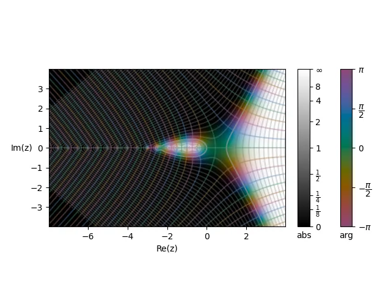
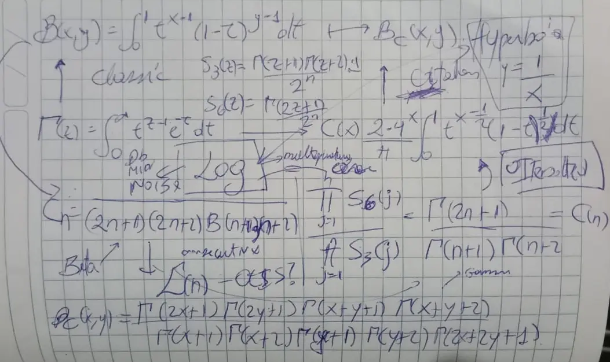

It's been a while since I last published anything here in English, but I've been writing in Spanish about [Diophantine equations and elliptic curves](https://edelveart.github.io/es/blog/divagaciones-diofanticas-entre-numeros-figurados-y-curvas-elipticas/) $E/\mathbb{Q}$ attached to figurate numbers, with everything that comes along, Mordell-Weil groups included.
I've found several corollaries along the way.

Well, what got me going a few weeks ago, and what I'll develop here, is a simple idea: instead of *adding* figurate numbers (which is already done, and we'll see it shortly), let's *multiply* them.
To be specific, I'm referring to the article on the Wayback Machine called [Polygorials by Daniel Dockery](https://web.archive.org/web/20140617132401/http://danieldockery.com/res/math/polygorials.pdf).

> Separately, on August 16 I released `version 1.6` of my Ruby gem for making algorithmic music with Sonic Pi, [figurate_numbers](https://github.com/edelveart/figurate_numbers).  It includes `ArithTransform.figuratenomial(n, k, seq)`, which takes a sequence of figurate numbers `seq` and constructs a Fibonomial from them.

But since I haven't yet defined what I mean by **figurate number** around here, I should start unifying how I write them from now on.
The reference I use and will keep using is [Figurate Numbers (2012) by Elena Deza and Michel Deza](https://www.worldscientific.com/worldscibooks/10.1142/8188), whose notation I'll also keep, though for now I'll stay general.

> You can use my library [figuratenum on PyPI](https://pypi.org/project/figuratenum/) for the examples below.
```shell
pip install figuratenum[figurate-viz]
```

## Versatile figurate numbers

I call it versatile because I think it's the most comfortable way to understand it and to communicate it with lots of study techniques. Consider a polynomial $\mathfrak{f} \in \mathbb{Q}[X]$ of degree $\deg(\mathfrak{f})= k \ge  2$, which plays the role of the geometric dimension (planar, spatial, or multidimensional). It induces a function
$$
    \begin{aligned}
        \mathfrak f:\mathbb Z & \longrightarrow\mathbb Q,  \\
        n                     & \longmapsto\mathfrak f(n).
    \end{aligned}
$$

In particular, let

$$
\mathfrak{f}(X) = \sum_{j=0}^k a_j X^j \in \mathbb{Q}[X],\quad a_k \neq 0
$$

The only restriction on the coefficients is that the leading coefficient needs to be nonzero ($S_3$, for instance, have $a_0=0$). Well, the bilateral sequence induced by $\mathfrak{f}$ is given by

$$
    \bigl(\mathfrak f(n)\bigr)_{n\in\mathbb Z}
    =
    \left(
    \sum_{j=0}^{k} a_j n^j
    \right)_{n\in\mathbb Z}.
$$

This is what I understand by a figurate number; in essence, the polynomial that carries its nature. That said, let me move on to the prelude of the topic at hand, first the sum, and then the main course, the multiplication.

## Sums of figurate numbers

Probably the most beautiful way to learn what a figurate number is starts with the **triangular numbers** $\mathfrak{f}(n) = S_3(n)$, which at bottom are simply a sum
$$
S_3(n) = \sum_{j=1}^n j = 1 +2 +3 + \cdots + n
$$
and which, by Gauss's trick, we prove to be
$$
S_3(n) = \frac{n(n+1)}{2}.
$$

> $\textbf{Remark}$. In many places you'll find this written as $T_n = S_3(n)$.

```py
from figuratenum import FigurateNum

seq1 = FigurateNum().triangular()
print([next(seq1) for _ in range(1000)])
# [1, 3, 6, 10, 15, 21, 28, 36, 45, 55, 66,
#  78, 91, 105, 120, 136, 153, 171, 190, ...]
```

The first terms are $1,3,6,10,15, \ldots$. I also want to show the generating function $G_{S_3}(z)$ here, again with `figuratenum`.

```py
from figuratenum.figurate_viz import ComplexViz

c = ComplexViz(domain_grid_radius=(2))
c.visualize_plane(
    "triangular", cmap_color="Set3",
    disk_radius=None
)
```


Well, it's not crazy to wonder: what if we sum these terms again, but now instead of summing $j$ we sum $S_3(j)$? Of course, we do

$$
\sum_{j=1}^n S_3(j) =  S_3(1) + S_3(2)  + \cdots + S_3(n)
$$

and with a bit of algebraic manipulation we arrive at the tetrahedral numbers, whose dimension is $k=3$, reflected in the superscript.
$$
S_3^{3}(n) = \frac{n(n+1)(n+2)}{6} = \sum_{j=1}^n S_3(j)
$$

```py
seq1 = FigurateNum().tetrahedral()
print([next(seq1) for _ in range(1000)])
# [1, 4, 10, 20, 35, 56, 84, 120, 165, 220, 286,
# 364, 455, 560, 680, 816, 969, 1140, 1330, ...]
```

So the **tetrahedral numbers** are the additive counterpart of iterated factorials (the multiplicative idea we'll get to in a moment).


Let's now take the hexagonal numbers, $S_6(n) = n(2n-1)$, and apply the same process, which leads to

$$
\sum_{j=1}^n S_6(j) = \frac{n(n+1)(4n-1)}{6} = S_6^3(n)
$$

which gives the hexagonal pyramidal numbers, also of dimension $k=3$.

```py
seq1 = FigurateNum().m_pyramidal(6)
print([next(seq1) for _ in range(1000)])
# [1, 7, 22, 50, 95, 161, 252, 372, 525, 715,
# 946, 1222, 1547, 1925, 2360, 2856, 3417, ...]
```

Their generating function $G_{S_6}(z)$ can also be computed directly with `figuratenum`:

```py
from figuratenum.figurate_viz import ComplexViz

c = ComplexViz(domain_grid_radius=(2))
c.visualize_plane(
    "hexagonal", cmap_color="Set3",
    disk_radius=None
)
```



You'll see shortly why I chose the hexagonals. For now, notice that if we take the process to the limit, the ratio of the hexagonal pyramidal numbers to the tetrahedral (triangular pyramidal) ones converges to an integer,
$$
\frac{S_6^3(n)}{S_3^3(n)} = \frac{4n-1}{n+2} \longrightarrow 4 \quad (n \rightarrow \infty).
$$

In fact, they converge to the same number when evaluating the ratio of hexagonal and triangular numbers,
$$
\lim_{n \infty} \frac{S_6(n)}{S_3(n)} = \frac{ 4n-1}{n+1}  = 4.
$$

This quotient idea came a little later than what follows, as I wanted to see whether it had anything to do with what makes certain quotients special.

> In general, many figurate numbers can be built from combinations, sums, and recursions of other numbers; *Figurate Numbers (2012)* is a book full of these beautiful constructive ideas.

Let's get to the main course, the truncated (finite) products.

## Products of figurate numbers

Just as we did with the sum, it's natural to ask: and what if we multiply? So let's do the same thing
$$
\prod_{j = 1}^n j = n!
$$
which is the idea of the factorial, but if we want to take the factorial again
$$
\prod_{j=1}^n j!
$$
we get the **superfactorial**. This is, for me, the multiplicative mirror of the tetrahedral numbers. I realized, almost by accident, that we're iterating, and creating a dual map between the two operations on consecutive natural numbers.

| Iteration |     Sum of $j$      | Product of $j$ |
| :-------: | :-----------------: | :------------: |
|     1     | Triangular numbers  |   Factorial    |
|     2     | Tetrahedral numbers | Superfactorial |

What struck me about the table is that what counts is the iteration, additive on one side and multiplicative on the other, much like reductions modulo $p$ (which have nothing to do with anything here), but I associated them almost spontaneously.

## Catalan numbers from planar figurate numbers

I've taken the naturals $1,2,3, \ldots$, but it's natural to start thinking about the same thing with a different sequence.

### Triangular numbers

For example, with triangular numbers, the terrain expands a bit beyond the simple factorial to combinations of factorials

$$
\prod_{j=1}^n S_3(j) = \frac{n!(n+1)!}{2^n}
$$

$\textit{Proof}$. I write out the product of triangular numbers, $\prod_{j=1}^{n} \frac{j(j+1)}{2}$, and directly, expanding into separate products,
$$
\frac{1}{2^n} \left(\prod_{j=1}^n j\right) \left(\prod_{j=1}^n(j+1)\right)
$$
which is evidently $\frac{1}{2^n}n! (n+1)!$, as claimed. $\square$

### Hexagonal numbers

What surprised me on the Wayback Machine was that if I do the same with hexagonal numbers

$$
\prod_{j=1}^n S_6(j) = \frac{(2n)!}{2^n}
$$

$\textit{Proof}$. I expand the figurate numbers $\prod_{j=1}^n j(2j-1)$ and separate them as

$$
\prod_{j=1}^n j \prod_{j=1}^n (2j-1)
$$

On the left I have $n!$, and on the right $(1\cdot 3 \cdot 5 \cdots (2n-1))$. Splitting $(2n)!$ into its even and odd factors,

$$
(2n)! = (2\cdot 4 \cdot 6 \cdots 2n)(1\cdot 3 \cdot 5 \cdots (2n-1))
$$
Since $2 \cdot 4 \cdot 6 \cdots 2n = 2^n n!$, then
$$
(1\cdot 3 \cdot 5 \cdots (2n-1)) = \frac{(2n)!}{2^n n!}.
$$

Finally, multiplying by $n!$ and solving, the identity above for hexagonals is proved. $\square$

### Catalan numbers as quotient

Why the hexagonal numbers? Well, here's the answer, just put a quotient of hexagonals over triangulars (where the $2^n$ cancel) and out comes

$$
\frac{\prod_{j=1}^n S_6(j)}{\prod_{j=1}^n  S_3(j)} = \frac{(2n)!}{n!(n+1)!} = C_n
$$

which is the well-known sequence of the [Catalan numbers - OEIS A000108](https://oeis.org/A000108), exactly as it appears derived [on page 9 of the Polygorials](https://web.archive.org/web/20140617132401/http://danieldockery.com/res/math/polygorials.pdf). Its first terms grow like this


$$
1, 1, 2, 5, 14, 42, 132, \ldots
$$

But, as with many of these identities, a few naive exploratory questions come to mind.


<figcaption class="not-prose text-neutral-content text-sm mb-8 text-center">
  <em>Screenshot of an old 2023 photo about the Catalan numbers in Sonic Pi.</em>
</figcaption>

> What harm could there be in extending this form of the Catalan numbers, a quotient of factorialized triangulars and hexagonals, to the complex numbers?

## Building a Catalan gamma function

Every time I see a factorial $!$ I think of the Gamma function $\Gamma$; as I've said many times, this association comes from the very short book by [Emil Artin](https://ncatlab.org/nlab/files/Artin-TheGammaFunction.pdf).

What I'll do is a naive extension from the integers to a complex variable, $n \mapsto z \in \mathbb{C}$.
Here, just as a reminder to myself, I write
$$
\Gamma(z) = \int_0^{\infty} t^{z-1}e^{-t}dt
$$
for $\Re(z) > 0$. Its meromorphic continuation has simple poles at $0$ and the negative integers $-1, -2, \ldots$ and, by the way, it has no zeros (so $1/\Gamma$ is entire).
So I rewrite the Catalan sequence over the complex numbers

$$
C(z)=\frac{\Gamma(2z+1)}
{\Gamma(z+1)\Gamma(z+2)}
$$

The upside is that we can now plug in non-integer arguments, rational ones to start. Since I also like thinking about the volume of $n$-balls, I'll begin with $\frac{1}{2}$; you'll see why I said that, and maybe it's not a good thing.

$$
C\left(\frac{1}{2}\right) = \frac{\Gamma(2)}{\Gamma(\frac{3}{2}) \Gamma(\frac{5}{2})}
$$

These values are already tabulated in plenty of sources, and we get
$$
C\left(\frac{1}{2}\right)
= \frac{1}{\frac{\sqrt{\pi}}{2}\cdot\frac{3\sqrt{\pi}}{4}}
= \frac{1}{\frac{3\pi}{8}}
= \frac{8}{3\pi}
$$

### Its integral aspect

To get back to the explicit continuum, I'll write the following integral representation of the Catalan numbers (valid for $\Re(x) > -\frac{1}{2}$),

$$
C(x) = \frac{2\cdot 4^x}{\pi} \int_0^1 t^{x - \frac{1}{2}} (1-t)^{\frac{1}{2}} dt
$$

$\textit{Proof}$. I need three well-known facts. First, by Legendre's duplication formula,

$$
\Gamma(z) \Gamma(z + \frac{1}{2}) = 2^{1-2z}\sqrt{\pi} \Gamma(2z)
$$

taking $z = x + \frac{1}{2}$, we get

$$
\Gamma (2x+1) = \frac{4^x}{\sqrt{\pi}} \Gamma(x+1)\Gamma(x + \frac{1}{2})
$$

From which, partway through solving, it follows that

$$
C(x)= \frac{4^x \Gamma(x + \frac{1}{2})}{\sqrt{\pi}\Gamma(x+2)}
$$

Now I also need this well-known identity for quotients of Gamma

$$
\frac{\Gamma(a)}{\Gamma(a+b)} = \frac{1}{\Gamma(b)} \int_0^1 t^{a-1}(1-t)^{b-1} dt
$$

We know that $a = x + \frac{1}{2}$, and $b$ has to be determined by the denominator $\Gamma(x+2)$, so $a+b = x+2$, which means solving $ x + \frac{1}{2} + b = x+ 2 $, giving $b=\frac{3}{2}$.
Almost done: since $\Gamma(\frac{3}{2}) = \frac{\sqrt{\pi}}{2}$, the integral form is proved by substituting $a$ and $b$ into the quotient identity. $\square$

I switched from $z$ to $x$ for the variable because I want to think of a function that goes hand in hand with $\Gamma$.

## An Eulerian beta function of Catalan numbers

Well, since we already have the Gamma version, it's natural to say again: what if we build a Euler-type Beta function for it? In other symbols, I'll write

$$
B_C(x,y)=\frac{C(x)C(y)}{C(x+y)}
$$

The expanded result is practically direct; it's enough to substitute everything we did above.

$$
B_C(x,y)=
\frac{
\displaystyle
\frac{\Gamma(2x+1)}
{\Gamma(x+1)\Gamma(x+2)}
\cdot
\frac{\Gamma(2y+1)}
{\Gamma(y+1)\Gamma(y+2)}
}{
\displaystyle
\frac{\Gamma(2(x+y)+1)}
{\Gamma(x+y+1)\Gamma(x+y+2)}
}
$$

With a bit of algebra and a minute of patience, I get

$$
B_C(x,y)=
\frac{
\Gamma(2x+1)\Gamma(2y+1)
\Gamma(x+y+1)\Gamma(x+y+2)
}   {
\Gamma(x+1)\Gamma(x+2)
\Gamma(y+1)\Gamma(y+2)
\Gamma(2x+2y+1)
 }
$$

It landed in my lap like a gift. Now, it has the most expected properties of such a function; for example, it's symmetric, that is, $ B_C(x,y) = B_C(y, x)$. With a nose for algebra, I also get $B_C(x, 0) = C(0) = 1$. And above all, the associativity-type identity (the same one the classical Beta satisfies)

$$
B_C(x,y)B_C(x+y,z) = B_C(y,z)B_C(x, y+z)
$$

By its very definition, this construction is also a multiplicative $2$-coboundary, and therefore satisfies the corresponding $2$-cocycle identity. But let's not get sidetracked.

Something I could study in the future would be the special values. For example, if we plug in $x = y = \frac{1}{2}$, we get $B_C\left(\frac{1}{2}, \frac{1}{2}\right) = \frac{64}{9\pi^2}$.

## Integral of the Catalan pseudo-beta

Since we've already made the Gamma function explicit, let me also recall the traditional Euler Beta

$$
B(x,y) = \int_0^1 t^{x-1}(1-t)^{y-1} dt
$$

Now, to get an integral form for $B_C(x,y)$ it will again be somewhat tedious, but I can rewrite everything using what we did above.

$$
B_C(x,y) = \frac{
\left( \frac{2\cdot 4^x}{\pi} \int_0^1 t^{x - \frac{1}{2}} (1-t)^{\frac{1}{2}} dt\right)
\left( \frac{2\cdot 4^y}{\pi} \int_0^1 s^{y - \frac{1}{2}} (1-s)^{\frac{1}{2}} ds  \right)
  } {
\frac{2\cdot 4^{x+y}}{\pi} \int_0^1 u^{x+y - \frac{1}{2}} (1-u)^{\frac{1}{2}} du
   }
$$

 To wrap up, we'd still need to simplify by cancelling a few terms, namely,
$
\frac{(2\cdot 4^x)(2\cdot 4^y)}{2\cdot 4^{x+y}} = 2, $ and the powers of $\pi$ leave one factor $\frac{1}{\pi}$. So the identity simply becomes

$$
B_C(x,y) = \frac{2}{\pi} \frac{
\left(  \int_0^1 t^{x - \frac{1}{2}} (1-t)^{\frac{1}{2}} dt\right)
\left(  \int_0^1 s^{y - \frac{1}{2}} (1-s)^{\frac{1}{2}} ds  \right)
  } {
 \int_0^1 u^{x+y - \frac{1}{2}} (1-u)^{\frac{1}{2}} du
   }
$$

My idea would be to write it as a single integral rather than a quotient, but I think I'll leave that for another time.


## Catalan numbers from the classical Beta function

For a bit of variety, I'll plot both functions in the complex plane using the `cplot` library. For the moment I have to think about whether to implement these Gamma factorials visually in $\mathbb{C}$ in `figuratenum`, so nothing is available to date.

Well, going back to the beginning to deal with the triangular polygorial in terms of the Gamma function

$$
\frac{\Gamma(n+1)\Gamma(n+2)}{2^n} = \prod_{j=1}^n S_3(j)
$$



and, similarly, the hexagonal polygorial
$$
\frac{\Gamma(2n+1)}{2^n} =  \prod_{j=1}^n S_6(j).
$$



Curiously, if we take the quotient again we arrive at $C(z)$. Nevertheless, I want to do something different with this game of identities.
In that spirit, by the classical identity (I'll use $a,b$, but it's the same as $x,y$), $B(a,b)$, and setting $a = n+1$ and $b = n+2$, this becomes
$$
B(n+1, n+2) = \frac{\Gamma(n+1)\Gamma(n+2)}{\Gamma(2n+3)}
$$
Since we want to reach the Catalan function in terms of Gamma, which was (I'll write it again)
$$
C_n = \frac{\Gamma(2n+1)}{\Gamma(n+1)\Gamma(n+2)}
$$
If you look closely, it's quite similar but upside down. So I invert the expression we just computed to make it resemble this one
$$
\frac{1}{B(n+1, n+2)} = \frac{\Gamma(2n+3)}{\Gamma(n+1)\Gamma(n+2)}
$$

How do we convert it to match? Well, among the thousands of properties of Gamma, there's the functional equation

$$
\Gamma(2n+3) = (2n+ 2)(2n+ 1) \Gamma(2n+1),
$$

Therefore, check this out

$$
\frac{1}{B(n+1, n+2)} = (2n+2)(2n+1)C_n
$$

So the Catalan numbers are
$$
C_n = \frac{1}{(2n+1)(2n+2)B(n+1, n+2)}
$$


The beautiful part is that the factor multiplying the Beta in the denominator is a quadratic polynomial in $n$, namely
$$
(2n+1)(2n+2) = 4n^2 + 6n + 2 = L(n)
$$

If I evaluate the first terms of $L(n)$, with $n \ge 1$,

$$
12, 30, 56, 90, 132, 182, 240, 306, 380, 462
$$

By one of life's coincidences, it's exactly the same sequence that appears in

- [OEIS - A002939](https://oeis.org/A002939)

starting at index $2$. But it coincides when $L(n)$ is injected at values $n \ge -1$, that is, it produces $0, 2, 12, 30, \ldots$


## A small proposal to look into

After all these identities, and since the quotient of the products of $S_6$ over $S_3$ generates a sequence as combinatorially important as the Catalan numbers,

> Which other quotients or products can generate a number or pattern with an interesting combinatorial meaning, let's call it $\Lambda(n)$, and what are the conditions for that to happen?

That is, if we have two figurate numbers of equal or different dimensions $k_1$ and $k_2$,
$$
\frac{\prod_{j=1}^n \mathfrak{f}^{k_1}(j)}{ \prod_{j=1}^n \mathfrak{f}^{k_2}(j)} = \Lambda(n)
$$

As I wrote above, I only tested whether it depended on the limiting process and convergence while keeping the integer condition. However, in both dimensions $k=2$ and $k=3$, the ratio $\frac{S_6^k}{ S_3^k}$ converge to $4$.
But when taking the product, only the two-dimensional case turns out to be a gem. What other related aspects could I explore?
I could try this in dimension $k=2$, exploring different pairs of figurate numbers whose ratio converges to an integer. I might give that a try sometime.


<figcaption class="not-prose text-neutral-content text-sm mb-8 text-center">
<em>A glimpse of my notebook, where I was already thinking about an iterated, superfactorial-like form of figurate numbers. The hyperbola and the logarithm lie at the heart of all these mappings.</em>
</figcaption>


I'll leave these identities and the quotient of two polygorials here, along with its naive pseudo-Beta function.
