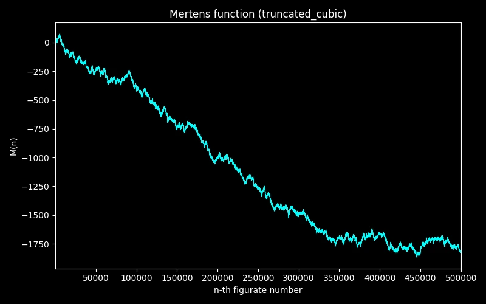
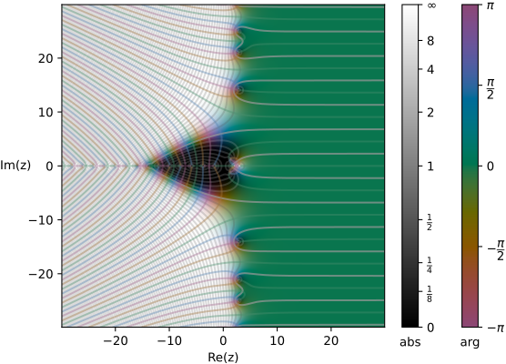

In the summer of this winterless year in Lima, during a geometry seminar at the [Instituto de Matemática y Ciencias Afines](https://imca.edu.pe/es/), I was thinking about what else to develop with my library for working with figurate numbers, `figuratenum`, totally inspired by the [book *Figurate Numbers* by Elena Deza and Michel Deza (2012)](https://www.worldscientific.com/worldscibooks/10.1142/8188).

By March, I had brought something analytic about figurate numbers to discuss with some professors and listeners, the generating functions $G_{\mathfrak{f}}(z)$ with enhanced phase portraits (modulus lines too). Installing my library from PyPI is done with

```shell
pip install figuratenum[figurate-viz]
```

> `figuratenum` currently has documentation and a list of errata for the book. [Take a look here](https://edelveart.github.io/figuratenum/)

Before moving on, I want to put in context that, unlike others I've written, this one is much more classical and conservative in its methods and ideas.

#### Overview

The first part will be brief, covering some everyday things around figurate numbers, and how questions come up along the way, while the second will focus on the more mathematically interesting aspects.

To be more specific, I'll work through a **particular case of generalized Dirichlet series**; there will be three pretty images and the anecdotes that led me to these ideas, and I'll also link my first contribution to **OEIS**.
Of course, I'll include some special values computed using **Bernoulli numbers**, as well as some **essential propositions** and **their proofs**.

Regarding the pictures, a rather beautiful analytic object available in version `3.0.0` of `figuratenum` is the **ordinary generating function** of these sequences in the style of [Wegert (2012)](https://link.springer.com/book/10.1007/978-3-0348-0180-5). In the image below, I define the one for the generalized triangular numbers $G_{S_3}(z)$. The code needed to reproduce it is extremely short.

```py
from figuratenum.figurate_viz import ComplexViz

c = ComplexViz(resolution=1200, brightness=0.6)
c.visualize_plane(
    "generalized_mgonal", m=3,
    cmap_color="tab20b",
    xlim=(-3.85, 4),
    ylim=(-1.8, 1.8),
)
```


## Prelude

An announcement shared by IMCA said there would be a single seminar talk, given by [Prof. Andrés Chirre](https://sites.google.com/view/andreschirre/home), on Bounding partial sums of the Möbius function $\mu$, at bottom something related to the Riemann hypothesis, on **February 26** in the main lecture hall of IMCA.
I decided to go practically at the last minute that I found out. So I started reading about this Möbius function; I already knew it from elementary number theory, and it's about divisibility.

### An aside on recent progress on the zeros of zeta

A brief aside here. Perhaps many people in Peru would be happy to know that [a 2018 paper by Andrés Chirre [GdL20]](https://arxiv.org/abs/1810.08843) is cited in an August 2026 article written with the assistance of AI by [Levent Alpöge (a former doctoral student of Manjul Bhargava) and Ralph Furman](https://arxiv.org/html/2608.13637v1), in which they prove unconditionally that

$$
\liminf_{T \rightarrow \infty} \frac{N_0^s (T, 2T)}{N(T, 2T)} \ge \frac{2}{3},
$$
where $N_0^s(T, 2T)$ denotes the number of simple zeros on the critical line $\Re(s) =\frac{1}{2}$ with imaginary parts between $T$ and $2T$, while $N(T, 2T)$ counts all nontrivial zeros in the same interval, but with multiplicity.

On November 20, Levent Alpöge again said he had formally proved, in a brutal amount of Lean code (17 million lines of code), the hypothesis in this open [`remark.pdf`](https://alpo.ge/remark.pdf).

A few hours later, a possible solution by [Alessandro M. Masullo (*The Music of Primes*), made without AI](https://sites.google.com/view/tmotp/home), surfaced before a complete review had taken place. And on November 21 this announcement came out on the [blog of Lean itself](https://leanprover-community.github.io/blog/posts/riemann-hypothesis/).

### Alpha version of figuratenum

Once I decided to go listen to the talk, I wondered whether I could also study the cumulative sums of the Möbius function for figurate numbers and add something to `figuratenum`. In short, something as simple as this:

$$
M_{\mathfrak{f}}(N) = \sum_{n = 1}^{N} \mu\bigl(\mathfrak{f}(n)\bigr).
$$

The thing is, I implemented that function in a very preliminary version, without thinking about optimization, with the sole goal of discussing it with Chirre the next day, so it isn't exposed in the main API of the [3.0.0a - February 25](https://pypi.org/project/figuratenum/3.0.0a0/) version of my library.



For example, unoptimized, it took my AMD processor `22m 2s 41ms` to compute the first $500\,000$ terms under the Mertens function that you see in the image for the truncated cubic numbers $TC(n)$.

Also, some other sequences compute faster with more terms, [you can check this earlier field note on my blog](https://edelveart.github.io/blog/two-years-leading-to-figuratenum-v3-visualizations-in-the-complex-plane/) (I hope I haven't gotten the count wrong in this present note).

> In the $\LaTeX$ PDF I emailed him after the talk, I showed him several results that I haven't formalized yet, but I can say that for some figurate numbers the cumulative sum $M_{\mathfrak{f}}(N)$ is constant or bounded, owing to their purely arithmetic properties, which are easily deduced. However, many others show a more chaotic behavior and the bounds remain to be established.


## The day of the talk

He told those of us present about the work he had been doing together with [Harald Helfgott (known for proving the weak Goldbach conjecture)](https://webusers.imj-prg.fr/~harald.helfgott/), developing an analytic method of their **own from scratch**, because there were already problems with relying on numerical values from **old articles that turned out to be miscalculated** when revised over time.

A word on the $T$ that appears in the expression above. Very loosely speaking, Chirre and Helfgott's method provides an **explicit formula for systematically improving existing bounds** as more extensive computer calculations rigorously verify that the zeros keep appearing where expected, up to greater heights $T$.

Moving on. At the end of his talk, which was extremely exciting, going from one end of the blackboard to the other with enthusiastic gestures, I approached to ask him a few questions about the kind of **zeta functions of figurate numbers** that I had written the day before in a great hurry.

Although I had never been interested in the Riemann zeta function, except as general knowledge from the real harmonic series and the harmonic numbers $H_n$, I then imagined a sort of figurate zeta
$$
\zeta_{\mathfrak{f}}(s) = \sum_{n \ge 1} \frac{1}{\mathfrak{f}(n)^s}.
$$
The difference with the classical zeta, where $n \in \mathbb{N}$ presented **linear growth**, is that with figurate numbers the growth is quadratic, cubic, or **polynomial** depending on the geometric dimension $k$.


### The series and the document I didn't print

The next natural interest I had was to ask about another kind of associated complex function, one open to analytic interpretation. Next to Andrés Chirre, there was also Professor [Oswaldo Velásquez](https://sites.google.com/imca.edu.pe/oswaldo/). That day I slept very little, because I was developing `figuratenum` and uploading the library to `PyPI` in `alpha` version, making sure of the `tests`, and writing up the new material of the topic for the document (I'll mention it again in a moment).

I mentioned the idea that generating functions had already been studied, and he immediately told me that maybe I could study **Dirichlet series**.
He wrote on the blackboard $ \sum_{n\ge 1} a_n n^{-s}$ and the analytic things I could study. And this is what I'm going to develop in this note.

> As an anecdote, that same day, I went to print the PDF of the $\LaTeX$ file I had written, but the printer's USB, halfway down the avenue on my way to catch the bus, didn't recognize it and couldn't read it, so I printed nothing. Yes, a series of noes. So I only went to the talk.

As soon as I got back, I emailed the file I was going to hand to Chirre in person, and I received the suggestion to start on this topic with Apostol's book on [Analytic Number Theory](https://link.springer.com/book/10.1007/978-1-4757-5579-4). From it I'll draw the more general space of Dirichlet series, together with what I usually do, which is to try to see things with a pinch of algebra.

## What is a figurate number

Since I need to give an isomorphism, I have to begin with what a figurate number is for me. Plainly, it is a polynomial $\mathfrak{f}(X) \in \mathbb{Q}[X]$, whose degree $\deg(\mathfrak{f}) = k \ge 2$ is associated with the dimension in which the geometric notion of the arrangement of its points lives. Namely, I'll distinguish between plane figurate numbers ($k=2$), spatial ones for $k=3$, and multidimensional ones for $k \ge 4$.
In particular, if

$$
\mathfrak{f}(X) = \sum_{j=0}^k a_j X^j, \quad a_j \in \mathbb{Q},\quad a_k \neq 0
$$
each polynomial $\mathfrak{f}$ defines a polynomial function

$$
    \begin{aligned}
        \mathfrak f:\mathbb{C} & \longrightarrow \mathbb{C},  \\
        z                    & \longmapsto\mathfrak f(z).
    \end{aligned}
$$

I'll call (classical) figurate numbers the sequence induced by the restriction of $\mathfrak{f}$, such that
$ \mathfrak{f}: \mathbb{N} \rightarrow \mathbb{N},$ that is,

$$
\bigl(\mathfrak f(n)\bigr)_{n\in\mathbb N}
=
\left(
\sum_{j=0}^{k} a_j n^j
\right)_{n\in\mathbb N},
$$


Likewise, I'll call generalized figurate numbers the bilateral sequence induced by $\mathfrak{f}$, expressed as

$$
    \bigl(\mathfrak f(n)\bigr)_{n\in\mathbb Z}
    =
    \left(
    \sum_{j=0}^{k} a_j n^j
    \right)_{n\in\mathbb Z},
$$
provided that it satisfies $\mathfrak{f}(\mathbb{Z}) \subseteq \mathbb{Z}$. In the first case, I'll require the sequences to have a geometric meaning; in the second, by extension, I'll admit an algebraic interpretation. The latter I'll leave for another time.

One of the most important properties of the classical figurate numbers is the following

> $\textbf{Proposition}$. The classical figurate numbers, thanks to their geometric interpretation as nested configurations of points, are strictly increasing sequences, $\mathfrak{f}(n+1) > \mathfrak{f}(n), \forall n \in \mathbb{N}$.
The proof is left to whoever made it this far.

## The generalized Dirichlet series

As I showed, it's common for figurate numbers to live in the space of sequences and to be represented as such in a geometric perspective. Now I go with Apostol; what I'll address is a very particular case of the general Dirichlet series, for sequences $(a_n)$ where
$$
(a_n) = (\mathfrak{f}(n))_{n \in \mathbb{N}}
$$
are the figurate numbers.
Now I consider the vector space $\mathbb{Q}[X]$ of polynomials with rational coefficients (for each $k$, the polynomials of degree at most $k$ form a subspace) and the function

$$
    \begin{aligned}
         D:\mathbb{Q}[X] & \longrightarrow\mathbb D_{\lambda},  \\
        \mathfrak{f}                    & \longmapsto  D_{\mathfrak{f}},
    \end{aligned}
$$
where $\mathbb{D}_\lambda$ represents the space of functions generated by the generalized Dirichlet series corresponding to the polynomials of $\mathbb{Q}[X]$.

For each $\mathfrak{f} \in \mathbb{Q}[X]$ I have
$$
D_{\mathfrak{f}} (\sigma + \sqrt{-1} t) = \sum _{n=1}^{\infty} \mathfrak{f}(n) e^{-\lambda (n) (\sigma + \sqrt{-1}t) }
$$
with $\sigma, t \in \mathbb{R}$, whenever there is convergence.
I also require, as with figurate numbers, that $(\lambda(n))_{n \in \mathbb{N}}$ be a strictly increasing real sequence (tending to $\infty$). Why so much generality, you ask? I think the generality will be interesting for later studies. For today, I'll restrict the exponent to the sequence given by the integral

$$
\lambda (n) = \int_1 ^n \frac{1}{u}du = \log n
$$

> Many of the ideas I've been thinking about lately are born as layers of logarithms, of structures and patterns that are multiplicative.

Thus, the isomorphism of vector spaces that I'll take will be $D : \mathbb{Q}[X] \rightarrow \mathbb{D}_{\log}$, where

$$
\mathbb{D}_{\log} = \operatorname{span}_\mathbb{Q} \{ \zeta(s-j): j \in \mathbb{N}_0\}
$$

(as meromorphic functions on $\mathbb{C}$, after analytic continuation). Well, to prove how we get here, it will be enough to go step by step.

$\textit{Proof}$. By definition the series is naturally represented as (the other way around from the direct, naive zeta, and with non-constant coefficients) $ D_\mathfrak{f}(s) = \sum_{n=1}^{\infty} \frac{\mathfrak{f}(n)}{n^s}$.
From here I substitute according to the formula I wrote above

$$
\sum_{n=1}^{\infty} \frac{\sum_{j=0}^k a_j n^j}{n^s}
$$
which reduces, by simple algebraic manipulation, to the two summations
$$
\sum_{j=0}^k a_j \sum_{n=1}^{\infty}\frac{1}{n^{s-j}}.
$$

I recognize the infinite sum as a zeta function, but shifted by an integer. Hence, we have arrived at a rational linear combination of $k+1$ shifted zeta functions of the form
$$
\sum_{j=0}^{k} a_j \zeta(s-j)
$$
with $\Re (s) > k+1$. More formally, a basis of $\mathbb{Q}[X]$ is given by the monomials $B_1 = \{1, X, X^2, X^3, \ldots\}$
and the basis of the shifted zetas is
$$
B_2 = \{ \zeta(s), \zeta(s-1), \zeta(s-2), \ldots\}.
$$

Indeed, the zeta functions $\zeta(s-j)$ are linearly independent over $\mathbb{Q}$, because each one has a simple pole at a distinct point $s = j+1$, with residue equal to $1$. By the function $D$ that I defined above, I have
$$
D(X^j) = \zeta(s-j),
$$
for all $j \in \mathbb{N}_0$. Then, the map $D$ that I set up sends $B_1$ to $B_2$, which yields the isomorphism $\mathbb{Q}[X] \cong \mathbb{D}_{\log}$. This proves it. $\square$

And naturally we get this corollary, enough to understand the figurate picture.

> $\textbf{Corollary}$. Every figurate number $\mathfrak{f} \in \mathbb{Q}[X]$ determines, through $D$, a finite linear combination of shifted zeta functions with rational coefficients.

$\textit{Proof}$. A consequence of the linearity of $D$ and of the representation of $\mathfrak{f}$ in the canonical basis of $\mathbb{Q}[X]$. $\square$

## The Dirichlet series of the polygonal numbers and special values with Bernoulli

According to [Deza and Deza (p. 21)](https://www.worldscientific.com/worldscibooks/10.1142/8188), polygonal numbers ($k=2$) of $m \ge 3$ sides are defined through the sequence associated with the function

$$
S_m(n) = \frac{(m-2)n^2-(m-4)n}{2}.
$$
But for the construction of the isomorphism it suits me to separate the coefficients $\frac{m - 2}{ 2 }n^2-\frac{m-4}{2}n $.
It is a polynomial with no constant term. Taking the infinite series, that is, the Dirichlet series with $\lambda(n)= \log(n)$ (natural logarithm), the one associated with $(S_m(n))_{n \in \mathbb{N}}$ is

$$
\begin{aligned}
    D_{S_m}(s) &= \sum_{n=1}^{\infty} \frac{S_m(n)}{n^s} \\
    &= \frac{m-2}{2} \ \zeta(s-2) - \frac{m-4}{2} \ \zeta(s-1).
\end{aligned}
$$

To begin with, it converges absolutely for $\Re(s) > 3$. Likewise, by the same properties of zeta, it is meromorphic on $\mathbb{C}$ with simple poles at $s=2$ and $s=3$ (for $m \neq 4$).

To compute the triangular numbers S_3(n) with `figuratenum`, it's enough to do

```py
from figuratenum import FigurateNum

seq = FigurateNum().polygonal(m=3)
print([next(seq) for _ in range(100)])
# [1, 3, 6, 10, 15, 21, 28, 36, 45, 55, ...]
```

Well, I'm still preparing, in a separate note, a **couple of ideas** from my personal view of the Bernoulli numbers; it will still take some time.

The only thing I'll mention for what comes in this note is that the zeta function $\zeta(s)$ is related, on the one hand, to the prime numbers $p$ through what is the Euler product $ \prod_{p}\left(1-\frac{1}{p^s}\right)^{-1}$, where $\operatorname{Re}(s)>1.$  Yes, at some point I'll also have to rewrite this object for myself.

And, on the other hand, to special values at certain integer points. The **Riemann hypothesis**, for instance, has special interest on a line called critical, $\Re(s)= \frac{1}{2}$ (there is also the critical band in music, just kidding, it's simply a band). The story is highly well known.

I figured that for the figurate numbers, in a first stage it is enough for what comes next to take the trivial values; that is,

> The values at the points $\zeta(-n)$, where $n$ is a natural number or zero.

But as you surely think, how do we compute them one by one? Well, there are the **Bernoulli numbers**. To compute each $-n$ in the zeta function, the following identity applies

$$
\zeta(-n) = - \frac{B_{n+1}}{n+1}, \quad  n \in \mathbb{N}_0.
$$

You'll find the proof in the base reference (a gorgeous book) of this note [(p. 72)](https://link.springer.com/book/10.1007/978-4-431-54919-2). Also, I want to clarify that in the following notes I'll keep

> the convention of the positive rational $B_1 = 2^{-1} $ (see the fabulous article by [Peter H. N. Luschny](https://arxiv.org/abs/2009.06743)). With my associative way of thinking, this reminded me quite a bit of what is known as the dot in Western musical notation of durations.

In general, for any $S_m(n)$ I have the parametrization in the following table that I made with a bit of symbolic `algebra` in Python (I'll upload how I did it later). But first, an essential example. At $n=1$ I got
$$
D_{S_m}(1)  = \frac{5m}{24} - \frac{11}{12},
$$

which is indeed defined, since the shifts turn the unit point into the values $\zeta(-1)$ and $\zeta(0)$

| $n$   | $D_{S_m}(n)$           | $n$   | $D_{S_m}(n)$                        |
| ----- | ---------------------- | ----- | ----------------------------------- |
| $0$   | $m/24-1/6$             | $-12$ | $m/24-1/6$                          |
| $-1$  | $m/240-1/120$          | $-13$ | $3617m/16320-3617/8160$             |
| $-2$  | $1/60-m/240$           | $-14$ | $3617/4080-3617m/16320$             |
| $-3$  | $1/252-m/504$          | $-15$ | $43867/14364-43867m/28728$          |
| $-4$  | $m/504-1/126$          | $-16$ | $43867m/28728-43867/7182$           |
| $-5$  | $m/480-1/240$          | $-17$ | $174611m/13200-174611/6600$         |
| $-6$  | $1/120-m/480$          | $-18$ | $174611/3300-174611m/13200$         |
| $-7$  | $1/132-m/264$          | $-19$ | $77683/276-77683m/552$              |
| $-8$  | $m/264-1/66$           | $-20$ | $77683m/552-77683/138$              |
| $-9$  | $691m/65520-691/32760$ | $-21$ | $236364091m/131040-236364091/65520$ |
| $-10$ | $691/16380-691m/65520$ | $-22$ | $236364091/32760-236364091m/131040$ |
| $-11$ | $1/12-m/24$            | $-23$ | $657931/12 - 657931m/24$            |

The first thing I noticed is that there are rather long fractions (perhaps later I can use height functions $h(x)= \log \max \{|p|, |q| \}$, for $x=p/q$ in lowest terms) as it goes on. Second, it could be rewritten more succinctly. For the moment, this is enough.

Great, I'll directly work out the first three examples, for polygonal numbers with $m=3,4,5$ sides, to make this excerpt clearer.

### Triangular zetas and successive terms

With the triangular numbers, $D_{S_3}$ is the linear combination of shifted zetas

$$
D_{S_3}(s) = \frac{1}{2}\zeta(s-2) + \frac{1}{2}\zeta(s-1).
$$

A pair of simple poles at $s=3$ and $s=2$, as I said. From the table just above, I simply substitute and get the following special values.

| $n$   | $D_{S_3}(n)$ | $n$   | $D_{S_3}(n)$       |
| ----- | ------------ | ----- | ------------------ |
| $1$   | $-7/24$      | $-11$ | $-1/24$            |
| $0$   | $-1/24$      | $-12$ | $-1/24$            |
| $-1$  | $1/240$      | $-13$ | $3617/16320$       |
| $-2$  | $1/240$      | $-14$ | $3617/16320$       |
| $-3$  | $-1/504$     | $-15$ | $-43867/28728$     |
| $-4$  | $-1/504$     | $-16$ | $-43867/28728$     |
| $-5$  | $1/480$      | $-17$ | $174611/13200$     |
| $-6$  | $1/480$      | $-18$ | $174611/13200$     |
| $-7$  | $-1/264$     | $-19$ | $-77683/552$       |
| $-8$  | $-1/264$     | $-20$ | $-77683/552$       |
| $-9$  | $691/65520$  | $-21$ | $236364091/131040$ |
| $-10$ | $691/65520$  | $-22$ | $236364091/131040$ |

What stands out here is that values repeat in pairs, for example $D_{S_3}(-1) = D_{S_3}(-2) = \frac{1}{240}$ or $D_{S_3}(-15) = D_{S_3}(-16) = \frac{-43867}{28728}$. So we claim,

> $\textbf{Proposition}$. Let $n \in \mathbb{N}$ be odd, then $D_{S_3}(-n)$ = $D_{S_3}(-n-1)$.

$\textit{Proof}$. Practice.

### Square zeta and multiplicativity

Moving on. With the square numbers (a good reason to call them that), $1, 4, 9, 16, 25  \ldots$ there is a single pole at the point $s=3$. Their Dirichlet series reduces to the simplest of all the figurate families,
$$
D_{S_4}(s) = \zeta(s-2).
$$

But I want to step away from the topic a little here, because of this matter. Unlike other figurate numbers, the hypercubic numbers $C^k(n) = n^k$, with $k=2$ here, are in fact completely multiplicative functions in the sense of arithmetic functions $f: \mathbb{N} \rightarrow \mathbb{C}$, that is
$$
C^k(n m) = C^k(n) C^k(m)
$$
for all $n, m \in \mathbb{N}$.

$\textbf{Proposition}$. The hypercubic numbers $C^k$ with $k\ge 2$ are completely multiplicative functions, and hence, for $\gcd(m,n) =1$, they are also multiplicative.

> In fact, I've been thinking that the figurate numbers are rational linear combinations of hypercubic numbers (together with the powers $n^0$ and $n^1$).

This highlighted property is what makes it possible to define it with a single Euler product, $\prod_p \left( 1-p^{2-s} \right)^{-1}$, which I mentioned above. Well, the table with $m=4$ looks like this.

| $n$   | $D_{S_4}(n)$ | $n$   | $D_{S_4}(n)$      |
| ----- | ------------ | ----- | ----------------- |
| $1$   | $-1/12$      | $-11$ | $-1/12$           |
| $0$   | $0$          | $-12$ | $0$               |
| $-1$  | $1/120$      | $-13$ | $3617/8160$       |
| $-2$  | $0$          | $-14$ | $0$               |
| $-3$  | $-1/252$     | $-15$ | $-43867/14364$    |
| $-4$  | $0$          | $-16$ | $0$               |
| $-5$  | $1/240$      | $-17$ | $174611/6600$     |
| $-6$  | $0$          | $-18$ | $0$               |
| $-7$  | $-1/132$     | $-19$ | $-77683/276$      |
| $-8$  | $0$          | $-20$ | $0$               |
| $-9$  | $691/32760$  | $-21$ | $236364091/65520$ |
| $-10$ | $0$          | $-22$ | $0$               |

What is immediate is that the even values of the square zeta vanish.
> $\textbf{Proposition}$. Let $n \in \mathbb{N}_0$, then $D_{S_4}(-2n) = 0$.

$\textit{Proof}$. Routine exercise for agility.

### Pentagonal zetas and their secrets

With the pentagonal numbers I close this first explicit note on Dirichlet series.
I'll linger here to say that the generalized pentagonal numbers $S_5(n)$ for $n = 0, \pm 1, \pm2, \ldots$ have many secrets and relations with other ideas.

I already mentioned, very much in passing, in the documentation that they appear in partition theory, in [Euler's pentagonal number theorem.](https://edelveart.github.io/figuratenum/advanced-theory/).
On the other hand, a few days ago I also made my
> [first contribution to the OEIS, the sequence A054602](https://oeis.org/A054602), which was an **integral identity** using $S_5(x)$, which I'll discuss in detail in a note (you can see it in the Spanish resources section).

```py
from figuratenum import FigurateNum

seq = FigurateNum().generalized_mgonal(m=5)
print([next(seq) for _ in range(100)])
# [0, 1, 5, 12, 22, 35, 51, 70, 92, 117, 145,
# 176, 210, 247, 287, 330, 376, 425, 477, 532, ...]
```

$$
D_{S_5}(s) = \frac{3}{2}\zeta(s-2) - \frac{1}{2}\zeta(s-1).
$$

| $n$   | $D_{S_5}(n)$ | $n$   | $D_{S_5}(n)$        |
| ----- | ------------ | ----- | ------------------- |
| $1$   | $1/8$        | $-11$ | $-1/8$              |
| $0$   | $1/24$       | $-12$ | $1/24$              |
| $-1$  | $1/80$       | $-13$ | $3617/5440$         |
| $-2$  | $-1/240$     | $-14$ | $-3617/16320$       |
| $-3$  | $-1/168$     | $-15$ | $-43867/9576$       |
| $-4$  | $1/504$      | $-16$ | $43867/28728$       |
| $-5$  | $1/160$      | $-17$ | $174611/4400$       |
| $-6$  | $-1/480$     | $-18$ | $-174611/13200$     |
| $-7$  | $-1/88$      | $-19$ | $-77683/184$        |
| $-8$  | $1/264$      | $-20$ | $77683/552$         |
| $-9$  | $691/21840$  | $-21$ | $236364091/43680$   |
| $-10$ | $-691/65520$ | $-22$ | $-236364091/131040$ |

The first special values here have a beautiful property.

$\textbf{Proposition}$. Let $n \in \mathbb{N}$, then
$$
D_{S_5}(-2n) = -\frac{1}{3}D_{S_5}(-2n+1)
$$

$\textit{Proof}$. Homework for Sunday.

## Phase portrait of the pentagonal zeta and nontrivial zeros

One of the most beautiful activities, artistically speaking, that one can do with the computer (or by hand if you're a painter) is the representation of $\zeta(s)$ in the complex plane, something I've postponed until this moment. In part, because I haven't implemented it completely in `figuratenum` yet and I still have to decide its structure.

I made the plot with `cplot` and a couple of lines of Python code. The tricky part here is calibrating to taste the limits of the $\Re(s)$ part and the $\Im(s)$ part. In the end I made it square, as funny as that sounds given what I said.



If I imagine on the image, separately, for each term, that for $\zeta(s-2)$ the nontrivial zeros would lie on the line $\Re(s) = \frac{5}{2}$ and on the line $\Re(s) = \frac{3}{2}$ for $\zeta(s-1)$ (assuming the Riemann hypothesis). But, at bottom, for a point $s_0$ to be a nontrivial zero of $D_{S_5}(s)$ it **must satisfy the equation**
$$
3\zeta(s-2) - \zeta(s-1) = 0,
$$
in other words, a cancellation must occur between both zeta terms.

## A Diophantine-style equation

Naturally, with the tables given, the first thing is to ask ourselves

> do these Bernoullian values $B_n$ of the zetas show some regularity or arithmetic relation that can be patterned
> among different families?

Likewise, I also thought about the potion of the functional equation for the triangulars (it looks slightly complicated)
$$
\begin{aligned}
D_{S_3}(s)=\frac{1}{2}\Bigg[&
2^{s-2}\pi^{s-3}
\sin\left(\frac{\pi(s-2)}{2}\right)
\Gamma(3-s)\zeta(3-s)
\\[8pt]
&+
2^{s-1}\pi^{s-2}
\sin\left(\frac{\pi(s-1)}{2}\right)
\Gamma(2-s)\zeta(2-s)
\Bigg]
\end{aligned}.
$$

In it, the gamma function appears. As for the logarithm I used as the exponent $\lambda(n)$, as I said above, it is born from the integral of a hyperbola or from the differential equation that comes out by symbolic analogy, $xy'=1$ (you can read [my note on the logarithm in Spanish](https://edelveart.github.io/es/blog/el-logaritmo-y-su-aroma-geometrico-en-la-musica/)).

In fact, since we wrote an equation above, and since I've been playing with these functions for some time now, it came to me very naturally (while I was coming back from buying at the bakery, and I think also because of what I did with elliptic curves $E/\mathbb{Q}$) to think of a kind of Diophantine equation of zeta functions, which I make explicit below. To put the penultimate touch on this note, I propose the following.

$\textbf{Definition}$. Let $\mathfrak{f}_1$ and $\mathfrak{f}_2$ be two figurate numbers of dimensions $k_1, k_2\ge 2$ and let their corresponding Dirichlet series be
$D_{\mathfrak{f}_j}(s) = \sum_{n \ge 1}\mathfrak{f}_j(n)n^{-s} \in \mathbb{D}_{\log}, j=1,2$. I'll call the **Diophantine equation of figurate Dirichlet series** the equation
$$
 D_{\mathfrak{f}_1}(s) = D_{\mathfrak{f}_2}(s)
$$
whose solutions could live in $\mathbb{Z}$ or $\mathbb{Q}$, or in the complex domain, $s \in \mathbb{C}$.

From this definition I deduce the base case with pure polygonal numbers.


$ \textbf{Proposition}$. Let $m_1, m_2 \ge 3, m_1 \neq m_2$. Then, for $s\in\mathbb{C}\setminus\{2,3\}$, $D_{S_{m_1}}(s) = D_{S_{m_2}}(s)$ is equivalent to the zeta function equation

$$
\zeta(s-2) = \zeta(s-1).
$$

> $\textit{Proof}$. By the definition of the series $D_{S_m}$ above, if we equate both series and group the terms we get
> $\frac{m_1 - m_2}{2} [ \zeta(s-2)- \zeta(s-1)] = 0$. Since $m_1$ and $m_2$ are different, it follows that $\zeta(s-2) = \zeta(s-1)$. Which proves it and, as a bonus, exemplifies the equational idea.

