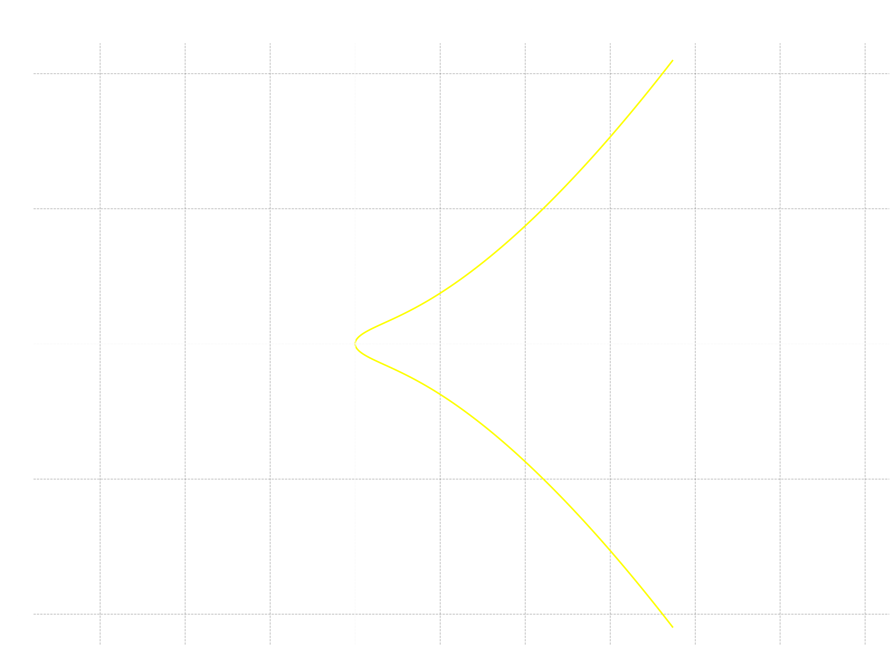
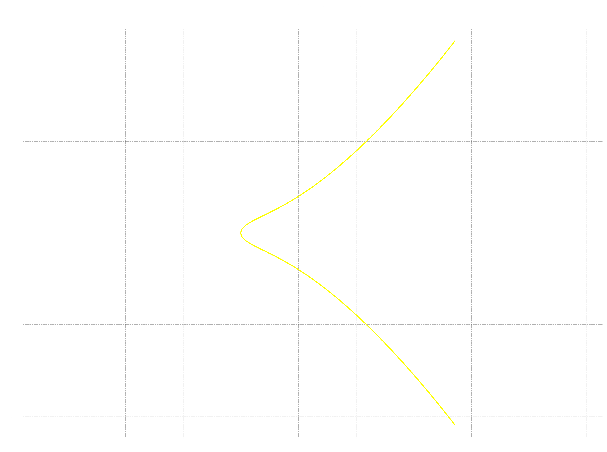
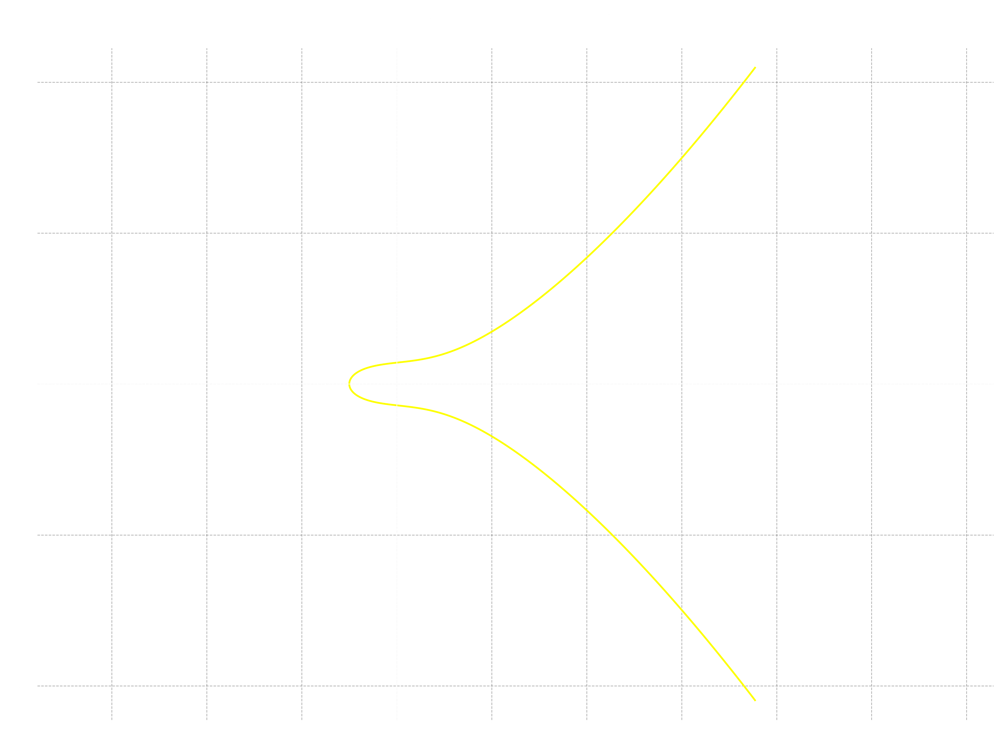
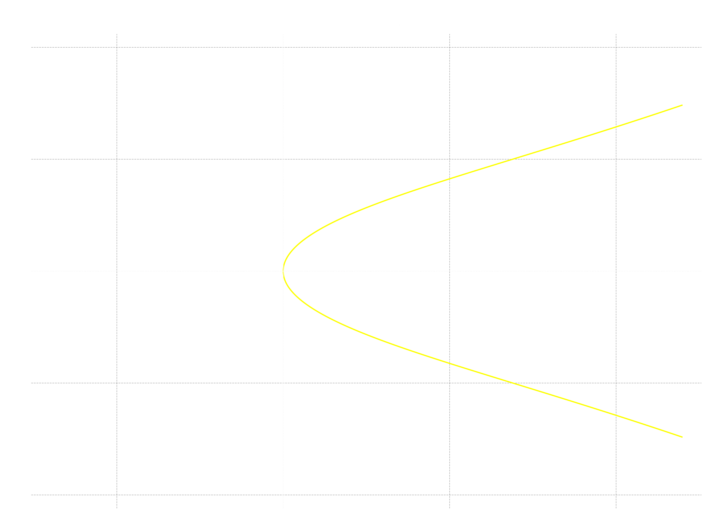
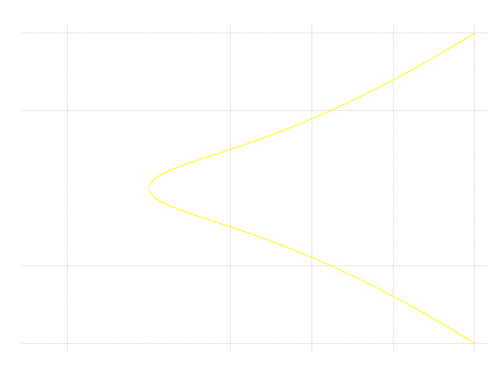
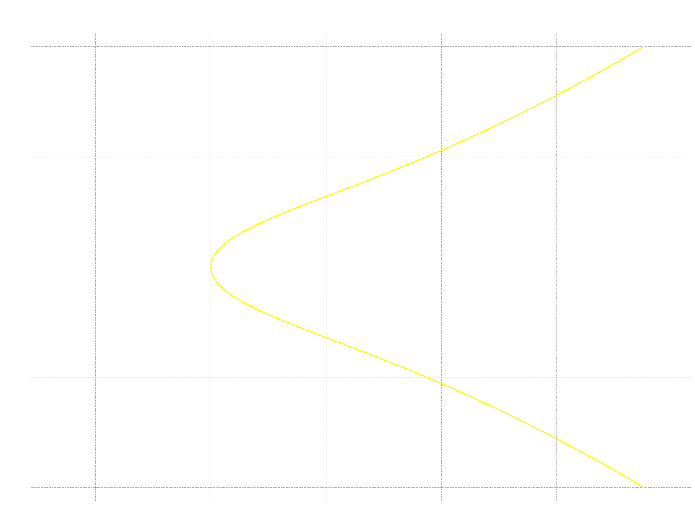
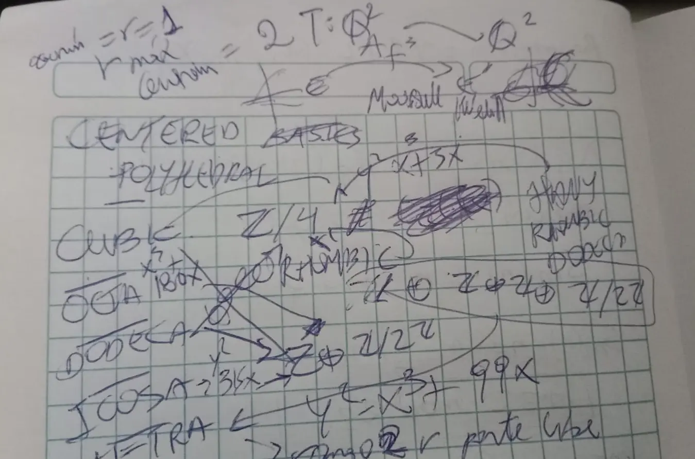

Los números **figurados espaciales centrados** contienen un punto en el núcleo de su constitución geométrica y le crecen hacia afuera capas poliédricas, poetizando un poco la expresión del libro de Elena Deza y Michel Deza [*Figurate Numbers* (2012)](https://www.worldscientific.com/worldscibooks/10.1142/8188), en la **página 120**.

Seguiré también la notación allí presente que contiene una rayita arriba, es decir,

$$
\bar{\mathfrak{f}}^k(n)
$$
para diferenciarlos de los números figurados sin ese punto (en $k=2$) o bola central. En esta **V nota** tocaré **todos los números centrados** derivados de los **sólidos platónicos** y algo más.

Por otra parte, cambiaré la estrategia de mi exposición y escribiré la ecuación diofántica directamente en la sección que le corresponde a cada número figurado, que extenderemos en términos de $x \in \mathbb{Q}$ en el lado derecho, para no repetir la ecuación tal y como aparece en nuestra principal referencia; así que serán de la forma
$$
y^2 = \bar{\mathfrak{f}}^3(x).
$$

Asimismo, enunciaré la matriz que representa el automorfismo afín o lineal $A_{\bar{\mathfrak{f}}^3}$, de la cual se deduce cómo realizar los cambios de variable en la ecuación base.

> Para leer esta nota de forma natural, consultar debes la [nota común preliminar](https://edelveart.github.io/es/blog/divagaciones-diofanticas-entre-numeros-figurados-y-curvas-elipticas/). Allí está el origen de estas divagaciones y en las tres notas previas también.
>
> Para calcular las secuencias en los fragmentos de código de mis notas, usa mi librería [`figuratenum` en PyPI](https://pypi.org/project/figuratenum/)

En palabras **simples y comunes**, seré bastante seco respecto de las anteriores entregas y repetiré, cual guacamayo, el mismo argumento de demostración.

## El primo A en la curva elíptica de los cúbicos centrados

Para variar el inicio, contradeciré brevemente lo que advertí en el preludio. El problema que intentaremos resolver viene dado por la ecuación diofántica
$$
S_4(v) = \bar{C}(w).
$$

La curva elíptica no singular (ya dimos por hecho esto en la nota anterior) asociada se define como
$$
E_{\bar{C}}: y^2 = (2x - 1)(x^2 - x + 1).
$$

```python
from figuratenum import FigurateNum

centered_cube = FigurateNum().centered_cube()
print([next(centered_cube) for _ in range(20)])
# [1, 9, 35, 91, 189, 341, 559, 855, 1241, 1729, 2331,
# 3059, 3925, 4941, 6119, 7471, 9009, 10745, 12691, 14859]
```

- El décimo número cúbico centrado $\bar{C}(10) = 1729$, coincide con el número de [Hardy-Ramanujan](https://mathworld.wolfram.com/Hardy-RamanujanNumber.html). Esta observación la noté ayer debido a las bromas y conversaciones con un amigo músico hace cierto tiempo.

La transformación $T$ que necesitamos para llevar a forma de Weierstraß se representa en coordenadas homogéneas con la matriz

$$
A_{\bar{C}} = \begin{pmatrix}
2 & 0 & -1 \\
0 & 2 & 0 \\
0 & 0 & 1 \\
\end{pmatrix}
$$

Dicha transformación (muy parecida a la de la *Stella Octangula*, salvo por la traslación $-1$) induce un cambio de variables y sustituimos $x= \frac{X+1}{2}$ y $y=\frac{Y}{2}$ en la curva base, lo que nos deja en la parada de la curva elíptica

$$
E'_{\bar{C}}:  Y^2 = X^3 + 3X,
$$
con grupo de Mordell-Weil sobre los racionales isomorfo a $ \mathbb{Z} \oplus \mathbb{Z}/{2}\mathbb{Z}$ y discriminante $\Delta_E = -1728$.



Del registro en [LMFDB label 288.a2 | Cremona label 288a1](https://www.lmfdb.org/EllipticCurve/Q/288/a/2) extraemos pues, los puntos integrales

$$
\begin{aligned}
E'_{\bar{C}} (\mathbb{Z}) = \{&(0, 0), (1, 2), (1, -2), (3, 6), \\
&(3, -6), (12, 42), (12, -42)\},
\end{aligned}
$$
que bajo el filtro modular
$$
X \equiv 1 \pmod{2}, \quad Y \equiv 0 \pmod{2}
$$

y la transformación inversa $T^{-1}$ quedan los puntos enteros en la curva original

$$
E_{\bar{C}}(\mathbb{Z}) = \{(1, \pm 1), (2, \pm 3)\}.
$$

> $\textbf{Proposición}$. Los únicos números cúbicos centrados $\bar{C}(w)$ y cuadrados perfectos $S_4(v)$ a la vez son $1$ y $9$.

Se deduce del teorema de Siegel y de LMFDB. $\square$

## El dos al cuadrado en la curva elíptica de los dodecaedros rómbicos

La ecuación diofántica en forma de curva elíptica de los dodecaedros rómbicos sobre los racionales se define como

$$
E_{RD}: y^2 = 4x^3 - 6x^2 + 4x - 1.
$$

```python
from figuratenum import FigurateNum

rhombic_dodecahedral = FigurateNum().rhombic_dodecahedral()
print([next(rhombic_dodecahedral) for _ in range(20)])

# [1, 15, 65, 175, 369, 671, 1105, 1695, 2465, 3439, 4641,
# 6095, 7825, 9855, 12209, 14911, 17985, 21455, 25345, 29679]
```

Para transformar en una cúbica de Weierstraß empleamos la matriz asociada a la transformación afín invertible $T$ en coordenadas homogéneas
$$
A_{RD} = \begin{pmatrix}
4 & 0 & -2 \\
0 & 4 & 0 \\
0 & 0 & 1 \\
\end{pmatrix}
$$

Al respecto, $A_{RD}$ induce el cambio de variables $x= \frac{X+2}{4}$ e $y = \frac{Y}{4}$. Por sustitución directa encontramos la curva elíptica transformada

$$
E'_{RD}: Y^2 = X^3 + 4X,
$$

que aparece indexada en las etiquetas [LMFDB label 32.a4 | Cremona label 32a1](https://www.lmfdb.org/EllipticCurve/Q/32/a/4). Lo curioso es que su grupo de **Mordell-Weil no presenta parte libre**, es decir, tiene rango $r=0$ y es solamente isomorfo al grupo cíclico $\mathbb{Z}/4\mathbb{Z}$. Asimismo, tiene solo tres puntos enteros $(0, 0)$ y $(2, \pm 4)$.



Bien, el filtro modular correspondiente es $X \equiv 2 \bmod{4}$, $Y \equiv 0 \bmod{4}$, y la transformación inversa dejan únicamente los puntos
$$
E_{RD}(\mathbb{Z}) = \{(1, 1), (1, -1)\}.
$$

> $\textbf{Proposición}$. El $1$ es el único número que es a la vez dodecaédrico rómbico $RD(w)$ y cuadrado perfecto $S_4(v)$.

La prueba se ampara en la finitud del teorema de Siegel y de LMFDB. $\square$

## La curva elíptica de los dodecaedros rómbicos de Hauy

La ecuación diofántica correspondiente en curva elíptica base es el modelo

$$
E_{RD_H}: y^2 = (2x - 1)(8x^2 - 14x + 7).
$$

```python
from figuratenum import FigurateNum

hauy_rhombic_dodecahedral = FigurateNum().hauy_rhombic_dodecahedral()
print([next(hauy_rhombic_dodecahedral) for _ in range(20)])

# [1, 33, 185, 553, 1233, 2321, 3913, 6105, 8993, 12673, 17241, 22793,
# 29425, 37233, 46313, 56761, 68673, 82145, 97273, 114153]
```

La matriz asociada al automorfismo afín $T$ que encontré para transformarlo en forma de Weierstraß con los dos coeficientes $A$ y $B$ diferentes de cero, fue

$$
A_{RD_H} =
\begin{pmatrix}
4 & 0 & -3 \\
0 & 2 & 0 \\
0 & 0 & 1 \\
\end{pmatrix}
$$

El cambio de variable inducido para ambas curvas es $x= \frac{X+3}{4}, y = \frac{Y}{2}$. Esto produce finalmente la ecuación elíptica

$$
E'_{RD_H}: Y^2 = X^3 + X + 2,
$$

cuyo grupo de Mordell-Weil tiene también rango $0$ en la parte libre y subgrupo de torsión cíclico, es decir,  $E'_{RD_H}(\mathbb{Q}) \cong \mathbb{Z}/4\mathbb{Z}$, con el punto $(1, 2)$ de orden $4$ según la [LMFDB label 56.a4 | Cremona label 56a1](https://www.lmfdb.org/EllipticCurve/Q/56/a/4). Así, $E'_{RD_H}$ tiene en total tres puntos enteros $(-1, 0)$ y $(1, \pm 2)$.



Listo, el filtro que necesitamos para regresar a todos los puntos de nuestra ecuación base es $X \equiv 1 \bmod{4}$, $Y \equiv 0 \bmod{2}$. Luego de la inversa de $T$  solo  nos quedan los puntos

$$
E_{RD_H}(\mathbb{Z}) = \{(1, \pm 1)\}.
$$

> $\textbf{Proposición}$. El $1$ es el único número que es a la vez *dodecaedro rómbico de Hauy* $RD_H(w)$ y cuadrado perfecto $S_4(v)$.

La prueba se ampara en la finitud del teorema de Siegel y de LMFDB. $\square$

## Repetimos una curva elíptica en los dodecaédricos centrados

La ecuación diofántica correspondiente en su forma de cúbica viene dada por

$$
\begin{aligned}
E_{\bar{D}}: \quad y^2 &= (2x - 1)(3x^2 - 3x + 1) \\
&= 6x^3 - 9x^2 + 5x - 1
\end{aligned}
$$

```python
from figuratenum import FigurateNum

centered_dodecahedron = FigurateNum().centered_dodecahedron()
print([next(centered_dodecahedron) for _ in range(20)])

# [1, 21, 95, 259, 549, 1001, 1651, 2535, 3689, 5149, 6951, 9131,
# 11725, 14769, 18299, 22351, 26961, 32165, 37999, 44499]
```

Consideremos la matriz invertible que representa la transformación afín en coordenadas homogéneas
$$
A_{\bar{D}} =
\begin{pmatrix}
6 & 0 & -3 \\
0 & 6 & 0 \\
0 & 0 & 1 \\
\end{pmatrix}
$$
que induce el cambio de variables en la curva $x= \frac{X+3}{6}$ e $y =\frac{Y}{6}$. Con este juego de variables tenemos la curva elíptica en forma de Weierstraß

$$
E'_{\bar{D}}: Y^2 = X^3 + 3X,
$$

indexada en [LMFDB label 288.a2 | Cremona label 288a1](https://www.lmfdb.org/EllipticCurve/Q/288/a/2) con grupo de Mordell-Weil isomorfo sobre $\mathbb{Q}$ a $\mathbb{Z} \oplus \mathbb{Z}/2\mathbb{Z}$.


> Observación: las ecuaciones diofánticas, tanto de $\bar{C}(n)$ como de $\bar{D}(n)$, tienen la misma curva elíptica asociada.

Copio inmediatamente los puntos enteros registrados

$$
\begin{aligned}
E'_{\bar{D}}(\mathbb{Z}) = \{&(0, 0), (1, 2), (1, -2), (3, 6), \\
&(3, -6), (12, 42), (12, -42)\}.
\end{aligned}
$$

A tales puntos enteros les aplicamos el filtro modular $ X \equiv 3 \bmod{6}, Y \equiv 0 \bmod{6}$ y luego la transformación $T^{-1}$, con lo que quedan los puntos en nuestra curva original

$$
E_{\bar{D}}(\mathbb{Z}) = \{ (1, 1), (1, -1) \}.
$$

> $\textbf{Proposición}$. El $1$ es el único número que es a la vez dodecaédrico centrado $\bar{D}(w)$ y cuadrado perfecto $S_4(v)$.

La prueba se ampara en la finitud del teorema de Siegel y de LMFDB. $\square$

## Llega la curva elíptica de los icosaédricos centrados

La ecuación diofántica de los números icosaédricos centrados sobre $\mathbb{Q}$ se puede expresar como

$$
E_{\bar{I}}: y^2 = \frac{(2x - 1) (5x^2 - 5x+ 3)}{3}
$$

```python
from figuratenum import FigurateNum

centered_icosahedron = FigurateNum().centered_icosahedron()
print([next(centered_icosahedron) for _ in range(20)])

# [1, 13, 55, 147, 309, 561, 923, 1415, 2057, 2869, 3871, 5083,
# 6525, 8217, 10179, 12431, 14993, 17885, 21127, 24739]
```

La matriz homogénea que induce el cambio de variable restringida a la curva tiene múltiplos de 3 como entradas

$$
A_{\bar{I}} =
\begin{pmatrix}
30 & 0 & -15 \\
0 & 90 & 0 \\
0 & 0 & 1 \\
\end{pmatrix}
$$

El cambio de variable que necesito ahora es $x = \frac{X+15}{30}$ e $y=\frac{Y}{90}$; al aplicarlo sobre nuestra curva original, llegamos a la forma de Weierstraß

$$
E'_{\bar{I}}: Y^2 = X^3 + 315X.
$$



Mirando en la etiqueta [LMFDB label 352800.ge2  | Cremona label 352800ge1 ](https://www.lmfdb.org/EllipticCurve/Q/352800/ge/2), su grupo de Mordell-Weil sobre racionales aparece isomorfo a $\mathbb{Z} \oplus \mathbb{Z}/ 2\mathbb{Z}$.

Continuemos. Cito aquí sus siete puntos integrales

$$
\begin{aligned}
E'_{\bar{I}}(\mathbb{Z}) = \{&(0, 0), (15, 90), (15, -90), \\
&(21, 126), (21, -126), \\
&(1260, 44730), (1260, -44730)\}.
\end{aligned}
$$

Para recuperar los puntos enteros de nuestra curva $E_{\bar{I}}$, imponemos el filtro de congruencias $X \equiv 15 \bmod{30}$ y $Y \equiv 0 \bmod{90}$. Por último, le accionamos la transformación inversa y tenemos los únicos puntos que perduran

$$
E_{\bar{I}}(\mathbb{Z}) = \{(1, 1), (1, -1)\}.
$$

> $\textbf{Proposición}$. El $1$ es el único número que es a la vez icosaédrico centrado $\bar{I}(w)$ y cuadrado perfecto $S_4(v)$.

La prueba se ampara en la finitud del teorema de Siegel y de LMFDB. $\square$


## Casos anómalos

Las **últimas cuatro** ecuaciones, $E_{RD}, E_{RD_H}, E_{\bar{D}}, E_{\bar{I}}$ han resultado tener un resultado trivial sobre $\mathbb{Z}$, es decir, $1$.  Recuerda que con los números cúbicos $E_{C}$ de la nota anterior, que formaba una cúbica con punto singular $P=(0,0)$ (se anulaban simultáneamente las derivadas parciales $\partial_x, \partial_y$) de tipo cúspide, también tenía un resultado anómalo (infinitas soluciones, en vez de solo $1$).


## Del sin triángulo a la curva elíptica del tetraedro centrado

Igual que hicimos más arriba, expresamos la función cúbica derivada de la ecuación diofántica de los tetraedros centrados mediante

$$
E_{\bar{S}_3^3}: y^2  = \frac{(2x - 1) (x^2 - x + 3)}{3} .
$$

```python
from figuratenum import FigurateNum

centered_tetrahedron = FigurateNum().centered_tetrahedron()
print([next(centered_tetrahedron) for _ in range(20)])

# [1, 5, 15, 35, 69, 121, 195, 295, 425, 589, 791, 1035, 1325,
# 1665, 2059, 2511, 3025, 3605, 4255, 4979]
```

La matriz que requerimos para dejar la ecuación en forma de Weierstraß $A, B$ es
$$
A_{\bar{S}_3^3}  =
\begin{pmatrix}
6 & 0 & -3 \\
0 & 18 & 0 \\
0 & 0 & 1 \\
\end{pmatrix}
$$

representa un automorfismo afín en coordenadas homogéneas en $\operatorname{GL}(3, \mathbb{Q})$. En las curvas, tenemos los cambios de variable  $x = \frac{X+3}{6}$, $y = \frac{Y}{18}$. Al sustituir con Baldor, tenemos la curva

$$
E'_{\bar{S}_3^3}: Y^2 = X^3 +99X,
$$
cuya etiqueta [LMFDB label 34848.m2 | Cremona label 34848l1](https://www.lmfdb.org/EllipticCurve/Q/34848/m/2), tiene un grupo de Mordell-Weil con parte libre de rango $r=2$,
$$
E'_{\bar{S}_3^3}(\mathbb{Q}) \cong \mathbb{Z} \oplus \mathbb{Z} \oplus \mathbb{Z}/{2}\mathbb{Z}.
$$




Ahora, la lista de puntos enteros es algo más extensa de lo que hemos visto en la nota,
$$
\begin{aligned}
E'_{\bar{S}_3^3}(\mathbb{Z}) = \{&(0, 0), (1, 10), (1, -10), \\
&(3, 18), (3, -18), \\
&(12, 54), (12, -54), \\
&(33, 198), (33, -198), \\
&(49, 350), (49, -350),\\
&(99, 990), (99, -990), \\
&(192, 2664), (192, -2664)\}.
\end{aligned}
$$

El filtro del ruido integral debe cumplir las condiciones $X \equiv 3 \bmod{6}$ e $Y \equiv 0 \bmod{18}$. Los únicos puntos que quedan luego del filtrado modular en nuestra curva original son

$$
E_{\bar{S}_3^3}(\mathbb{Z}) = \{ (1, \pm 1), (6, \pm 11), (17, \pm 55)\}.
$$
En total son **seis puntos**, es decir, tres números figurados los que satisfacen la solución de nuestra ecuación diofántica detrás de esta elipticidad.

> $\textbf{Proposición}$. Los únicos números tetraédricos centrados $\bar{S}_3^3(w)$ y cuadrados perfectos $S_4(v)$ a la vez son $1$, $121$ y $3025$.

La prueba se ampara en la finitud del teorema de Siegel y de LMFDB. $\square$

## Pi radianes en la curva elíptica de los octaédricos centrados

Llegamos al último número figurado de esta nota. La ecuación diofántica de los cuadrados y octaédricos centrados la represento sobre los racionales como
$$
E_{\bar{O}}: y^2 = \frac{(2  x - 1)  (2  x^2 -2x  +3)}{3}
$$

```python
from figuratenum import FigurateNum

centered_octahedron = FigurateNum().centered_octahedron()
print([next(centered_octahedron) for _ in range(20)])

# [1, 7, 25, 63, 129, 231, 377, 575, 833, 1159, 1561, 2047,
# 2625, 3303, 4089, 4991, 6017, 7175, 8473, 9919]
```

La matriz asociada al morfismo afín biyectivo $T$ de $\mathbb{Q}^2$ en $\mathbb{Q}^2$ que inducirá el cambio de variables la escribí en coordenadas homogéneas

$$
A_{\bar{O}} =
\begin{pmatrix}
12 & 0 & -6 \\
0 & 36 & 0 \\
0 & 0 & 1 \\
\end{pmatrix}
$$
y pertenece a $\operatorname{GL}(3, \mathbb{Q})$. Despejamos entonces $x = \frac{X+6}{12}$ e $y = \frac{Y}{36}$. Reemplazamos por manipulación algebraica y tenemos la ecuación de la curva elíptica con al menos los mismos puntos enteros de $E_{\bar{O}}$ dada por

$$
E'_{\bar{O}}: Y^2  = X^3 + 180X.
$$



El registro en la base de datos de todas estas notas indica la etiqueta [LMFDB label 7200.y2 |Cremona label 7200q2](https://www.lmfdb.org/EllipticCurve/Q/7200/y/2). Particularmente, su grupo de Mordell-Weil tiene rango $1$ en la parte libre y subgrupo cíclico a lo Mazur, en la forma más simple
$$
E'_{\bar{O}}(\mathbb{Q}) \cong \mathbb{Z} \oplus \mathbb{Z}/{2}\mathbb{Z}
$$

Los puntos enteros que aparecen sobre los enteros

$$
\begin{aligned}
E'_{\bar{O}}(\mathbb{Z}) = \{&(0, 0), (4, 28), (4, -28),  \\
&(6, 36), (6, -36), \\
&(30, 180), (30, -180), \\
&(45, 315), (45, -315), \\
&(1014, 32292),\\
& (1014, -32292)\}.
\end{aligned}
$$

Nuevamente, los filtros de divisibilidad obligatoria para regresar ambas coordenadas a enteros en la curva base son $X \equiv 6 \bmod{12}$, $Y \equiv 0 \bmod{36}$. Luego, al transformar mediante $T^{-1}$, tenemos **seis puntos** enteros,

$$
E_{\bar{O}}(\mathbb{Z}) = \{(1, \pm 1), (3, \pm 5), (85, \pm 897) \}.
$$
Con lo que también hay en total tres números figurados que cumplen la ecuación diofántica, al igual que con los números tetraédricos centrados.

> $\textbf{Proposición}$. Los únicos números octaédricos centrados $\bar{O}(w)$ y cuadrados perfectos $S_4(v)$ a la vez son $1$, $25$ y $804609$.

La prueba se ampara en la finitud del teorema de Siegel y de LMFDB. $\square$

## Clausura esporádica

Para no olvidarme, el rango $r$ de la parte libre merece su comentario. No esperaba ir desde el rango $0$ hasta una curva de rango $2$. Al respecto, los grupos de Mordell-Weil se concentraron mayormente en la estructura de suma directa $\mathbb{Z} \oplus \mathbb{Z}/2\mathbb{Z}$ en cuatro de los siete números figurados.


<figcaption class="not-prose text-neutral-content text-sm mb-8 text-center">
    <em>Una página de cuaderno cuadriculado mientras clasifico los grupos de Mordell-Weil.</em>
</figcaption>

Antes de culminar, quiero cerrar esta **V nota mía** con un escondrijo musical de ley aparte. Hice uso de puras transformaciones afines $T$ para biyectar puntos entre $E_{\mathfrak{f}}$ y $E'_{\mathfrak{f}^k}$ sobre racionales.
Pero si consideramos que $T$ va entre espacios de módulos sobre anillos donde habitan naturalmente las congruencias (he aquí el porqué dije filtro modular y no puse simplmenete divisibilidad), son sostenidamente útiles para describir objetos armónicos y contrapuntísticos.

> Y hablando de porqués, existe una sencilla $T$ biyectiva sobre $\mathbb{Z}/12\mathbb{Z}$  que te envía intervalos consonantes en disonantes y viceversa. Fue un hermoso hallazgo de G. Mazzola.

Terminamos por esta tarde de puntillos. ¿Cuánto dura una tarde si le agrego un puntillo?
