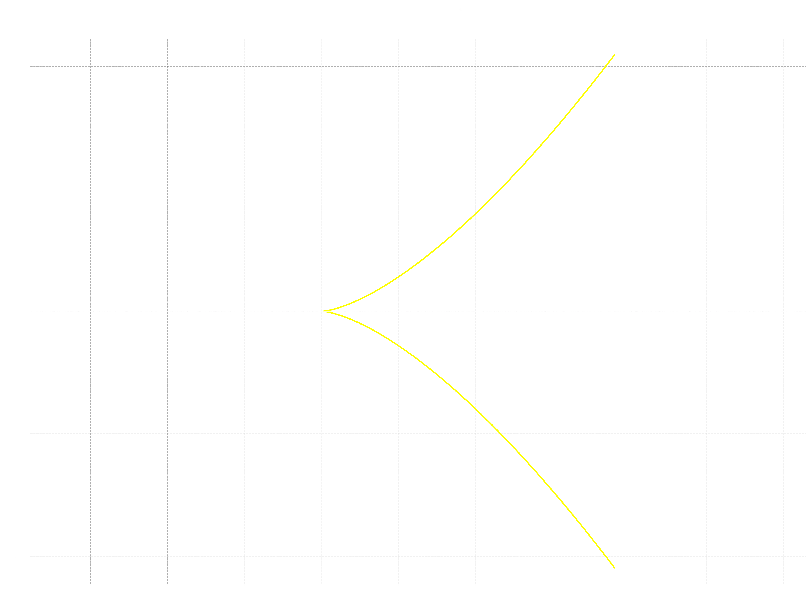
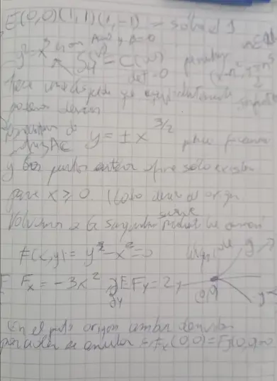
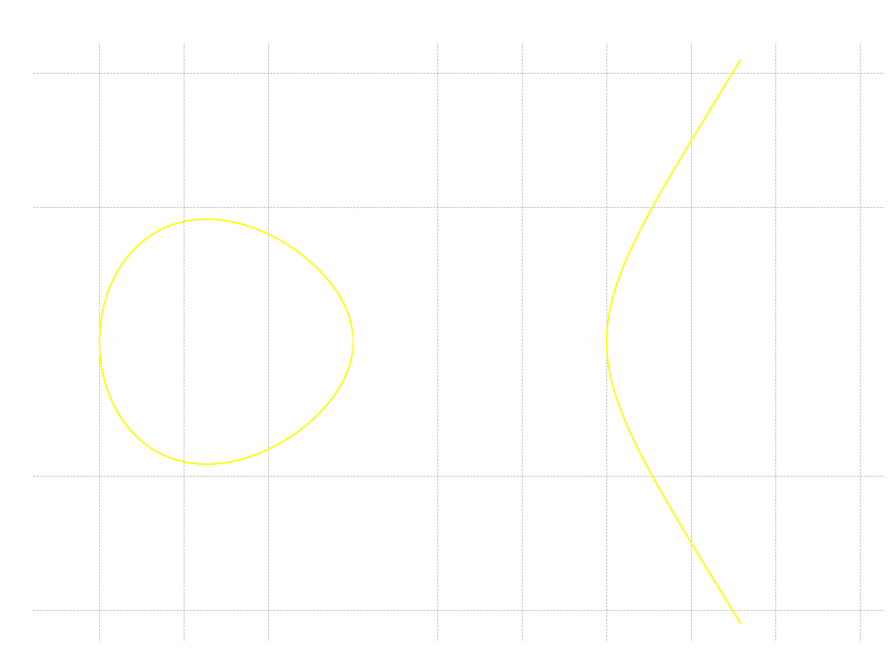
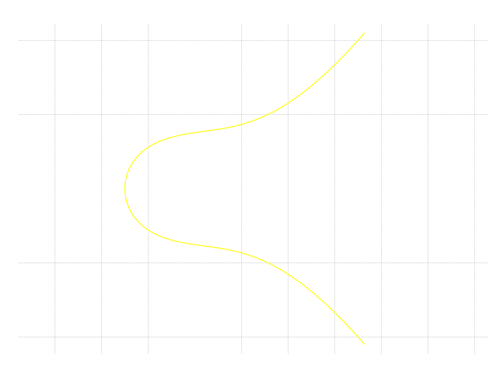

Hasta esta **IV nota** de la serie diofántica, hice dos modificaciones a mi primer planteamiento general sobre matrices y luego sobre los coeficientes de los morfismos de cambio de coordenadas.
Hoy completaré los tres tipos de números figurados $\mathfrak{f}^3$ asociados a los sólidos platónicos que nos faltan; a saber, el cubo, el dodecaedro y el icosaedro.

El problema que intentamos resolver viene por partida triple. Para el cubo buscamos diofánticamente todos los puntos enteros que satisfacen

$$
S_4(v) = C(w).
$$

En segundo lugar, haremos con el dodecaedro
$$
S_4(v) = D(w),
$$

y, por último, también buscaremos los puntos sobre $\mathbb{Z}$ para el icosaedro

$$
S_4(v) = I(w).
$$

Te recuerdo que las definiciones polinomiales vienen del libro de cajón para la combinatoria, el libro de Elena Deza y Michel Deza [*Figurate Numbers* (2012)](https://www.worldscientific.com/worldscibooks/10.1142/8188) y las veremos en cada sección según corresponda.

Además, puesto que vimos bastante teoría, abreviaré gran parte de las técnicas que necesitamos e iremos más directo al objeto, salvo con el primer caso.

> Para leer esta nota de forma natural, consultar debes la [nota común preliminar](https://edelveart.github.io/es/blog/divagaciones-diofanticas-entre-numeros-figurados-y-curvas-elipticas/). Allí está casi Tokio y en las dos notas previas también.

## Los números cúbicos

Muchas veces nos recordamos diciendo:
> Eleva ese número $n \in \mathbb{Z}$ al cubo. Pero, ¿por qué decimos cubo cuando hacemos $n^3$?

La respuesta viene desde la antigüedad. Si unas ocho canicas traslúcidas se imantan por arte sin magia potagia entre sí y las coloco como formando los vértices de una cajita, tendrás un cubo, o al menos los vértices.
Si ganaste $19$ canicas más a las ocho que tenías, es decir, $27$, podrás armarte una cajita más grande con $3^3$ canicas. Los números, para mí, son dependientes de la geometría y la geometría también de los números.

### La degeneración de la curva elíptica de los cúbicos

Los números cúbicos $\mathfrak{f}^3(n) = C(n) = n^3$ probablemente son los más simples de definir y, por ello, forman una curva elíptica degenerada. Si miramos más allá de los naturales al entorno  geométrico de la curva
$$
E_{C}: y^2 = x^3,
$$

lo primero es que la ecuación ya está en una especie de forma cortísima de Weierstraß ($A=0$ y $B=0$), por lo que la matriz $A_{C}$ no vendrá a la fiesta. Entonces, el $\Delta_E$ también es cero, y negaremos dos veces, pero la curva no es una curva elíptica no singular. Informalmente, le dije degenerada.

En segundo lugar, si graficamos la curva veremos que se forma una punta en el punto $(0, 0)$ del plano afín, aquí llega lo interesante.

Lo que tenemos es que en esta **curva singular**, los puntos reales solo existen para el lado derecho del $(0,0)$, bifurcados en dos ramas, $y > 0$ y  $y < 0$. Para recapitular la noción de suavidad, escribo la ecuación en forma implícita
$$
F(x,y) = y^2 - x^3 = 0,
$$

Entonces, al calcular sus derivadas parciales $F_x = \frac{\partial F}{\partial x} = -3x^2$ y, respecto a $y$, tenemos $F_y = \frac{\partial F}{\partial y}= 2y$. El caso anómalo es que en el punto $P = (0, 0)$, ocurre

$$
F_x(P) = F_y(P) = 0.
$$

Sí, se anulan ambas derivadas. Lo que se afila allí **es una cúspide**, un resultado posible también cuando se hacen reducciones  a una curva elíptica módulo un $p$ primo. Pero lo dejaremos de lado.

Quizás recuerdes también que esta ecuación ha sido estudiada desde hace mucho, cuando el velero va en $y$
$$
y = \pm x^{\frac{3}{2}}
$$

Pero eso es cántico de otro juglar.

### Los puntos enteros de los cúbicos

**Parametricemos** $S_4$ y $C$ puesto que todo está a nuestro favor y es, de hecho, lo que permite soltar la proposición adelante. Sea  $n \in \mathbb{N}$, entonces los puntos $P_j$ de ambos números figurados se computan

$$
 (x=n^2, y = n^3)
$$

Es fácil  comprobar que $y^2 = (n^3)^2 = n^6 = (n^2)^3 = x^3$ (sirvió mucho el juego de potencias) y recíprocamente, si $x, y$ son naturales con $y^2=x^3$, existe un natural $n$ tal que $x=n^2$ e $y=n^3$ (basta tomar $n=\frac{y}{x}$).

Así que el caso platónico del cubo, la proposición es

> **Proposición.** Hay infinitos números que son cúbicos $C(w)$ y cuadrados perfectos $S_4(v)$ a la vez.

Para ejemplificar, los puntos $(1, 1), (4, 8), (9, 27), (16, 64), \ldots $ corresponden a los números $1, 64, 729, 4096, \ldots$, es decir, las sextas potencias.

## Hacia la curva elíptica del dodecaedro

Planteo directamente la curva elíptica base asociada al dodecaedro en el plano afín como

$$
E_{D}:  y^2 = \frac{x(3x-1)(3x-2)}{2}
$$

Bien, la matriz que nos va a representar nuestra transformación afín (automorfismo afín sobre $\mathbb{Q}^2$) definido por

$$
\begin{aligned}
T:\mathbb{Q}^2 &\longrightarrow \mathbb{Q}^2\\
\begin{pmatrix}x\\y\end{pmatrix}
&\longmapsto
\begin{pmatrix}
18x-6\\
36y
\end{pmatrix}.
\end{aligned}
$$

mediante **coordenadas homogéneas** para biyectar los puntos racionales e inyectar sin perder los enteros es

$$
A_{D} = \begin{pmatrix}
    18 & 0 & -6\\
    0 & 36 & 0 \\
    0 & 0 & 1
\end{pmatrix} \in \operatorname{GL}(3, \mathbb{Q}),
$$

también escala y patina con un desplazamiento horizontal.
En coordenadas afines induce el cambio de variables  $x = \frac{X+6}{18}$ e $y = \frac{Y}{36}$ en $E_D$, así que queda

$$
\frac{Y^2}{1296}
=
\frac{1}{2}
 \left(\frac{X+6}{18}\right)
\left(\frac{X}{6}\right)
 \left(\frac{X-6}{6}\right).
$$

Si multiplico los denominadores del lado derecho me queda  $1296$, así que multiplico también
el lado izquierdo por lo mismo y llegamos a

$$
E'_{D}: Y^2=X(X+6)(X-6) = X^3-36X
$$

Cuyo discriminante cumple $\Delta_{E} \neq 0$ (es el mismo de la nota anterior, $2^{12}\cdot 3^6$), lo que indica no singularidad sobre racionales.

### Puntos enteros y grupo de Mordell-Weil del dodecaedro

En la base de datos LMFDB es nuevamente la curva que ya vimos para los números tetraédricos

- [LMFDB label 576.c3 | Cremona label 576h2](https://www.lmfdb.org/EllipticCurve/Q/576/c/3),

cuyo grupo de Mordell-Weil es $E'_D(\mathbb{Q}) \cong \mathbb{Z} \oplus (\mathbb{Z}/2\mathbb{Z})^2$.

Volvamos a nuestros puntos de interés.
Replico los puntos enteros tal y como puse en la nota dos sobre los números tetraédricos (es la misma curva, así que $E'_D(\mathbb{Z}) = E'_{S_3^3}(\mathbb{Z})$),

$$
\begin{aligned}
E'_{D}(\mathbb Z)=\{&
(-6,0),(-3,9),(-3,-9),\\
&(-2,8),(-2,-8),(0,0),(6,0),\\
&(12,36),(12,-36),\\
&(18,72),(18,-72),\\
&(294,5040),(294,-5040)
\}.
\end{aligned}
$$

El filtro modular involucra que cada punto entero de $E'_D$ debe cumplir simultáneamente
$$
X \equiv 12 \bmod 18,  \quad Y \equiv 0 \bmod 36.
$$

| **Punto** $(X,Y)$ | $X \equiv 12 \bmod  18$ | $Y \equiv 0 \bmod 36$ | ¿Pasa el filtro? |
| ----------------- | ----------------------: | --------------------: | :--------------: |
| $(-6,0)$          |                    $12$ |                   $0$ |        Sí        |
| $(-3,9)$          |                    $15$ |                   $9$ |        No        |
| $(-3,-9)$         |                    $15$ |                  $27$ |        No        |
| $(-2,8)$          |                    $16$ |                   $8$ |        No        |
| $(-2,-8)$         |                    $16$ |                  $28$ |        No        |
| $(0,0)$           |                     $0$ |                   $0$ |        No        |
| $(6,0)$           |                     $6$ |                   $0$ |        No        |
| $(12,36)$         |                    $12$ |                   $0$ |        Sí        |
| $(12,-36)$        |                    $12$ |                   $0$ |        Sí        |
| $(18,72)$         |                     $0$ |                   $0$ |        No        |
| $(18,-72)$        |                     $0$ |                   $0$ |        No        |
| $(294,5040)$      |                     $6$ |                   $0$ |        No        |
| $(294,-5040)$     |                     $6$ |                   $0$ |        No        |

Los puntos que llegaron hasta aquí son

$$
S_D = \{(-6,0),(12,36),(12,-36)\}.
$$

Transformémolos mediante la inversión $(X, Y) \longmapsto (\frac{X+6}{18}, \frac{Y}{36})$, y quedan únicamente
tres puntos.

$$
E_D(\mathbb{Z}) = \{(0, 0), (1, \pm 1)\}.
$$

> **Proposición.** El $1$ es el único número que es a la vez dodecaédrico $D(w)$ y cuadrado perfecto $S_4(v)$ (positivo).

Garantizado por el teorema de Siegel (que asegura la finitud) y LMFDB (que nos dice cuáles son). $\square$

Representa un caso anómalo, porque la solución es única. Vamos con el icosaedro.

## Hacia la curva elíptica del icosaedro

A estas alturas $h$ logarítmicas no elípticas de las notas iré de frente. La ecuación del icosaedro $\mathfrak{f}^3 (n) = I(n)$ en su modo elíptico es

$$
E_I: y^2 = \frac{x(5x^2-5x+2)}{2}
$$

La transformación que necesitamos es del tipo afín $T: \mathbb{Q}^2\rightarrow \mathbb{Q}^2$, cuya matriz invertible asociada sobre racionales, representada en coordenadas homogéneas, es

$$
A_I = \begin{pmatrix}
10 & 0 & -3 \\
0 & 20 & 0 \\
0 & 0 & 1 \\
\end{pmatrix}
$$
y pertenece a $\operatorname{GL}(3, \mathbb{Q})$. Reemplazo con cambio de variable $x=\frac{X+3}{10}$ e $y=\frac{Y}{20}$ en la ecuación original $E_I$, lo que induce una biyección de puntos racionales con la curva resultante

$$
E'_I: Y^2 = X^3 - X^2 + 7X + 57.
$$

El cómo llegué a $E'_I$, allí se los dejo (solo es sustituir y aplicar Baldor).

> De ahora en adelante, omitiré decir que estamos tratando con curvas no singulares a través de ver su determinante $\Delta$, a menos que el caso que encuentre tenga un punto de este tipo. Probablemente en un futuro con más preguntas lo necesitemos explícitamente, así como el $j$ invariante. Pero no me quiero adelantar mucho todavía.

### Los puntos enteros del icosaedro y su grupo de Mordell-Weil

Vuelvo a la ecuación $E'_I$, lo primero es que tiene cada uno de los términos por grado que le toca a una función polinomial cúbica.  En la base de datos LMFDB aparece con la etiqueta

- [LMFDB label 4800.z2 | Cremona label 4800bt1](https://www.lmfdb.org/EllipticCurve/Q/4800/z/2)

Su estructura de torsión es el grupo cíclico de orden $2$ y el rango de la parte libre es $r=1$, en símbolos tenemos

$$
E'_I(\mathbb{Q}) \cong \mathbb{Z} \oplus \mathbb{Z}/2\mathbb{Z}.
$$

Bueno, veamos, copio aquí la lista de **cinco enteros** propuesta en la base de datos

$$
E'_I(\mathbb{Z}) =
\left\{
(-3,0), (1,8),(1,-8), (7,20), (7,-20)
\right\}.
$$

Para ver si se agregó algún entero de más durante la inyección de $E$ en $E'$, aplicamos el filtro de congruencias

$$
X \equiv 7 \bmod 10, Y \equiv 0 \bmod 20
$$

| Punto $(X,Y)$ | $X \equiv 7 \bmod 10$ | $Y \equiv 0 \bmod 20$ | ¿Pasa el filtro? |
| ------------- | --------------------: | --------------------: | :--------------: |
| $(-3,0)$      |                   $7$ |                   $0$ |        Sí        |
| $(1,8)$       |                   $1$ |                   $8$ |        No        |
| $(1,-8)$      |                   $1$ |                  $12$ |        No        |
| $(7,20)$      |                   $7$ |                   $0$ |        Sí        |
| $(7,-20)$     |                   $7$ |                   $0$ |        Sí        |

La correspondencia biyectiva de puntos enteros entre ambas curvas se reduce, tras el filtro, a

$$
S_I = \{(-3,0),(7,20),(7,-20)\}.
$$

> Es menester recordarme que durante la inyección se introdujeron los puntos $(1,\pm 8)$. Igual ha pasado con más curvas vistas hasta
> el momento. Lo repito nuevamente porque es importante tenerlo en memoria.

Recuperamos la forma de los puntos en $E_I$ mediante la inversa afín $T^{-1}$, la cual nos regresa a las coordenadas enteras

$$
E_I(\mathbb{Z}) = \{(0, 0), (1, 1), (1, -1)\}.
$$

Como queremos  la parte positiva $x, y > 0$, hemos dado con el siguiente corolario.

> **Proposición.** El $1$ es el único número que es a la vez icosaédrico $I(w)$ y cuadrado perfecto $S_4(v)$.

La prueba se ampara en la finitud del teorema de Siegel y de LMFDB. $\square$

## Telescopio de la constelación resolutiva

Aunque vimos el caso anómalo de los cúbicos $C(n)$ y lo resolvimos sin teoría de curvas elípticas ni teorema de Siegel,
sin duda me hizo imaginar que las soluciones de más ecuaciones diofánticas también salen
por puros criterios aritméticos elementales (realmente ya lo suponía desde antes).

Pero, sean finitas o infinitas, las soluciones son por sí mismas de una belleza espontánea.
Recalco nuevamente con mi remarcador sin color lo que pienso hasta esta cuarta nota:

> El tránsito en doble sentido a media luna que estoy haciendo con el cruce
> de dos números figurados $\mathfrak{f}^{k_j}(n)$
> y las primeras curvas elípticas $E_{\mathfrak{f}}/\mathbb{Q}$ asociadas, va y regresa
> con enteros compartidos (tras el filtro modular). No obstante, mi telescopio atisba otros lares.
> También a un lado de esa estrella tipo-G, veo la trayectoria de las formas modulares asociadas $f(q)$,
> esas generadoras especiales para reducciones y conteo de puntos en $E_{\mathfrak{f}} \bmod{p}$.
> Pero la constelación que sueño tiene la forma más azul, con un cuerpo numérico $K$,
> $$
> \mathfrak{f}^k(n) \longmapsto E_\mathfrak{f}/K.
> $$
> En esa dirección, el espacio elíptico es expansivo.
