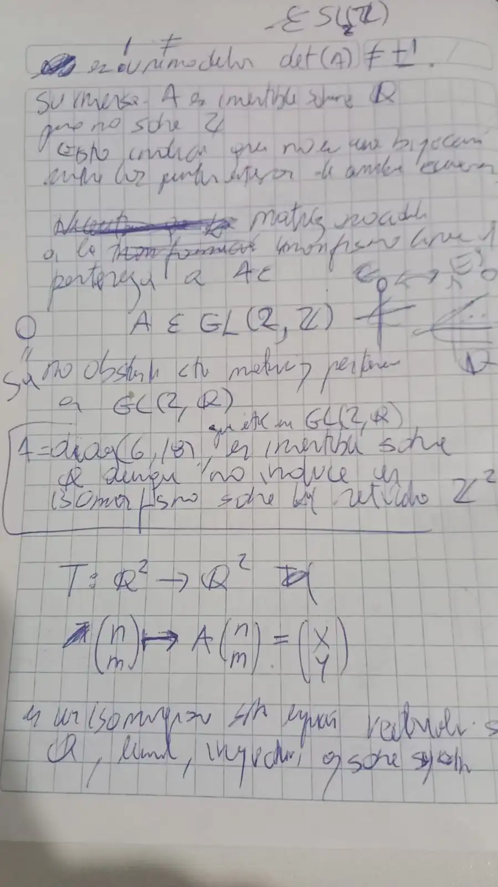
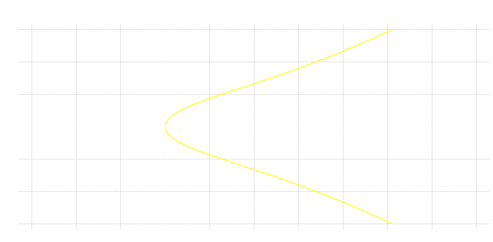
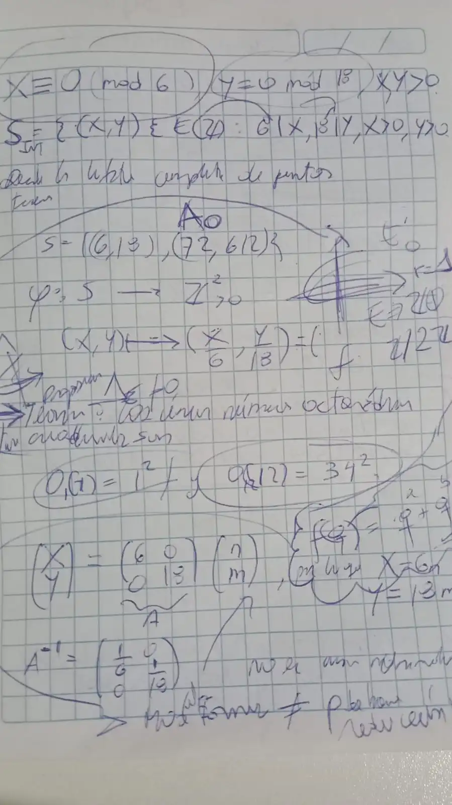

Llevo poco más de dos años escribiendo y pensando en más estampillas imaginarias, como de países visitados, para pegarlos en el libro de Elena Deza y Michel Deza (2012) sobre [números figurados](https://www.worldscientific.com/worldscibooks/10.1142/8188).
A raíz armónica de este libro, he desarrollado artesanalmente software para hacer música algorítmica con números figurados en [Sonic Pi](https://rubygems.org/gems/figurate_numbers), así como una librería para calcularlos y graficarlos, [figuratenum](https://pypi.org/project/figuratenum/), que ya vive en su propia página de [documentación](https://edelveart.github.io/figuratenum/).

Lo que voy a mostrar a continuación es, esencialmente, mi afán por expandir la curiosidad, de la forma más natural posible, hacia otros huariques de la noción de número figurado. Pienso, por lo tanto, escribir varias notas al respecto (cada una autocontenida en cuestión de nociones básicas).

Y antes de dar el contenido de cajón, te cuento que mi interés en las curvas elípticas emergió cual paiche del Amazonas cuando supe que puedes dotarlas de una estructura de grupo en la que los elementos son los puntos de la curva. Más adelante veremos esto, continuemos.

## Cómo llegué al huarique del problema

Bien, lo que veremos en cada publicación tratará de responder una pregunta que tuve hace unos días mientras caminaba bajo este clima cambiante y caluroso, cuando iba a comprar al mercado algo para preparar el almuerzo.

Estuve recordando que los números figurados planos (en el libro de cabecera) tienen una forma natural de estudiarse bajo el lente de **ecuaciones diofánticas**. Por ejemplo, ¿qué números triangulares $S_3(n)$ son también pentagonales $S_5(m)$? Es decir, encontrar los números enteros positivos que cumplan
$$
 \frac{n(n+1)}{2} = \frac{m(3m-1)}{2},
$$
respectivamente. La respuesta es que hay un conjunto infinito de números [triangulares y pentagonales a la vez (dale click y míralo en OEIS)](https://oeis.org/A014979).

Puedes verlos por separado en consola con mi librería de `PyPI`, en el rango que elijas.

```python
from figuratenum import FigurateNum

triangular = FigurateNum().triangular()
print([next(triangular) for _ in range(1000)])
# [1, 3, 6, 10, 15, 21, 28, 36, 45, 55, 66, 78, 91, 105, 120, ...]

pentagonal = FigurateNum().pentagonal()
print([next(pentagonal) for _ in range(1000)])
# [1, 5, 12, 22, 35, 51, 70, 92, 117, 145, 176, 210, 247, 287, 330, ...]
```

 Y me cuestioné lo siguiente:

> ¿Y si hago una **mixturización** de dimensiones?  ¿Y si la ecuación diofántica tiene a un lado un número figurado multidimensional de $k_1$ dimensiones y al otro lado  un número multidimensional de $k_2$ dimensiones?
> O, mejor aún para computar cosas más fácilmente, ¿si elijo para el problema un número figurado plano ($k_1=2$) y un número figurado espacial ($k_2=3$)?

Entiéndase por $k$ un entero mayor o igual a $2$ como la dimensión del número figurado.
Previo a ver cómo llegué al asunto central de esta nota de laboratorio, retomo mi énfasis en que las ideas sean naturales, pues fue así y solo así como caigo en las curvas elípticas; si no me hubiera ido al desvío con esa búsqueda de **mixturización**, no habría llegado a ellas. Ahora toca decirte qué es un número figurado.

## Mi forma de ver los números figurados

Solo en esta sección seré más preciso, porque es la base con la que hago el saludo protocolar a nuevas ideas aledañas a los números figurados.
Para empezar, un número figurado me gusta pensarlo a través de un polinomio $\mathfrak{f}(X)$ del anillo $\mathbb{Q}[X]$, y el cual define la función

$$
    \begin{aligned}
        \mathfrak f:\mathbb Z & \longrightarrow\mathbb Q,  \\
        n                     & \longmapsto\mathfrak f(n).
    \end{aligned}
$$

Así, la sucesión por ambos lados, es decir, bilátera asociada a $\mathfrak f$

$$
    \bigl(\mathfrak f^k(n)\bigr)_{n\in\mathbb Z}
    =
    \left(
    \sum_{j=0}^{k} a_j n^j
    \right)_{n\in\mathbb Z},
$$
donde $a_j \in \mathbb{Q}$, es lo que entiendo por número figurado.
Probablemente te parece extraño, pero esta holgura en el dominio viene bien para pensar en números figurados clásicos (solo enteros positivos) y los generalizados.

Entonces, con la definición quedamos en que los triangulares son
$$
\mathfrak{f}^2(n) = S_3(n) = \frac{n(n + 1)}{2}.
$$

El esqueleto está calcificado. Para reformular con más filo la pregunta central en nuestros términos actuales, buscamos soluciones a ecuaciones diofánticas de la forma
> $$
> \mathfrak{f}^{k_1}(v) = \mathfrak{f}^{k_2}(w), \quad k_j \ge 2, \  v, w \in \mathbb{Z}.
> $$


Es momento de ir a la ecuación.

## Números octaédricos en la curva elíptica

Hay múltiples formas de definir un número octaédrico, pero daré la definición más tradicional. Les presento a

$$
\mathfrak{f}^3(n) = O(n) = \frac{n(2n^2+1)}{3}.
$$
Puedes calcular la lista de números octaédricos con mi librería `figuratenum`

```python
from figuratenum import FigurateNum

seq1 = FigurateNum().octahedral()
print([next(seq1) for _ in range(1500)])
```

La lista de primeros términos que saldrán por consola son
$$
1, 6, 19, 44, 85, 146, 231, 344, \ldots
$$


Ahora el gran problema fue de decisión.
> ¿A qué otro número figurado pongo al frente de $O(n)$ para armar la ecuación diofántica? ¿Triangular, heptagonal, truncado?

Hay tantas posibilidades. Pero, para no complicarme en tal indecisión para estudiar, lo más espontáneo que se me ocurrió fue geometrizar de manera continua a la sucesión, así que

$$
n \longmapsto x.
$$

Esto con el fin de estudiar los huecos y espacios que tienen los objetos discretos mediante lo continuo, lo incesante y junto.

Con esto, recordé que cabe interpretarla como una función $y = f(x)$. Después, como vi que estamos en tercer grado,  saltó inmediata mi curiosidad por **elevar al cuadrado únicamente el lado izquierdo**, ya que me pareció estar dando un par de vueltas a la realidad de una **curva elíptica** $E/\mathbb{Q}$ sin querer mirarla. Lo que encuentro entonces es
$$
y^2 = \frac{2x^3 + x}{3}.
$$

Es evidente que hay una mixturización y desbalance, porque solo elevé al cuadrado un lado (ya no es equivalente a $y=O(x)$, y si hubiera elevado ambos lados solo habría obtenido de nuevo la gráfica de $\pm O(x)$), pero decidí continuar en la misma guisa de cambio diminuto a la hipérbola que hice en una [nota en español y que me llevó a los $q$-logaritmos](https://edelveart.github.io/es/blog/el-logaritmo-y-su-aroma-geometrico-en-la-musica/).
Es momento de determinar entonces si es una curva elíptica.


## Los ingredientes azucarados de la curva elíptica

### Lo que es

Bien podríamos dibujar la curva en $\mathbb{R}^2$ y ver qué sale, pero necesitamos saber que se trata de una curva elíptica. Dada la premisa autocontenida, necesitaré introducir algunas definiciones vertebrales al tema.

Una **curva elíptica sobre los racionales** $E/\mathbb{Q}$ es una curva proyectiva plana de tercer grado y de género $1$ que es, además, **suave** (esto es fundamental), con un punto racional distinguido $\mathcal{O}$ (el punto al infinito, en la forma de Weierstraß); aunque en lo que veremos, para mayor familiaridad nuestra, tomaremos las ideas en **coordenadas afines** y no proyectivas.

En el llano en llamas tenemos lo que se llama un **modelo** de Weierstraß (ojo con la Eszett) de $E / \mathbb{Q}$ dado por

$$
\begin{aligned}
y^2 + a_1xy + a_3y &= x^3 + a_2x^2 \\
                  &\quad + a_4x + a_6,
\end{aligned}
$$
con cada $a_j$ entero, lo que completa el apellido de modelo **integral**.
Impresiona la primera vez que se ve este tipo de curva por su complejidad, pero en nuestro desarrollo todo será más simple. Para más información, marca el [2 de Silverman](https://link.springer.com/book/10.1007/978-0-387-09494-6).

Los coeficientes que usaremos serán menos, no todos los seis que aparecen allí.
Como queremos que la curva nuestra se parezca a ese modelo, necesitamos hacerle unos retoques, para empezar el $3$ del denominador debe desaparecer.

### Suavidad e invariantes

Las curvas elípticas tienen muchos invariantes, así como en el arte musical se tiene invarianza por transposición o por inversión.
Uno sustancial para determinar la **suavidad** es el discriminante $\Delta_E$. Pero antes de ello, nuestra curva necesitará menos coeficientes y tendrá la siguiente forma
$$
E/\mathbb{Q}: y^2 = x^3 + Ax + B
$$

Recuerda que $A, B$ son enteros y sí, se le ha perdido el monomio de segundo grado. El discriminante queda entonces

$$
\Delta_E = -16 (4A^3 + 27B^2)
$$

> Listo, hay varias cuestiones sobre el discriminante (que sea mínimo), pero ya sabes a quién marcar.

Listo. Ya que hemos hablado de suavidad, conviene decir de qué va. Si tenemos una curva definida implícitamente por una ecuación
$$
F(x,y) = 0.
$$

Decimos que un punto $P = (x_0, y_0)$ de la curva $F(x,y)=0$ es suave si las derivadas parciales no se anulan al mismo tiempo. En pocos símbolos
$$
\left(\frac{\partial F}{\partial x}(P), \frac{\partial F}{\partial y}(P)\right) \neq (0, 0).
$$

Si se cumple esto, la curva no tiene picos ni cruces ni puntos aislados ni nodos ni cúspides donde la curva deje de comportarse como un objeto geométrico regular.

Probemos con nuestra ecuación entonces.

$$
F(x,y) = 3y^2-2x^3-x = 0
$$

Si calculamos la derivada parcial respecto de $x$ es $F_x= -6x^2-1$ y respecto de $y$ es $F_y = 6y$. Para que un punto sea singular (las cosas que dijimos arriba), debe cumplirse a la misma vez que $(F_x, F_y) = (0, 0)$, además de estar sobre la curva. Si despejamos a lo Baldor, de $F_y=0$ sale $y=0$, y al sustituir en la curva tenemos que $x=0$ o $x^2 = -\frac{1}{2}$, pero como estamos condicionados por la singularidad, debería ser también $x^2 = -\frac{1}{6}$. Ninguna de esas abscisas anula $F_x$ ($x=0$ da $-1$; $x^2=-\frac{1}{2}$ da $2$). Por lo que el puerto USB no recibe un disquete de 3 1/2: no hay puntos singulares y la curva es suave.

El discriminante hace el trabajo más simple en la detección de singularidades, sin tener que buscar cada punto singular por separado, ya que si $\Delta_E$ es **diferente de cero** nos informa que la **curva proyectiva es suave**.
Sin embargo, para ser más precisos, la  **condición** es que el campo $K$ tenga característica distinta de 2 y de 3, como los **racionales o los reales**.

## Transformaciones cuadradas

Lo que toca ahora es transformar nuestra curva elíptica en la forma de Weierstraß. Vimos que también ese $3$ se pega al $y^2$ en la ecuación implícita. Para solucionar esto, llamaremos al viejo truco de matrices cuadradas $A$ de $2\times 2$ con coeficientes racionales que conviertan nuestras coordenadas para dar el salto con pértiga.

Perfecto, planeamos hallar una $A$ tal que

$$

\begin{aligned}
T:\mathbb{Q}^2 &\longrightarrow \mathbb{Q}^2\\
\begin{pmatrix}x\\y\end{pmatrix}
&\mapsto
A\begin{pmatrix}x\\y\end{pmatrix}
=
\begin{pmatrix}X\\Y\end{pmatrix}.
\end{aligned}

$$

Así que nuestra ecuación en la forma que queremos estará escrita con las coordenadas $(X,Y)$ como imagen del punto $(x,y)$.
La matriz $A$ asociada al morfismo lineal es
$$
A_{O}=
\begin{pmatrix}
6 & 0\\
0 & 18
\end{pmatrix},
$$

es decir, $A_{O} = \operatorname{diag}(6, 18)$, que utilizaré cual ejemplo **prototipo** de una **función asociada a un número figurado**.
Entonces más adelante, pensaré en matrices

$$
A_{\mathfrak{f}^3} \in \operatorname{GL}(2, \mathbb{Q}).
$$

Es decir, cuyo determinante $\det (A) $ diferente de $0$ permita la inversión sobre $\mathbb{Q}$. Así, que $T$ es un isomorfismo de espacios vectoriales sobre $\mathbb{Q}$, en otras palabras, es inyectiva y sobreyectiva.



<figcaption class="not-prose text-neutral-content text-sm mb-8 text-center">
    <em>Mi cuaderno cuadriculado donde realizo estas notas y más preguntas.</em>
</figcaption>

### La curva elíptica octaédrica

Reemplacemos entonces el cambio es $X=6x$ y $Y=18y$ y, si despejamos las variables

$$
x=\frac{X}{6},\qquad y=\frac{Y}{18}.
$$

Reemplazamos por este cambio y llegamos a
$$
\left(\frac{Y}{18}\right)^2
=
\frac{2\left(\frac{X}{6}\right)^3+\frac{X}{6}}{3}.
$$

El denominador mayor que encontrarás es $324$.

$$
\frac{Y^2}{324} = \frac{X^3}{324} + \frac{X}{18}
$$

Multiplicamos como lo amerita y tenemos la ecuación clave de esta nota (presta atención):

$$
E'_{O}:\quad Y^2=X^3+18X.
$$

Como comprobación rápida con el discriminante, $\Delta_E = -16\,(4\cdot 18^3 + 27\cdot 0^2) = -2^9\cdot 3^6 \neq 0$, así que la curva es suave, como ya intuíamos.

Los números octaédricos $O(n)$ tienen esta curva elíptica asociada. Y merece aclarar que

> La matriz nos ha dado una equivalencia entre curvas afines sobre $\mathbb{Q}$.

Lo que viene a continuación, es tomar una mínima parte de lo ya estudiado en la teoría de curvas elípticas.

## El grupo de Mordell-Weil

Pues esta curva está indexada en la base de datos de $L$-funciones y formas modulares en el  enlace

- [LMFDB label 2304.a2 | Cremona label 2304p1](https://www.lmfdb.org/EllipticCurve/Q/2304/a/2).

Allí verás su gráfica que con un `script.py` tenemos



Como mi motivación estuvo dada por el álgebra de grupos, aquí introduciré la idea de **grupo de Mordell-Weil** de una curva elíptica.
El truco está en **enunciar cómo es la idea** que considero de lo más interesante por sí misma:

> Existe una ley de composición binaria geométrica que permite dotar de estructura de grupo al conjunto de puntos $K$-racionales de una curva elíptica $E/K$.


### Una ley geométrica

Entonces, sean $P$ y $Q$ dos puntos de la curva sobre los racionales. Dibujemos una **recta secante** $\mathcal{L}_{S}(P, Q)$ por ambos puntos, esta recta cruzará un tercer punto $R$ en la misma curva, ahora hacemos una reflexión axial, respecto al eje de abscisas $x$. Dicho punto reflejado es
$$
-R = P \oplus Q
$$

Ese fue el primer caso. Pero si $P=Q$, en vez de tomar una recta secante, trazaremos la **recta tangente** $\mathcal{L}_{T}(P, P)$ a ese punto $P$; si te das cuenta, implica la suma $P \oplus P = 2P$ (una duplicación).

Entonces, olvidemos las mayúsculas por el momento para divisar las cosas. Esta recta $\mathcal{L}$ no vertical tiene ecuación ampliamente conocida $ y = \lambda x + b $.
Nuevamente, substituimos en nuestra curva $E'_{O}$ de la manera

$$
(\lambda x + b)^2 = x^3 + 18x,
$$
donde sus tres raíces son las abscisas de los tres puntos de intersección que escribimos como   $x_P, x_Q, x_R$. Si  hacemos una simple suma con ellas del modo

$$
x_P + x_Q + x_R = \lambda^2
$$

deducimos que la primera coordenada de los puntos  $R$ y $-R$  son idénticamente $ x_R = \lambda ^2 -x_P -x_Q$, porque la suma

$$
P \oplus Q = (x_R, -y_R)
$$
mantiene intacta $x_R$ e invierte el signo de $y_R$.

Veamos el cálculo explícito ahora. Partimos que $E'_{O}$ (nuevamente en minúsculas), con dos puntos diferentes $P \neq Q$ y $x_P \neq x_Q$, la pendiente de $\mathcal{L}_S$ es la archiconocida

$$
\lambda = \frac{y_Q- y_P}{x_Q - x_P}
$$

Así, el punto $P \oplus Q = (x_3, y_3)$ viene dado por las coordenadas racionales

$$
x_3 = \lambda^2 - x_P - x_Q.
$$

$$
y_3 = \lambda(x_P - x_3) - y_P.
$$

Por el otro lado, la duplicación $P=Q$ mediante $\mathcal{L}_{T}$ tiene pendiente

$$
\lambda = \frac{3x^2_P + 18}{2 y_P}
$$

(siempre que $y_P \neq 0$; si $y_P = 0$ la tangente es vertical y $2P = \mathcal{O}$). Para llegar a la meta,  el punto $2P$ lo calculas usando $x_3$ y $y_3$ de arriba con $Q=P$.

### Cómo es exactamente el grupo

La idea de grupo fue lo que escuché por vez primera como matemática fuera de serie (la que no aprendí en la escuela), y me propuse leer más sobre ello. Usualmente se define mediante un conjunto de axiomas.
Y los puntos de la curva los satisfacen de manera análoga a como se haría con un objeto algebraico puro.

Por ejemplo, la cerradura, vimos que $P \oplus Q$ se queda dentro de la curva. El elemento neutro, del que no hemos hablado mucho hasta el momento, $\mathcal{O}$, es el punto en el infinito tal que al sumarlo $P \oplus \mathcal{O} = P$.
También tiene su inverso (cambio de signo de coordenada $y$), como $R \oplus (-R) = \mathcal{O}$, que nos lleva a la identidad en el infinito. También tenemos conmutatividad $P \oplus Q = Q \oplus P$. Y para cerrar con broche de punto en el infinito, presenta  asociatividad

$$
(P \oplus Q) \oplus R = P \oplus (Q \oplus R),
$$

que es la más complicada de demostrar. En suma, los puntos de $E(\mathbb{Q})$ forman un grupo abeliano con la operación $\oplus$.
Pero, es inmediato preguntarnos ¿qué grupo es explícitamente?

### Ya, ahora sí el grupo explícito

El teorema de Mordell-Weil es algo más general, para decir de manera global cómo es el grupo a grandes rasgos sobre un cuerpo numérico $K$ (extensiones finitas de $\mathbb{Q}$). Por obvias razones, no demostraremos aquí nada, pero bien vale que marques $2$.

Los versos del teorema dicen  que

> si $E$ sobre $K$ es una curva elíptica, entonces $E(K)$ es un grupo abeliano finitamente generado.

Esto implica que existen $P_j$ puntos de $E(K)$ que permiten construir, mediante combinaciones lineales con coeficientes enteros, cualquier otro punto $Q$ de $E(K)$.

Para situar en la mente mejor las cosas, más particularmente tenemos

$$
E(K) \cong E(K)_{\text{T}} \oplus \mathbb{Z}^{r}
$$

Tenemos frente a nosotros una parte de torsión $E(K)_{\text{T}}$, un subgrupo con puntos que tienen orden finito. Y, en el otro lado, tenemos un grupo libre de torsión de rango $r \ge 0$.

Antes de continuar, conviene dar un breve atisbo histórico que hice en español sobre la forma que demostró Mazur en los años setentas que sobre los racionales, el subgrupo de torsión $E(\mathbb{Q})_{\text{T}}$ es **una lista de 15 tipos de grupos posibles** (11 cíclicos $C_n$ de orden $n$ y 4 que son producto de dos cíclicos), y vienen en dos platos $A$ y $B$.

$$
T_A=\left\{C_n\mid n\in\{1,2,\ldots,10,12\}\right\},
$$

$$
T_B=\left\{C_2 \oplus C_{2n}\mid n\in\{1,2,3,4\}\right\}.
$$

La clasificación de la antigua conjetura de Ogg es, por tanto,
$$
E(\mathbb{Q})_T\cong G,
\quad G\in T_A\cup T_B.
$$
También existen ciertas clasificaciones para cuerpos más generales, $K$, como por ejemplo para cuadráticos.

Para ya casi cerrar la sección, solo queda la parte libre. Es el compendio de la complejidad y de quién encuentra el rango más grande. Ambas partes siguen siendo ampliamente estudiadas.

El grupo de nuestra curva es según LMFDB
$$
E'_{O}(\mathbb{Q}) \cong \mathbb{Z} \oplus \mathbb{Z}/2\mathbb{Z}
$$
Tiene rango $r=1$ y subgrupo de torsión de orden dos.

## Contemos los puntos enteros

Volvamos a los números figurados, porque estamos ya muy inmersos en los racionales; el foco no debe irse mucho de donde están en los enteros.

Según el **teorema de Siegel**,

> Una curva elíptica como la nuestra y, en general, $E : y^2 = x^3 + Ax + B$  sobre $\mathbb{Q}$, con $A, B$ enteros, tiene solamente un conjunto finito de puntos enteros.

Seguro pensarás que este teorema nos da una fórmula para hallar los puntos, pero no es así.

Lo que buscamos ahora tiene la forma

$$
\begin{aligned}
E'_O(\mathbb{Z}) = \bigl\{(X,Y) \in \mathbb{Z}^2 : \\
\qquad Y^2 = X^3 + 18X \bigr\}.
\end{aligned}
$$
Y Siegel solamente nos confirma que

$$
\# E'_{O} (\mathbb{Z}) < \infty,
$$
sin ninguna cota ni nada por el estilo.

Según la LMFDB, ya visto, en total hay $7$ puntos.  A saber,

$$
\begin{aligned}
E'_{O}(\mathbb{Z}) = \{&(0,0), (3,9), (3,-9),\\
                       &(6,18), (6,-18),\\
                       &(72,612), (72,-612)\}.
\end{aligned}
$$

Pero si observas, los números de lista que aparecen allí no tienen mucho que ver con los octaédricos.
Si puedes, grafícalos en la curva.
Bien, lo que sucedió fue que la matriz $A_O$ que definimos es invertible sobre racionales
$$
A_O^{-1} = \begin{pmatrix}
\frac{1}{6} & 0 \\
0 & \frac{1}{18}
\end{pmatrix},
$$

así que ocurren tres situaciones:

1. Los puntos enteros de $E_O$ (curva base antes de aplicar la matriz) se vuelven puntos enteros en $E'_O$ (después de aplicada la matriz).
2. No todos los puntos enteros de $E'_O$ se transformarán en puntos enteros de la curva base $E_O$.
3. Para recuperar los enteros en $E_O$ desde la forma de Weierstraß $E'_O$, hay que filtrar modularmente, es decir, aplicar un criterio de divisibilidad específico.

El cambio a la forma elíptica por excelencia de la LMFDB introdujo puntos enteros que no existen en la curva base.
La matriz $A_O$ está bastante lejos de ser **unimodular**, si tuviera entradas enteras y $\det(A) = \pm 1$,  hubiéramos estado dentro de $\operatorname{GL}(2, \mathbb{Z})$ (o $\operatorname{SL}(2, \mathbb{Z})$ si el determinante es $+1$) y dejaríamos de lado las 3 consideraciones.

Es menester entonces aclarar que el isomorfismo solo se da sobre racionales, pero no induce un isomorfismo sobre el retículo $\mathbb{Z}^2$.

Nosotros buscamos, según el inverso, retomar los puntos enteros de la curva original. Escribiremos como hicimos más arriba pero ahora pensando en puntos con coordenadas enteras
$$
x = \frac{X}{6}, y= \frac{Y}{18}
$$
Así, que lo que buscamos es el conjunto de puntos

$$
S =
\{  P=(X,Y)\in E'_O(\mathbb{Z}) \},
$$

tal que sus coordenadas satisfagan las congruencias
$$
 P = (X\equiv 0 \bmod{6}, Y\equiv 0\bmod{18}).
$$

Una tablita aquí nos muestra cuáles pasan el **filtro modular**.

| Punto $P=(X,Y)$ | $X\equiv 0\pmod{6}$ | $Y\equiv 0\pmod{18}$ | Cumple |
| :-------------: | :-----------------: | :------------------: | :----: |
|     $(0,0)$     |         Sí          |          Sí          |   Sí   |
|     $(3,9)$     |         No          |          No          |   No   |
|    $(3,-9)$     |         No          |          No          |   No   |
|    $(6,18)$     |         Sí          |          Sí          |   Sí   |
|    $(6,-18)$    |         Sí          |          Sí          |   Sí   |
|   $(72,612)$    |         Sí          |          Sí          |   Sí   |
|   $(72,-612)$   |         Sí          |          Sí          |   Sí   |

De los cuales extraemos los $5$ puntos
$$
\begin{aligned}
S = \{&(0,0), (6,18), (6,-18),\\
      &(72,612), (72,-612)\}.
\end{aligned}
$$

Les aplicamos la matriz $A^{-1}_O(X, Y) = (\frac{X}{6}, \frac{Y}{18})$ y nos quedan los puntos enteros en la ecuación base
$$
\begin{aligned}
E_O(\mathbb{Z}) = \{
&(0,0), (1,1), (1,-1),\\
&(12,34), (12,-34)
\}.
\end{aligned}
$$

## Corolario que sabe a teorema, pero es proposición



<figcaption class="not-prose text-neutral-content text-sm mb-8 text-center">
    <em>Segunda foto de mi cuaderno cuadriculado. La proposición y las formas modulares.</em>
</figcaption>

He postergado algo que muy probablemente notaste desde un inicio cuando hablé de ecuaciones diofánticas y puse una curva elíptica. Que lo que hemos planteado es

> $$
> \mathfrak{f}^{2}(v) = \mathfrak{f}^{3}(w), \quad v, w \in \mathbb{Z}.
> $$

El lado izquierdo de la curva elíptica son los números cuadrados $S_4(v) = v^2 = y^2$. Así que todo el tiempo hemos operado elípticamente la ecuación diofántica de números figurados

$$
S_4(v) = O(w).
$$

Desde un inicio solo nos interesa la parte natural, entonces removemos el $(0, 0)$ y los puntos se reducen a $4$.
Y de esos cuatro puntos, debemos elevar al cuadrado la ordenada para recuperar el número figurado en común; como $y$ y $-y$ dan el mismo cuadrado, quedan únicamente $2$ puntos con coordenadas enteras positivas, $(1,1)$ y $(12,34)$, y un corolario que sabe a **teorema** con presentación de proposición que es el plato insignia del huarique visitado en la nota.

> $\textbf{Proposición}$. Los únicos números figurados octaédricos  y cuadrados a la vez (positivos) son $1$ y $1156$.

El porqué está en $O(1)= 1^2=1$, mientras que $O(12)= 34^2= 1156$.


## Clausura elíptica

Sin duda, ha sido una divagación, mas he planteado el esqueleto bailador para estudiar más ecuaciones diofánticas entre números figurados de tal modo que el ancla esté en la teoría de curvas elípticas sobre $\mathbb{Q}$ y el motor en una matriz invertible asociada a un morfismo lineal $A_{\mathfrak{f}^{k}}$.

Además, ya los atisbo como moradores de más invariantes aritméticos  y, por supuesto, en cercanía de las funciones generadoras que más me llaman, las **formas modulares**.
