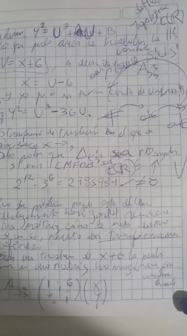

En la nota anterior encontramos un paiche del Amazonas dando un brinco diez metros hacia arriba; una curva elíptica nos dio un giro espontáneo para estudiar cuándo un número octaédrico $O(w)$ es también un cuadrado $S_4(v)$. Dejé un riachuelo y ahora vamos a replicar el experimento divagante con otro figurado espacial del libro de Elena Deza y Michel Deza [*Figurate Numbers* (2012)](https://www.worldscientific.com/worldscibooks/10.1142/8188).

> Para leer esta nota de forma natural, consultar debes la [nota común preliminar](https://edelveart.github.io/es/blog/divagaciones-diofanticas-entre-numeros-figurados-y-curvas-elipticas/). Allí está Tokio.

## Los números triangulares en tres dimensiones

Recordemos que los números tetraédricos tienen dimensión $k=3$ y vienen dados por

$$
\mathfrak{f}^{3}(n)=S_3^3(n)=\frac{n(n+1)(n+2)}{6}.
$$

Puedes calcularlos con mi librería [`figuratenum en PyPI`](https://pypi.org/project/figuratenum/) con el siguiente fragmento de código:

```python
from figuratenum import FigurateNum

tetrahedral = FigurateNum().tetrahedral()
print([next(tetrahedral) for _ in range(12)])
# [1, 4, 10, 20, 35, 56, 84, 120, 165, 220, 286, 364]
```

> La pregunta que quiero responder es la siguiente: ¿qué números tetraédricos son también cuadrados perfectos?

En nuestros términos, buscamos soluciones enteras positivas de la ecuación diofántica

$$
S_4(v)=S_3^3(w),
$$

es decir,

$$
v^2=\frac{w(w+1)(w+2)}{6}.
$$

Para aligerar la escritura y extenderla a racionales, llamaremos $x=w$ e $y=v$. En suma y resta, la ecuación que nos tomará la atención un momento será

$$
E_{S_3^3} / \mathbb{Q}: y^2=\frac{x(x+1)(x+2)}{6}.
$$

Como hicimos con los números octaédricos, vamos a geometrizar la ecuación cúbica afín y llevarla a una curva elíptica en forma de Weierstraß. Pero antes que canten los gallos, debemos comprobar que la curva resultante sea **no singular**.

### Tuve que mover el bote de la matriz

El riachuelo que dejé en fluidez nos dice ahora que debemos encontrar una matriz $A_{\mathfrak{f}^3}$ invertible asociada a $S_3^3$ para el día de hoy.
Como el número $6$ se pega a $y$, debemos ver dónde lo dejamos. Primero, fijemos la transformación lineal isomorfa $T:\mathbb Q^2\longrightarrow\mathbb Q^2$ sobre los puntos racionales, donde le planteamos una matriz asociada

$$
A_{S_3^3} = \begin{pmatrix}
6 & 0 \\
0 & 36
\end{pmatrix}
$$

y al accionarla sobre $(x, y)$, nos genera puntos racionales $P_j = (X, Y)$, con $X = 6x$ y $Y = 36y$. Continuemos. Despejamos el cielo gris de Lima en cada coordenada base de $E_{S_3^3}$  y reemplazamos

$$
\frac{Y^2}{1296}
=
\frac{(X/6)(X/6+1)(X/6+2)}{6}.
$$

Multiplicamos por $1296$ como tiene que ser y al simplificar

$$
Y^2=X(X+6)(X+12).
$$

Pero, como no todo siempre sale bien a la primera, al desarrollar el producto tenemos la curva

$$
Y^2=X^3+18X^2+72X,
$$
y la dejo sin nombre aunque tenga coeficientes en $\mathbb{Z}$, porque tiene un $X^2$ que escapa a la forma de Weierstraß recortada que queremos.
Necesito volar aquel término cuadrático.

### Segundo intento cuadrado y ya salió

Un truco sin magia potagia que podemos hacer es **trasladar la abscisa** mediante

$$
u=X+6,
$$

que en otro despeje es $X=u-6$. Basta sustituir y simplificar

$$
\begin{aligned}
Y^2
&=(u-6)^3+18(u-6)^2+72(u-6)\\
&=u^3-36u.
\end{aligned}
$$

Así llegamos a decir que nuestra curva elíptica tetraédrica se disfraza de

$$
E'_{S_3^3}/\mathbb{Q}:\quad Y^2=u^3-36u.
$$

Bien, falta que el invariante de apellido **discriminante** sea diferente de cero. Como $A=-36$ y $B=0$, tropezamos bien con la fórmula
$$
\begin{aligned}
\Delta_{E'}
    &=-16(4A^3+27B^2)\\
    &=-16\bigl(4(-36)^3\bigr)\\
    &=2^{12}\cdot3^6\\
    &=2985984\neq0.
\end{aligned}
$$


Espero no haberme confundido, ya que la suavidad está asegurada y tenemos una curva elíptica sobre $\mathbb Q$ para abordar nuestra ecuación diofántica.

### El huevito y las ramas

Antes de seguir, haré una divagación más. A diferencia de la gráfica de la ecuación de los números octaédricos $E'_O (\mathbb{R})$, estamos frente a una curva que tiene dos **componentes conexas** (en la topología euclídea).
Esto ha pasado porque el discriminante $\Delta_{E'}$ es mayor a cero, que en geometría se dice:

> Sus tres raíces $\alpha_j$ reales son diferentes.

Cuando el discriminante te sale menor que cero, la curva tiene una sola componente (como en los octaédricos) y
> solo tiene una raíz real y dos complejas conjugadas.

Es menester decirte que hay un poco de topología en este vislumbramiento y que necesitamos pensar en dos espacios.

En lo afín, la componente del huevito (el óvalo) es una curva cerrada, acotada y compacta; en evidente esencia, tiene la topología de círculo.
Por su parte, las dos ramas, que seguro te recuerdan un poco a las ramas de **Hebarista**, **la hipérbola que murió de computación**, forman la componente conexa principal, en la cual miras que

$$
\lim_{u \rightarrow \infty} Y = \pm \infty.
$$

Cuando saltamos a lo proyectivo, le damos vida al punto al infinito $\mathcal{O}$ y ambas ramas se toman sus yemas terminales con este pegamento y también se cierran; lo que brota de ellas es también la topología de círculo $S^1$ al compactificarlas.

Y ya que hablamos dos veces de topología, aquí también tenemos una estructura resaltable con tu remarcador sin color; *per analogiam* con el teorema de Mordell-Weil, llegamos a **un producto topológico que es homeomorfo a la disjunta unión de dos círculos**


$$
    E'_{S_3^3}(\mathbb{R}) \cong S^1 \times \mathbb{Z}/2\mathbb{Z} \cong S^{1} \sqcup S^1.
$$

El grupo de orden finito, que tiene la topología discreta y se multiplica por el grupo infinito del círculo, no hace más que duplicar dichas componentes conexas. Suficiente.

## Desliza  la matriz cual patinaje sobre arena

Bueno, se me cayó el **modelo prototipo** (más allá de unimodular) de matriz de la nota común, donde imaginé
$$
A_{\mathfrak{f}^k} \in \operatorname{GL}(2, \mathbb{Q}),
$$

porque ahora hicimos dos transformaciones que equivalen a dos cambios de variable. Ya no hice un morfismo lineal, sino lo que se llama morfismo afín por el deslizamiento en las dunas. Recordemos que una transformación afín es una función

$$
\begin{aligned}
T:\mathbb{Q}^2 &\longrightarrow \mathbb{Q}^2\\
\begin{pmatrix}x\\y\end{pmatrix}
&\mapsto
A\begin{pmatrix}x\\y\end{pmatrix} +
\begin{pmatrix}
a \\
b
\end{pmatrix}
=
\begin{pmatrix}u\\Y\end{pmatrix},
\end{aligned}
$$

donde $A$ es nuestra matriz cuadrada $A_{S_3^3}$ invertible ($\det (A) = 216$) de $\operatorname{GL}(2, \mathbb{Q})$,  más una pizca de vector de traslación $^T(a, b) = \begin{pmatrix}6 \\ 0\end{pmatrix}$.

En el sentido contrario, la inversa de la transformación existe bajo estas condiciones y es única. La escribimos
$$
\begin{aligned}
T^{-1}:\mathbb{Q}^2 &\longrightarrow \mathbb{Q}^2\\
\begin{pmatrix}u\\Y\end{pmatrix}
&\mapsto
A^{-1}\left( \begin{pmatrix}u\\Y\end{pmatrix} - \begin{pmatrix}a\\b\end{pmatrix} \right)
=
\begin{pmatrix}x\\y\end{pmatrix}
\end{aligned}
$$

Aunque pareciera que es un isomorfismo entre espacios vectoriales sobre $\mathbb{Q}$, en la superficie y en el fondo movemos el origen. Por eso, a menos que tengamos un cero como vector $^T(a, b)$, rompemos la lista del mercado de axiomas. Así que tenemos, algo más técnicamente divagando, que $T$ es un **automorfismo afín** sobre $\mathbb{Q}$. Y los puntos racionales de ambas curvas $E_{S_3^3}$ y $E'_{S_3^3}$ están en biyección.

> En mirada geométrica, $T$ preserva el paralelismo entre rectas. Asimismo, me gusta pensar en los vectores actuando de dos maneras, como puntos y como desplazamientos, lo que implica perder el $(0, 0)$.

### Condensar en un solo lugar homogéneo

Desde el modelo prototipo prefiero pensar en un solo objeto matricial que es el engranaje entre número figurado y curva elíptica. Tener un vector de traslación cercano pero aparte me hace pensar en dos objetos.
Por eso recurriré a una técnica prohibida que leí hace mucho tiempo en visión computacional.

Esta técnica se identifica en su QR bajo el nombre de **coordenadas homogéneas** y condensa todo en una única matriz.
A cada punto $(x,y)$ del plano afín le asociamos el representante mediante la inyección

$$
\begin{aligned}
\iota &: \mathbb Q^2\longrightarrow\mathbb Q^3 \\
 & (x,y)\longmapsto(x,y,1).
\end{aligned}
$$

Con esta afinación no estándar y en la que agregamos una cuerda más, nuestra transformación $T$ viene asociada con $A_{S_3^3} \in \operatorname{GL}(3, \mathbb{Q})$, una matriz triangular superior (ojalá fuera tetraédrica) que opera sobre los puntos racionales

$$
\begin{pmatrix}6&0&6\\0&36&0\\0&0&1\end{pmatrix}
\begin{pmatrix}x\\y\\1\end{pmatrix} =
\begin{pmatrix}u\\Y\\1\end{pmatrix}
$$
Deduce al ojo el determinante por tu cuenta. Para cerrar la sección, merece la pena refinar y bifurcar mi **prototipo general de matriz asociada a un número figurado** en dos riachuelos según los cambios de coordenadas requeridos:

$$
A_{\mathfrak{f}^k} \in \begin{cases}
    \operatorname{GL}(2,\mathbb Q), \\
    \operatorname{GL}(3,\mathbb Q).
\end{cases}
$$


<figcaption class="not-prose text-neutral-content text-sm mb-8 text-center">
    <em>Foto de mi cuaderno cuadriculado con tres curvas transformadas.</em>
</figcaption>

## ¿Qué sucede con los puntos enteros?

¿Ya calculaste el determinante? Seguro lo viste en la foto.  Como es diferente de $\pm 1$, pierde la unimodularidad, así que la red de enteros $\mathbb{Z}^2$ se descalibra, como se descalibró el origen.

Traemos a la mesa nuevamente el **teorema de Siegel** que afirma desde 1929 que los puntos enteros se acaban, $\# E(\mathbb{Z}) < \infty$. Recopilamos la siguiente lista de puntos con coordenadas integrales de la curva indexada en la LMFDB

- [LMFDB label 576.c3 | Cremona label 576h2](https://www.lmfdb.org/EllipticCurve/Q/576/c/3),

que reproduzco a continuación.

$$
\begin{aligned}
E'_{S_3^3}(\mathbb Z)=\{&
(-6,0),(-3,9),(-3,-9),\\
&(-2,8),(-2,-8),(0,0),(6,0),\\
&(12,36),(12,-36),\\
&(18,72),(18,-72),\\
&(294,5040),(294,-5040)
\}.
\end{aligned}
$$

Más arriba, nuestra matriz $A_{S_3^3}$ dio el cambio de coordenadas

$$
u=6x+6,\quad Y=36y.
$$

Como vamos de regreso hacia la ecuación elíptica tetraédrica base, para recuperar los puntos integrales debemos imponer las condiciones de divisibilidad

$$
P_j = (u\equiv 0 \bmod{6}, Y\equiv 0\bmod{36}).
$$

He replicado aquí mi método de **filtro modular**, con lo que pienso que hacemos una especie de síntesis sustractiva del ruido de puntos enteros en la curva $E'_{S_3^3}$, que está en biyección con la base. El filtro garantiza que $x=\frac{(u-6)}{6}$ sea entero según la primera condición; y que  $y=\frac{Y}{36}$ también tenga sabor integral. La tablilla de surf nos lleva a la ola.

| Punto $P=(u,Y)$ | $u\equiv0\pmod6$ | $Y\equiv0\pmod{36}$ | ¿Pasa el filtro? |
| :-------------: | :--------------: | :-----------------: | :--------------: |
|    $(-6,0)$     |        Sí        |         Sí          |        Sí        |
|    $(-3,9)$     |        No        |         No          |        No        |
|    $(-3,-9)$    |        No        |         No          |        No        |
|    $(-2,8)$     |        No        |         No          |        No        |
|    $(-2,-8)$    |        No        |         No          |        No        |
|     $(0,0)$     |        Sí        |         Sí          |        Sí        |
|     $(6,0)$     |        Sí        |         Sí          |        Sí        |
|    $(12,36)$    |        Sí        |         Sí          |        Sí        |
|   $(12,-36)$    |        Sí        |         Sí          |        Sí        |
|    $(18,72)$    |        Sí        |         Sí          |        Sí        |
|   $(18,-72)$    |        Sí        |         Sí          |        Sí        |
|  $(294,5040)$   |        Sí        |         Sí          |        Sí        |
|  $(294,-5040)$  |        Sí        |         Sí          |        Sí        |

De los **trece puntos** de la lista, **nueve** frecuencias quedan sonando en enteros. Así, el conjunto filtrado es

$$
\begin{aligned}
S=\{&
(-6,0),(0,0),(6,0),\\
&(12,36),(12,-36),\\
&(18,72),(18,-72),\\
&(294,5040),(294,-5040)
\}.
\end{aligned}
$$

Lo único que resta es poner reversa

$$
(u,Y)\longmapsto\left(\frac{u-6}{6},\frac{Y}{36}\right),
$$

y retomar los puntos enteros de la ecuación **triangular piramidal** (así también se le llama a $S_3^3$) original. En efecto, son cine elíptico los puntos

$$
\begin{aligned}
E_{S_3^3}(\mathbb Z)=\{&
(-2,0),(-1,0),(0,0),\\
&(1,1),(1,-1),\\
&(2,2),(2,-2),\\
&(48,140),(48,-140)
\}.
\end{aligned}
$$

## El cuadrado tetraédrico sin relleno

Ya casi estamos. Desde el inicio buscamos las soluciones a la ecuación diofántica escondida bajo el disfraz de curva elíptica $S_4(v)=S_3^3(w)$.
Al respecto, de $E_{S_3^3}(\mathbb{Z})$ solo atisbamos los índices naturales positivos. Los puntos con $x\leq 0$ quedan fuera de la fiesta. Además, como $y$ y $-y$ dan el mismo cuadrado, cada pareja de puntos simétricos respecto al eje de abscisas corresponde a un único número figurado.

Nos quedan tres tipos de peldaños en el numerador:

$$
S_3^3(1)=\frac{1\cdot2\cdot3}{6}=1=1^2,
$$

$$
S_3^3(2)=\frac{2\cdot3\cdot4}{6}=4=2^2,
$$

y finalmente,

$$
S_3^3(48)=\frac{48\cdot49\cdot50}{6}=19600=140^2.
$$

> **Proposición.** Los únicos números tetraédricos $S_3^3(w)$ y cuadrados perfectos $S_4(v)$ a la vez son $1$, $4$ y $19600$.

El porqué deviene nuevamente de la **belleza a media sombra del teorema de finitud de Siegel**, que garantiza que la lista termina, con su contrapunto elíptico en la base de datos. $\square$

## Clausura elíptica tetraédrica

Un corolario más, que sabe a teorema, pero es proposición. De hecho, salté la página 97 del libro cabecera, donde se enumera ya la respuesta a la pregunta.
Lo bueno es que refiné el prototipo de matriz asociada a un número figurado y me detuve a contemplar la curva en $\mathbb{R}$. Nos vemos en la siguiente divagación.
