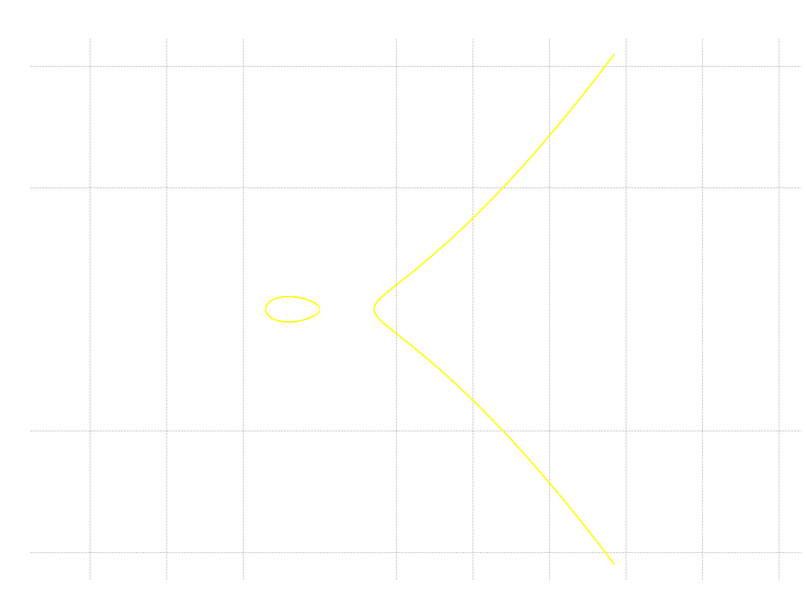
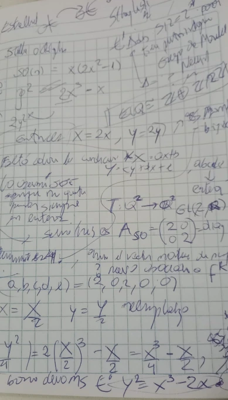

Otro nombre para el número figurado que tomaremos hoy es octaedro estrellado y que aparece también como figurado espacial en el libro de Elena Deza y Michel Deza [*Figurate Numbers* (2012)](https://www.worldscientific.com/worldscibooks/10.1142/8188). Y el resultado al que llegaré también ya se encuentra allí mencionado, específicamente en la página 120.

Algo curioso que me encontré leyendo, aparte del libro de cabecera, es que es como la versión tridimensional de lo que es un hexagrama (un número figurado plano). Bien, vamos.

> Para leer esta nota de forma natural, consultar debes la [nota común preliminar](https://edelveart.github.io/es/blog/divagaciones-diofanticas-entre-numeros-figurados-y-curvas-elipticas/). Allí está Tokio y en la nota anterior a esta serie también.

## La ecuación base

Para suerte mía, la *Stella Octangula* tiene una definición bastante simple, es una función polinómica con coeficientes enteros. Lo que trataremos de resolver es la ecuación diofántica

$$
S_4(v) = SO(w),
$$

donde
$$
SO(w) = w(2w^2 -1)
$$

Puedes calcularla con mi librería [figuratenum  en PyPI](https://pypi.org/project/figuratenum/), en el rango que elijas.

```python
from figuratenum import FigurateNum


stella_octangula = FigurateNum().stella_octangula()
print([next(stella_octangula) for _ in range(20)])

# [1, 14, 51, 124, 245, 426, 679, 1016, 1449, 1990, 2651,
#  3444, 4381, 5474, 6735, 8176, 9809, 11646, 13699, 15980]
```

## La curva elíptica de la estrella octángula

La ecuación de nuestra forma base es
$$
E_{SO}: y^2  = 2x^3 -x
$$
y es inmediato observar que necesitamos quitar el $2$ pegado a $y$. Así que, como en lectura a primera vista metemos el cambio de coordenadas

$$
P_{E'} = (X = 2x, Y=2y)
$$

Entonces, la matriz asociada a $A_{SO}$ es $\operatorname{diag}(2, 2) \in \operatorname{GL}(2, \mathbb{Q})$. Por ser diagonal, su determinante es solo el producto de esta diagonal principal, $4$ , por lo que es invertible y produce un isomorfismo en el plano afín de curvas elípticas sobre los racionales.

Entonces, $x = \frac{X}{2}$ e $y=\frac{Y}{2}$ que introducimos en la ecuación base

$$
\frac{Y^2}{4} = 2\left(\frac{X}{2}\right)^3 - \frac{X}{2}
$$
que es igual a $\frac{X^3}{4} - \frac{X}{2}$. Basta borrar los denominadores con la multiplicación por $4$ y llegamos a la curva necesaria

$$
E'_{SO} : Y^2 = X^3 -2X.
$$



Sobre $\mathbb{R}$ la gráfica también tiene un huevito y ramas infinitas, es decir posee dos componentes conexas.

### Puntos enteros y grupo de Mordell-Weil

Aparece en LMFDB en el modelo

- [LMFDB label 256.b1 | Cremona label 256b1](https://www.lmfdb.org/EllipticCurve/Q/256/b/1)

Su grupo de Mordell-Weil es cíclico de orden dos en torsión y la parte libre de rango $r=1$, es decir $E'_{SO} \cong \mathbb{Z} \oplus \mathbb{Z}/2\mathbb{Z}$.

A lo que vinimos es a ver los puntos enteros que son finitos siempre por el teorema de Siegel $\# E(\mathbb{Z}) < \infty$.
Cito los **siete puntos** de $E'_{SO}(\mathbb{Z}) = \{​(−1,1),(−1,−1),(0,0),(2,2),(2,−2),(338,6214),(338,−6214)\}$.

Lo que buscamos en todas estas notas son los puntos de $E_{SO}$, cuyas coordenadas cumplan simultáneamente el filtro de paridad mediante las congruencias

$$
P_j = (X \equiv 0 \bmod{2}, Y \equiv \bmod{2})
$$
Y, ya para no repetir la tabla, los únicos que quedan al volvere a las coordenadas originales (dividir entre $2$ o aplicar la matriz $A_{SO}^-1 a (X, Y)$). Este juego que replicamos en las notas anteriores, nos suelta

$$
E_{SO}(\mathbb{Z}) = \{ (0, 0), (1, \pm 1), (169, \pm 3107)\}.
$$
Pero, como imponemos la positividad, $x, y > 0$, solo quedan dos puntos. Así que tenemos el siguiente corolario que responde lentamente a nuestra pregunta al inicio de este huarique.

> $\textbf{Proposición}$. Los únicos números figurados estrellados octaédricos  $SO(w)$ y cuadrados $S_4(v)$ a la vez son $1$ y $9,653,449$.

Lo escribo con comas para que se vea separado a la vista; el porqué está nuevamente en el teorema de finitud de Siegel y el cruce con **LMFDB**. $\square$


<figcaption class="not-prose text-neutral-content text-sm mb-8 text-center">
    <em>Mi cuaderno cuadriculado mientras pienso en la Stella Octangula.</em>
</figcaption>

## Lo suficiente es esquivar racionales en el envío

En todas las transformaciones lineales o afines que hemos hecho, el cambio de coordenadas ha tenido, de manera subyacente y oculta, una forma de este tipo

$$
X = ax + b , \quad Y = cy + dx + e,
$$

donde cada una de las no vocales $ (a, b,c,d,e)$ es un **coeficiente entero**. Como recuerdas, las entradas de las matrices $A_{O}, A_{S_3^3}$ tenían coeficientes enteros. Aquí, podríamos escribir un posible vector asociado $V_{SO}= (2, 0, 2, 0 ,0 )$. Tengo que pensarlo.

Esta última exigencia de integralidad es
> **suficiente para que no se nos escape algún punto entero** en la curva elíptica en forma de Weierstraß; es decir, para que enviemos todos los puntos enteros de $E$ en la curva elíptica isomórfica $E'$.

Así, podremos recuperar con exactitud el conjunto de puntos en $\mathbb{Z}^2$ al aplicar el filtro modular sobre $E'$ y, luego,  la transformación inversa $A_{\mathfrak{f}^3}^{-1}$, como solemos hacer.

Antes de que se me olvide, tengo un *spoiler*. Dije **suficiente y no necesaria** porque, si ponemos las no vocales como racionales, puede pasar (¿cuándo, cuándo?) que la transformación envíe todos los puntos enteros de una curva concreta $E$ hacia $E'$, aunque este juguete no lo encontrarás en todas las tiendas matemáticas.

Nos vemos en la siguiente nota figurada con más puntillismo sobre curvas.


