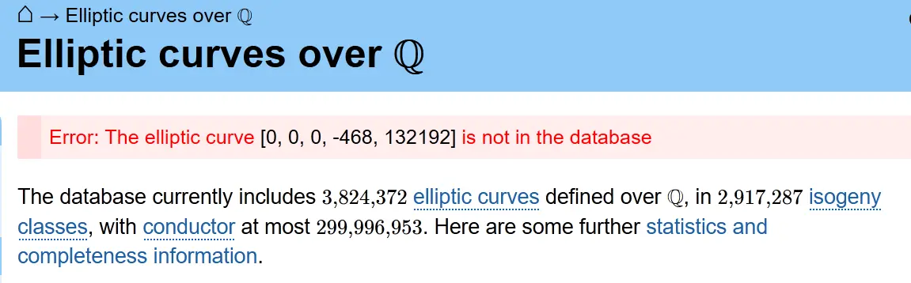
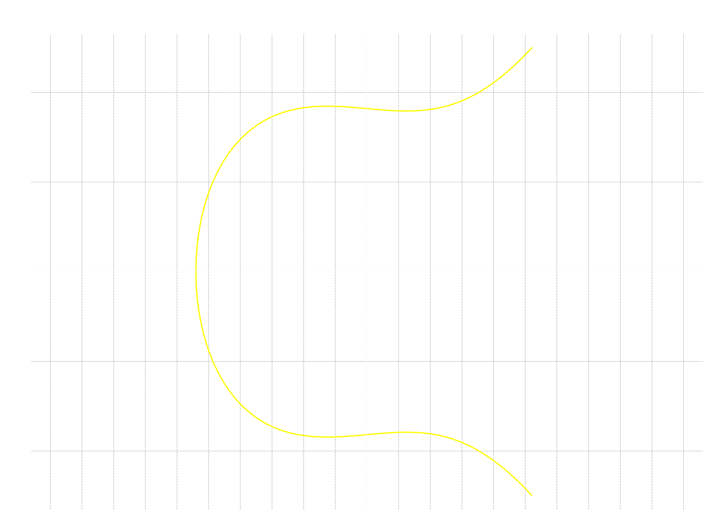
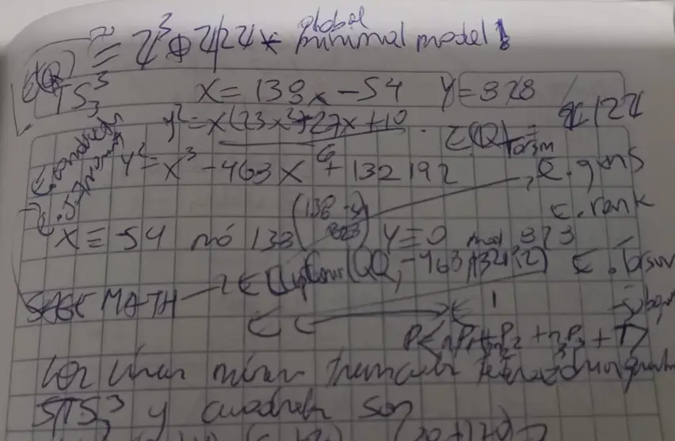

Hasta la **V nota** había tenido todo a la mano, ahora veremos que hay que pedir cuerda trenzada a herramientas conexas. Hoy solo tocaré los números tetraédricos truncados $\mathfrak{f}^3(n) = TS_3^3(n)$, en la curva elíptica asociada para resolver la ecuación diofántica como siempre sobre $\mathbb{Z}$. Es decir,

$$
E_{TS_3^3}: y^2 = \frac{x(23x^2-27x+10)}{6}.
$$

> Para leer esta nota de forma natural, consultar debes la [nota común preliminar](https://edelveart.github.io/es/blog/divagaciones-diofanticas-entre-numeros-figurados-y-curvas-elipticas/). Allí está el origen de estas divagaciones y en las cinco notas previas también. El libro estrella: [*Figurate Numbers* (2012)](https://www.worldscientific.com/worldscibooks/10.1142/8188)
>
> Para calcular las secuencias en los fragmentos de código de mis notas, usa mi librería [`figuratenum` en PyPI](https://pypi.org/project/figuratenum/)

Antes de empezar, debes saber que seré bastante más suscinto en mis explicaciones, con el propósito de evitar la redundancia de lo que ya vimos y por sinrazones de premura.

## La transformación afín en homogéneas

Los números truncados tetraédricos $TS_3^3(n)$ los generas así  como verás a continuación. Asegúrate de instalarlo primero con `pip install figuratenum`.

```python
from figuratenum import FigurateNum

truncated_tetrahedral = FigurateNum().truncated_tetrahedral()
print([next(truncated_tetrahedral) for _ in range(200)])
# [1, 16, 68, 180, 375, 676, 1106, 1688, 2445, 3400, 4576, 5996,
# 7683, 9660, 11950, 14576, 17561, 20928, 24700, ... ]
```
Bien, la transformación afín $T$ (no la confundas con lo truncado) para crearle un clon en la forma de Weierstraß a $E_{TS_3^3}$ es algo grande en sus entradas, la saqué con algo de tiempo, la verifiqué con código y se define mediante la matriz de coordenadas homogéneas

$$
A_{TS_3^3} =  \begin{pmatrix}
138 & 0 & -54 \\
0 & 828 & 0 \\
0 & 0 & 1 \\
\end{pmatrix}
$$

que induce un cambio de variables en los puntos racionales de la curva elíptica (envía inyectivamente los puntos integrales) como $x= \frac{X+54}{138}$,  $y = \frac{Y}{828}$. Con un momento de inspiración algebraica, la sustitución a medio tiempo queda expresada en la curva

$$
E'_{TS_3^3}: Y^2 = X^3 - 468X + 132192.
$$

Voy a buscar inmediatamente en la **LMFDB**, pero aparece este aviso descorazonador en primera instancia



Bien, puesto que falta revisar sus invariantes, llamaré al rotomartillo ultrapercutor rompepavimento de curvas elípticas. En palabras simples y no tan comunes, llamaremos a **SageMath**.

Pero antes, la gráfica, de la que también sale que tiene discriminante no nulo, nos cuenta pictóricamente que es una curva elíptica.



## Los tetraédricos truncados con SageMath

Para resolver la incógnita de no tener un enlace a una página web para observar los detalles aritméticos de la curva, será suficiente ejecutar unos cuantos fragmentos dentro de una celda

- [`sagecell` en SageMath.org](https://sagecell.sagemath.org/)

La manera en que opera SageMath es muy intuitiva, con **nombres de métodos muy semánticos** también.
Gran parte de mis comprobaciones computacionales y `tests` de mi otra librería sobre formas modulares y curvas elípticas para crear algorítmicamente música en Sonic Pi, las hice con SageMath (véase [modular_forms en RubyGems](https://rubygems.org/gems/modular_forms)).

Bien, pues crearé una curva elíptica `EllipticCurve([A, B])` y le pediré prácticamente como en un **restaurante la carta de sus invariantes**.

```py
E = EllipticCurve([-468, 132192])

print("Curva:", E)
print("Discriminante:", E.discriminant())
print("Conductor:", E.conductor()) # factorización: factor(E.conductor())
print("Invariante j:", E.j_invariant())

Emin = E.global_minimal_model()

print("\nModelo mínimo:")
print(Emin)
print("Coeficientes a-invariants:", Emin.ainvs())
```

Lo que saldrá por `consola` será

```shell
Curva: Elliptic Curve defined by y^2 = x^3 - 468*x + 132192 over Rational Field
Discriminante: -7542520934400
Conductor: 12651840
Invariante j: -3796416/2525975

Modelo mínimo:
Elliptic Curve defined by y^2 = x^3 - 468*x + 132192 over Rational Field
Coeficientes a-invariants: (0, 0, 0, -468, 132192)
```

Coloqué también el **modelo mínimo** para asegurarme de que **no existe** un modelo equivalente más simple (de discriminante menor); porque algunas curvas que sí estaban en LMFDB, cuando las busqué mediante coeficientes, estos se **reducían a valores más pequeños** y por lo tanto, a una curva elíptica equivalente (me salió con rima sin querer).

> Aquí volví a probar la búsqueda directamente con el conductor $N$ y con el $j$-invariante, pero tampoco apareció nada.

## El grupo de Mordell-Weil de los tetraédricos truncados

Es la hora de calcular el grupo de Mordell-Weil y, por supuesto, los puntos enteros. Le agrego un poco de verificación a las cosas, aunque podría hacerse sin ello. Escribí también una especie de $\mathbb{QQ}$ debido a la sintaxis, nada cambia si no lo coloco, pero es para mantenerme en mente con los racionales.

```py
E = EllipticCurve(QQ, [-468, 132192])
# Rango
r = E.rank(proof=True)
print("Rango:", r)

# Generadores de la parte libre
G = E.gens(proof=True)
print("Generadores:", G)

# Certificación de los generadores
print("Generadores certificados:", E.gens_certain())

# Subgrupo de torsión
T = E.torsion_subgroup()
print("Grupo de torsión:", T)
print("Orden de la torsión:", T.order())
print("Generadores de torsión:", T.gens())
```

Lo que imprimirás por `consola` serán puntos en coordenadas homogéneas,

```py
Rango: 3
Generadores: [(-44 : 260 : 1), (-24 : 360 : 1), (-8 : -368 : 1)]
Generadores certificados: True
Grupo de torsión: Torsion Subgroup isomorphic to Z/2 associated to the Elliptic Curve defined by y^2 = x^3 - 468*x + 132192 over Rational Field
Orden de la torsión: 2
Generadores de torsión: ((-54 : 0 : 1),)
```

Listo, con esto puedo y podemos ya describir el isomorfismo de grupos para la curva que encarna la ecuación diofántica que quiero resolver. Primero, tiene rango $r= 3$, curiosidad aquí y no aparte, porque es la curva de mayor rango que me he topado hasta esta nota. Sus puntos generadores en la parte libre son $(-44,260), (-24,360)$ y $(-8,-368)$. Asimismo, presenta el punto $T= (-54,0)$ de orden dos  ($2 T = \mathcal{O}$) que genera el subgrupo de torsión.
Así que el grupo de Mordell-Weil que hila los puntos es
$$
E'_{TS_3^3}(\mathbb{Q}) \cong \mathbb{Z}^3 \oplus \mathbb{Z}/2\mathbb{Z}
$$

> Quiero recordar nuevamente la idea de este grupo. Sea $P$ un punto cualquiera con coordenadas racionales sobre la curva $E'$, entonces, $P = n_1P_1 + n_2P_2 + n_3P_3 + T$,  donde cada $n_j$ es entero y ese $T$ es un punto de torsión (el neutro $\mathcal{O}$ o el $(-54,0)$). De hecho, ya llevo tres significados de $T$.

## Los puntos enteros al final

Al fin la sección de la nota que seguro esperabas. Calcularé todos los puntos enteros que arroja SageMath para nuestra curva. Te pregunto, ¿habrá un método más expresivo y matemático que `E.integral_points`?

```py
E = EllipticCurve(QQ, [-468, 132192])

G = E.gens(proof=True)
assert E.gens_certain()

puntos = E.integral_points(
    both_signs=True,
    mw_base=G
)

print("E'(Z) = ", (puntos))
print("puntos totales: ", len(puntos))
```

La lista es relativamente grande respecto a anteriores curvas, con un total de $\# E'_{TS_3^3}(\mathbb{Z}) = 39$ puntos enteros. La lista completa la copio aquí debajo, pero debes deslizar al máximo a la derecha para verla.

```py
E'(Z) =  [(-54 : 0 : 1), (-51 : -153 : 1), (-51 : 153 : 1), (-44 : -260 : 1), (-44 : 260 : 1), (-24 : -360 : 1), (-24 : 360 : 1), (-8 : -368 : 1), (-8 : 368 : 1), (6 : -360 : 1), (6 : 360 : 1), (18 : -360 : 1), (18 : 360 : 1), (42 : -432 : 1), (42 : 432 : 1), (61 : -575 : 1), (61 : 575 : 1), (84 : -828 : 1), (84 : 828 : 1), (93 : -945 : 1), (93 : 945 : 1), (126 : -1440 : 1), (126 : 1440 : 1), (222 : -3312 : 1), (222 : 3312 : 1), (436 : -9100 : 1), (436 : 9100 : 1), (594 : -14472 : 1), (594 : 14472 : 1), (774 : -21528 : 1), (774 : 21528 : 1), (1029 : -33003 : 1), (1029 : 33003 : 1), (2706 : -140760 : 1), (2706 : 140760 : 1), (3576 : -213840 : 1), (3576 : 213840 : 1), (38632 : -7593128 : 1), (38632 : 7593128 : 1)]
```

Perfecto, pero como en las notas anteriores, la función afín me aseguró que los puntos con coordenadas enteras se enviarán de $E$ hacia $E'$; en esta última curva transformada puede haber más, que aunque enteros, en el retorno a casa, quizás no vuelvan como enteros.
Por lo que, aplicamos el filtro modular $ X \equiv 54 \pmod{138}$ y para la segunda coordenada, $Y \equiv 0 \pmod{828}$.

Aunque un poco repetitivo, vuelvo a escribir prácticamente todo con los filtros mediante el operador `%`,  para que sea sencillo recordar.

```py
E = EllipticCurve(QQ, [-468, 132192])

G = E.gens(proof=True)
assert E.gens_certain()

puntos = E.integral_points(
    both_signs=True,
    mw_base=G
)

print("Cantidad de puntos enteros de E':", len(puntos))

puntos_originales = []

for P in puntos:
    X = ZZ(P[0])
    Y = ZZ(P[1])

    if (X + 54) % 138 == 0 and Y % 828 == 0:
        x = (X + 54) // 138
        y = Y // 828
        puntos_originales.append((x, y))

print("Puntos que pasan el filtro modular:", len(puntos_originales))

for p in puntos_originales:
    print(p)
```

Por acortar la nota dado que ya hemos hecho muchas veces este marco procedimental, también introduje la transformación inversa $T^{-1}$, $(X, Y) \longmapsto \left(\frac{X+54}{138}, \frac{Y}{828}\right)$, en el código de arriba (recuerda que $T$ es $X = 138x-54$, $Y=828y$).
De los $39$ puntos enteros, solo perduraron un subconjunto de nueve puntos $S \subseteq E'(\mathbb{Z}) $  y que con $T^{-1}$ me imprimieron las coordenadas en la curva original

$$
\begin{aligned}
E_{TS_3^3}(\mathbb{Z}) = \{&(0, 0), (1, -1), (1, 1),\\
&(2, -4), (2, 4), (6, -26),\\
&(6, 26), (20, -170), (20, 170)\}.
\end{aligned}
$$

## El corolario

Para cerrar, es menester recordar que la ecuación diofántica que quise resolver con enteros $v$ y $w$ en la marcha elíptica es
$$
S_4(v) = TS_3^3(w).
$$

Como ya tenemos los puntos listados, elevo al cuadrado la coordenada de ordenadas y tenemos ya el siguiente corolario (me salió con rima asonante)

> $\textbf{Proposición}$. Los únicos números tetraédricos truncados $TS_3^3(w)$ y cuadrados perfectos $S_4(v)$ a la vez son $1$, $16$, $676$ y $28900$.
>

La prueba deviene de la finitud de puntos integrales del teorema de Siegel y de la lista exhaustiva y certificada que calcula SageMath con `integral_points`. $\square$

## Pase de abordaje diofántico

El caso diofántico con el número figurado truncado $TS_3^3(n)$ llega en buena hora, al lonchecito. Por un instante, me dio algo de desazón mental el ver que no encontré esta curva elíptica en LMFDB luego de calcular su $j$-invariante con mi otra librería y hacer la búsqueda en la base de $L$-funciones y formas modulares nuevamente sin hallarla. Como ya estaba con `modular_forms`, pensé,

> ¿qué inconveniente tendría expandir las herramientas a una interfaz bastante amigable y potente, como lo es SageMath con las curvas elípticas $E/\mathbb{Q}$?


<figcaption class="not-prose text-neutral-content text-sm mb-8 text-center">
    <em>Mi cuaderno cuadriculado mientras recuerdo algunos métodos para invariantes y grupos de curvas elípticas con SageMath.</em>
</figcaption>

Toda la VI nota ha sedimentado en mi idea diofantina ciertos fragmentos de SageMath, de tal manera que, en lo sucesivo, traeré la misma pócima para curvas elípticas sin página web, hasta los días presentes.
