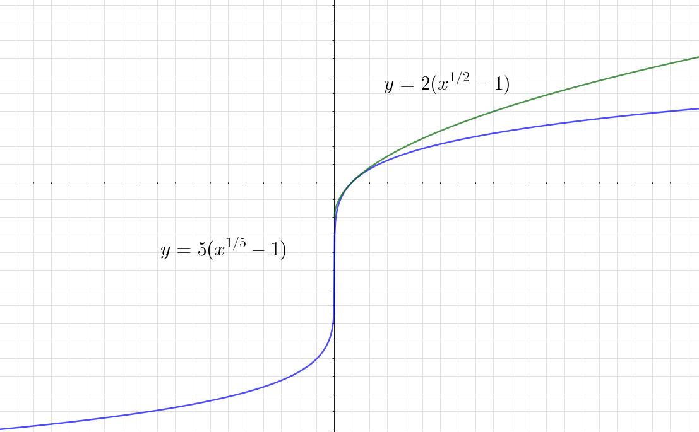
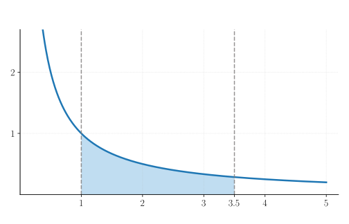
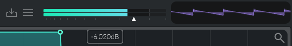
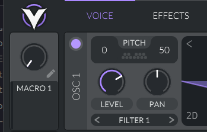
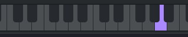
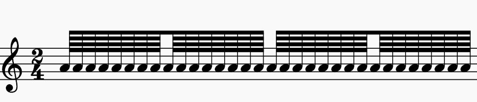

Es natural escuchar hablar de decibelios $\text{dB}$ en cualquier estudio de grabación, de hecho en cualquier etapa de la producción. Como sabemos, los decibelios están basados matemáticamente en algo llamado logaritmo.
Entonces, me propuse pensar qué entiendo por logaritmo de una forma ligeramente demorada y abstraerla para algunas **aplicaciones musicales** que llaman a esta función. De paso, tendremos un par de cosas para un sintetizador digital.

Por cierto, obviaré toda la parte histórica y también las interpretaciones físicas, que abundan en múltiples lugares. Me centraré sobre todo en abstraer la idea.

## La familia de curvas

El logaritmo $\ln = \log_e$ real es una función inversa a la exponencial, nos dicen muchos textos. Mas quise llegar al logaritmo como un objeto geométrico, en parte por mi gusto por las cuestiones aritméticas de curvas elípticas y tópicos comunes del álgebra.

Mi primera aproximación fue valerme de las raíces enésimas y pensar en el logaritmo real a partir de una familia de curvas
$$
L_n: y_n = n(\sqrt[n]{x} - 1).
$$

Obviamente, para iniciar tomé un entero $n \ge 2$. No es difícil hallar una familia evidente de puntos enteros (no todos) de esta curva bajo la forma
$$
P=(x,y) = ((k+1)^n, kn)
$$
con $k \ge -1$ si $n$ es par y $k$ cualquier entero cuando $n$ es impar. Esto se deduce de las propiedades de las raíces reales.
Asimismo, con respecto a la recta vertical, $L_n$ cruza el eje $y$ exactamente en el punto $P = (0, -n).$

## Límite de la aritmética

El siguiente paso es considerar valores cada vez más grandes de $n$. Cuando $n$ es impar, por el lado derecho ($x > 0$) la gráfica se aproxima a la función logaritmo, mientras que por el lado izquierdo ($x < 0$) se escapa cada vez más hacia abajo (decrece sin límite) a medida que $n \rightarrow \infty$.

Dicho esto, volvamos y tomemos $L_n(x)$ como función y traigamos la noción de límite. En síntesis de sonido para no escribir infinito tenemos lo siguiente

$$
\lim_{n \rightarrow \infty} L_n(x) = \ln(x), \ x > 0.
$$

En el caso $n$ par, la función converge a $\ln(x)$ cuando tomamos el lado derecho, con $x= 0$ llegamos a $-\infty$ y el lado izquierdo no se cuenta, es decir, la función no está definida para $x < 0$ en los reales.

Antes de continuar, si ahora lo que hacemos es intercambiar las coordenadas $L_n(\mathbb{Z})$ a modo de juego, es decir,
$$
(x,y) \mapsto (y, x),
$$
aparecen naturalmente los puntos enteros, reflejamos respecto de la recta $y=x$, de una familia de funciones que también puede aproximar la exponencial.
En ambos casos, usamos el mascroscopio de aproximar una función mediante una familia de curvas plana, a través de la convergencia puntual.
Suficiente sobre este lado del mirador.

## El área de una cónica

En segunda instancia mi aproximación fue pensar el logaritmo que nace de una hipérbola unitaria

$$
H(\mathbb{R})= \{ (x, y) \in \mathbb{R}^2 \mid xy=1 \}
$$

Si tomamos el lado positivo, la rama con $x > 0$ que se encuentra en el primer cuadrante, y la pensamos con una función $y= \frac{1}{x}$, lo que vamos a hacer es integrar
$$
\int_1^{x} \frac{1}{t}dt, \ x \in \mathbb{R}^+,
$$
cuyo resultado se reduce nuevamente a $\ln(x)$.

En el gráfico, elegí el punto $x=\frac{7}{2}$.

Por otra parte, ¿qué pasaría si el intervalo comprendido por $x$ es $]0, 1[$? Simplemente cambiamos el orden y colocamos el signo $-$ (por la propiedad de integrales). Lo que nos queda de esta manera
$$
- \int_{x}^{1}\frac{1}{t}dt.
$$

Y la función resultante arroja $ \ln(x) < 0$. De hecho, cabe reescribir la integral como el límite (por sumas de Riemann)

$$
\lim_{n}\sum_{k=1}^n \frac{x-1}{n+k(x-1)}.
$$
Por izquierda, lo único que cambia son los índices. En otras palabras, los índices van de $k=0$ hasta $n-1$; mucho más al gusto de un arreglo computacional.

> ¿Qué condiciones debe cumplir mi figurita diferente a un rectángulo para que pueda aproximar un área mediante sumas infinitesimales?

## Hacia el logaritmo musical

¿Para qué tanto floro con esto? Pues en la música, además de los decibelios (en sus diferentes tipos que no veremos aquí), los cents y las notas de un teclado MIDI forman la cancha de los logaritmos. A decir verdad, lo que haremos es mover unos cuántos parámetros y listo, bastará interpretarlos en su entorno necesario, desde lo físico hasta lo digital.

Sin más, te invito al desfile de la función musical con parámetros $A \in \mathbb{R}^+$, $b > 0$ con $b \neq 1$, $m_0, m > 0$ y $C \in \mathbb{R}$.

$$
\Lambda_b^{C}\left(\frac{m}{m_0}\right) = \dfrac{A}{\displaystyle \left(\int_1^{b} \frac{1}{u} du\right)} \int_1^{\frac{m}{m_0}} \frac{1}{t} dt + C
$$
Un ratio es lo que ves y algo más. Observa que $m$ es la variable que mueve el bote. De aquí se desprende la propiedad

$$
\Lambda_b^{C}\left(b \frac{m}{m_0}\right) - \Lambda_b^{C}\left(\frac{m}{m_0}\right) = A.
$$

En palabras simples y sencillas, la salida aumenta $A$ si multiplico la razón de entrada por $b$.

### Decibelios

Volvemos a la interpretación desde arriba, los decibelios de escala completa, $m_0$ es la amplitud máxima que va a permitir nuestro sistema digital, mientras que $m$ es la amplitud pico de la señal que se quiere medir. En audio digital normalizado es común tomar $m_0=1$.

$$
\Lambda_{\text{dBFS}} = \dfrac{20}{\displaystyle \left(\int_1^{10} \frac{1}{u} du\right)} \int_1^{\frac{m}{1}} \frac{1}{t} dt
$$
Por supuesto, hay que concretar la misma escala de amplitud. Vamos Vital, arriba a la derecha aparece un medidor de pico digital.

La flecha que indica $-6.020\text{dB}$ corresponde a un nivel de ganancia configurado. Listo, el siguiente caso tiene que ver con afinación.

### Cents

¿Cuántas octavas hay entre dos frecuencias $f_0$ y $f_1$? O incluso mejor, ¿cuán pequeño puedo hacer mis intervalos para que existan $A=1200$ pasos en una octava? Los cents también son un caso especial con valores fijos de $A$ y $b$ ($A=1200$, $b=2$), donde $m$ y $m_0$ cumplen el rol de frecuencias en $\text{Hz}$.

$$
\Lambda_{\text{Cents}} = \dfrac{1200}{\displaystyle \left(\int_1^{2} \frac{1}{u} du\right)} \int_1^{\frac{f_1}{f_0}} \frac{1}{t} dt
$$
Si establecemos $A=1$, retomamos el número de octavas. En un semitono hay $100$ pasos. Esto lo puedes ver en el sintetizador Vital en el espacio al lado derecho dentro de *PITCH*, subimos o bajamos el *TUNE* un cuarto de tono.

Vamos con el mapeo casi universal de muchos instrumentos digitales.

### MIDI

Bien, el MIDI es el protocolo por excelencia (aunque salgan muchos más, como OSC) para comunicarse entre ordenador y otros instrumentos. ¿Cómo convierte el ordenador, al presionar una tecla discreta en el piano, esa nota en una frecuencia o viceversa? También las notas MIDI son un caso especial de $\Lambda$. La base es $b=2$ y la frecuencia de referencia $m_0 = f_0$ puede variar en relación con el parámetro $C$ de desplazamiento.

Seleccionemos el archiconocido $\text{A}=440\text{Hz}$. Hacemos

$$
\Lambda_{\text{MIDI}} = \dfrac{12}{\displaystyle \left(\int_1^{2} \frac{1}{u} du\right)} \int_1^{\frac{f}{440}} \frac{1}{t} dt + 69
$$

En efecto, es la nota $\text{A} \mapsto 69$. Te la repito en semifusas para que la recuerdes.

¿Qué otra cosa esperabas?

## Otras representaciones

Anteriormente había desarrollado en varios posts, que puedes ver, sobre [la tangente hiperbólica real](https://edelveart.github.io/blog/ensalada-real-de-la-tangente-hiperbolica-de-sonic-pi/) y luego en una serie de notas sobre la tangente hiperbólica compleja y su relación con la función sigmoide en tres partes: [1](https://edelveart.github.io/blog/circuiteria-de-variable-compleja-i/), [2](https://edelveart.github.io/blog/circuiteria-de-variable-compleja-ii/), [3](https://edelveart.github.io/blog/circuiteria-de-variable-compleja-iii/).

Bien, también hay posibilidad de decir $\ln(x)$ si tomamos la integral que define a $\operatorname{artanh}$, que también proviene de una curva hiperbólica. Como la observé es simplemente una transformación algebraica desde la hipérbola unitaria
$$
\begin{gathered}
y = \frac{1}{x}\\[6pt]
\downarrow\\[6pt]
y = \frac{1}{1-x}\\[6pt]
\downarrow\\[6pt]
y = \frac{1}{1-x^2}
\end{gathered}
$$

La integración produce $\operatorname{artanh}(z) = \int_0^{z} \frac{1}{1-t^2} dt$. Como ves, admitimos solo el dominio $]-1, 1[$ para la $z$. Así, el logaritmo puede representarse como la integral
$$
\ln(x)=2\int_0^{\frac{x-1}{x+1}}
\frac{dt}{1-t^2},
\qquad x>0.
$$

Listo, garantizamos que el límite superior esté en eso admitido. Prueba a reescribir $\Lambda$ en esta forma.

## Como ecuación diferencial ordinaria (EDO)

Otra de las maneras en que contemplé el logaritmo, nace nuevamente de la geometría. Es sencillamente agregar una $'$. Observa, planteo la transformación mediante substituir $y$ por su derivada $y' = \frac{dy}{dx}$ desde la hipérbola

$$
xy = 1 \mapsto xy'= 1,
$$
con una condición inicial $y(1)=0$. Quedamos en que se trata de una ecuación diferencial ordinaria lineal de primer orden no homogénea, en un dominio $x \neq 0$.

> Dejaré la serie de Taylor del logaritmo para otro momento, porque merece un tratamiento especial, para ver desde dónde lo saco a la manera de un mago que sabe el truco que todos saben, pero haciéndolo en cámara lenta.

## Coda musical y logarítmica

Probablemente sepas varias aplicaciones más para $\Lambda$ en el mundo del audio y la música. En algún punto de estas notas, quizás las toque a modo de vista cenital, como lo he hecho aquí con los cents, los decibelios y el MIDI.

Para terminar, solo quiero decir que casi todo el ambiente logarítmico está perfumado por un aroma multiplicativo. Algebraicamente, el logaritmo traduce multiplicaciones en sumas. La conocida identidad que sirve para calcular a primera vista
$$
\ln(xy) = \ln(x) + \ln(y)
$$
expresa justamente que $\ln$ es un morfismo de grupos. Con los reales se cumple
$$
\ln: (\mathbb{R}_{>0}, \cdot) \longrightarrow (\mathbb{R}, +),
$$
que es, además, biyectivo (un isomorfismo), como intuitivamente intercambiamos las coordenadas de puntos para tomar el aroma aritmético de la exponencial.
