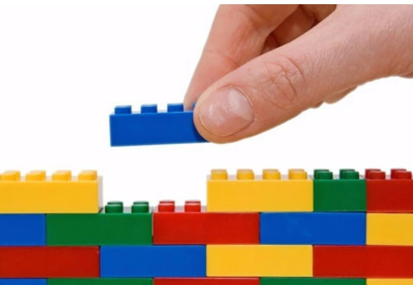
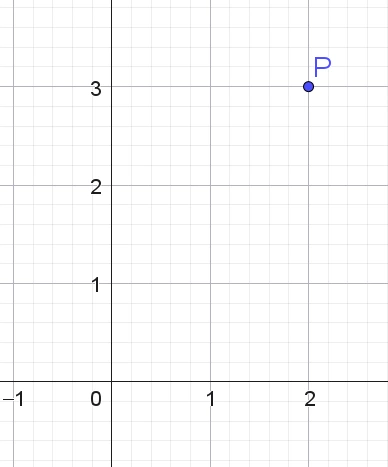
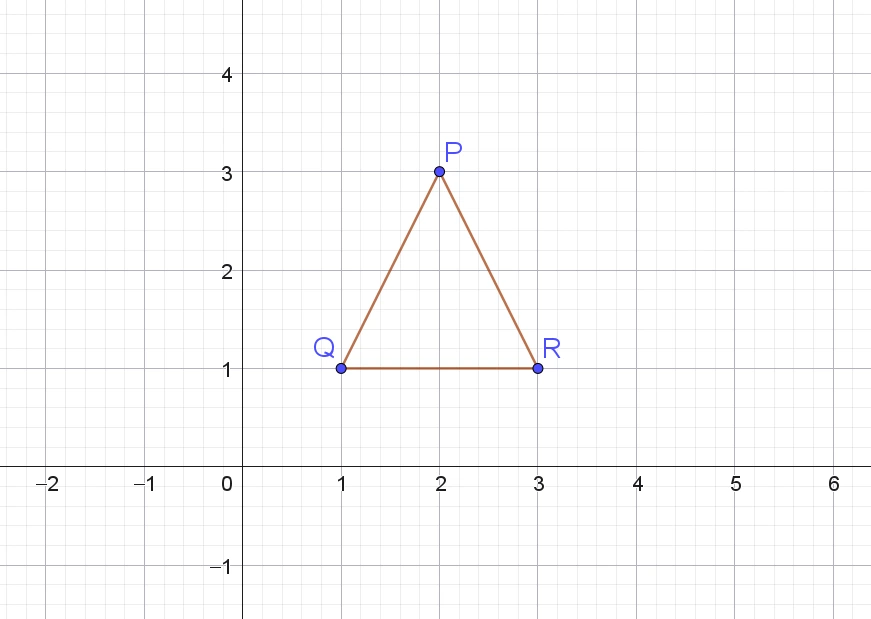
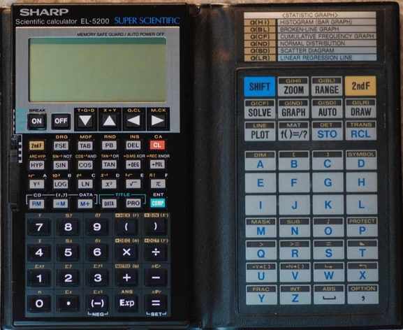
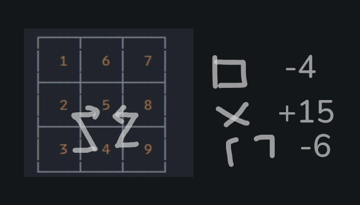
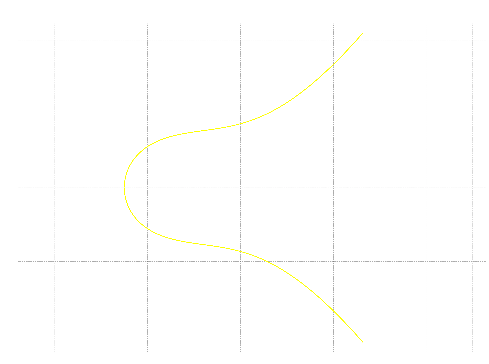
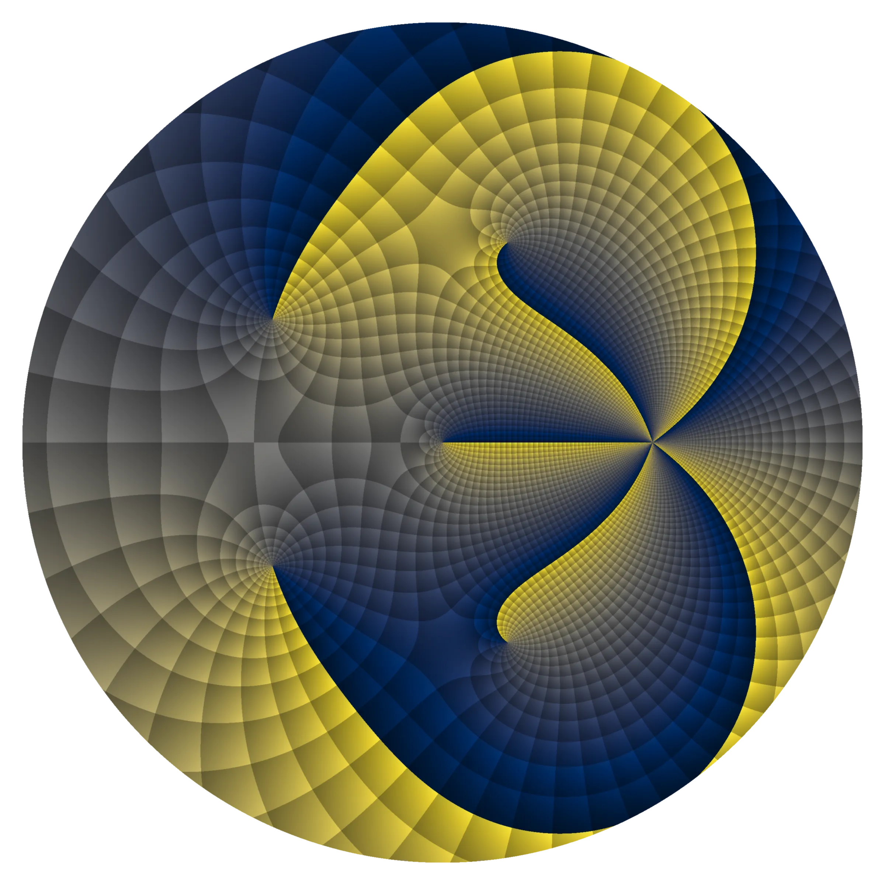

> A mí nunca me gustaron ni me interesaron las matemáticas en la escuela más que cualquier otro curso, **salvo una única idea y el juego que me inventé**.

La frase de arriba es un resumen personal de las matemáticas que vi en el colegio. Esta nota va para algunos amigos que me han preguntado por qué me gustan los números y las matemáticas, si son tan difíciles o, incluso, terribles, en el buen sentido de no saber qué hacer frente a un trinomio cuadrado perfecto. Pues voy a contar un posible porqué desarrollo [bibliotecas de software](https://edelveart.github.io/projects/) que hacen matemáticas para la música y el live coding.

Estás cordialmente invitado a lo que fue mi fiesta de promoción de primaria. Debo aclarar que no hablaré de álgebra ni de cosas difíciles, así que puedes entender esta nota sabiendo solo la matemática de escuela primaria (salvo en la última sección, donde me permito un par de palabras quizás más propias de la adultez).

Axioma primero a considerar:

> Mis profesoras de matemáticas en primaria fueron excelentes, así como mi profesor de secundaria. Realmente se preocuparon por nosotros como aprendices y personas. Nunca fui un alumno excepcional en matemáticas (como sí lo fueron varios amigos). No obstante, tampoco fui malo resolviendo cosas, simplemente los contenidos no llegaron a captar mi atención más allá de las horas de clase.



<figcaption class="not-prose text-neutral-content text-sm mb-8 text-center">
    <em>Jugué muchas horas con estos bloques de construcción llamados PLAYGO. Foto tomada de PIXABAY</em>
</figcaption>


## El aburrimiento

Recuerdo que, de niño, **nunca estuve especialmente interesado en las matemáticas**. En la escuela pública de mi país, Perú, la recuerdo como cualquier otra asignatura, como ciencias, donde tenías que armar tu maqueta de la célula, o como lenguaje, donde tenías que identificar el objeto indirecto de una oración. En aquellos años, la mayor parte de mi tiempo fuera de la escuela, además de hacer música y danzar, **solía pasarla leyendo** mi Atlas de Geografía e Historia y varios libros de ciencia que me regalaron por Navidad.

En el colegio, recuerdo con claridad que había que resolver sumas y aprender a llevar el $1$, en adiciones como esta

$$
\begin{array}{rr}
  & 13 \\
+ & 9 \\
\hline
  & 22
\end{array}
$$

Luego subieron a tres cifras, y así también con la multiplicación $\times$ y la división $\div$. Una vez que conocí el algoritmo, me pareció bastante trillado repetirlo constantemente.

En los exámenes solía ser medianamente preciso y, a veces, muy bueno. Entendía el algoritmo aritmético, pero muchas de las tareas parecidas a estas sumas que me dejaban simplemente no las hacía. Solo prestaba atención durante el horario de clase y esa era toda la matemática que conservaba conmigo. La mayor parte de las tareas las hacía en el aula.

Recuerdo que, al volver del colegio, sí le dedicaba un muy buen tiempo a jugar con mis bloques de *PLAYGO* y, posteriormente, a mi **trompo**, con el que me fascinaba hacer la voladita (en el parque o en el recreo).

> Una de las actividades que solían dejar en el salón de clase y que me aburría de sobremanera era, por ejemplo, determinar en cuántos días construía una casa determinada cantidad de albañiles (un problema de regla de tres simple inversa). Me parecía totalmente irrelevante y sin sentido.

Con esta anécdota de la regla de tres me doy cuenta de que **me aburrían** algunas cosas del mundo real, es decir, una **matemática aplicada** elemental. Me parecían poco interesantes las cuestiones que tienen que ver con el tiempo, como  calcular que, a más albañiles, la casa se construye en menos días o que, por el contrario, con menos albañiles, la edificación demora más días en erigirse.

Por supuesto, pensaba en otras variables que el problema no contemplaba y que tampoco pregunté, como que alguno pudiera faltar o llegar tarde a la construcción, o que se le malograra su bicicleta a medio camino.

## Segundo de primaria y las figuras

Bueno, ahora sí viene la parte innata, y va justo a **contracorriente** de eso que se dice de que las **matemáticas para la vida diaria** son las que más pueden interesar y motivar a aprenderlas.
En ese entonces, como niño, las matemáticas, al igual que las otras asignaturas y sus temarios, eran simplemente focos de **averiguación posterior en libros** o **atención exclusiva durante el horario del colegio**, más allá de que fueran útiles o de que pudiera imaginarlas representando alguna actividad de la vida cotidiana.

> Tampoco encontré interesantes los problemas sobre tiempo y distancias entre ciudades cuando se viaja en un vehículo.

De todos los temas que me enseñaron en primaria, el único que me pareció interesante fue el del **plano cartesiano**. Me enseñaron que dados dos números naturales ($1,2,3, 4,5,6,7,8 \ldots$), por ejemplo,
$$
(2, 3)
$$

los puedes **dibujar** en el plano, donde debes hallar el punto donde coincidan el $2$ de la recta horizontal y el $3$ de la recta vertical. Te muestro en la figura el punto $P=(2,3)$,


¿Y qué tiene de interesante esto, seguro preguntas? Pues en las clases nos dejaron como un **acto de magia** el colocar varios puntos (coordenadas) en el plano y luego dibujar unos segmentos de recta para unirlos y ver qué figura se formaba. No recuerdo exactamente cuáles eran las coordenadas, pero supongamos que si $P=(2,3)$, $Q=(1,1)$ y $R=(3,1)$, al pintar la figura tengo



Mi profesora no exigió precisar nada sobre si era un triángulo equilátero o isósceles; simplemente era un triángulo y fue suficiente. Creo que fue formidable que fuera así. Al mirar hacia atrás, me doy cuenta de que, al no pensar en esas cuestiones, pude capturar la idea más importante del plano cartesiano de **manera ingenua**.

A un par ordenado de números que forman lo que llamamos un punto $P= (x,y)$ y que viven sin espacio (existen de manera abstracta), uno puede descubrirle un significado geométrico al representarlo en una posición del plano.

Es decir, los números, que no tenían más sentido por sí solos que el de hacer cuentas con manzanas, con fracciones de tortas o restando chapitas de botellas para jugar al fútbol en los pasadizos del colegio, ahora tenían una figura, una geometría que los hacía visibles en un **objeto abstracto**.

> Supongo que intuitivamente pensé que los **números crean una geometría** y viceversa, que una **geometría nace de un conjunto de números**, y que solo basta averiguar cuáles son.

La diferencia con los otros temas de matemáticas es que aquí sí hice más ejercicios y me propuse algunos propios con puntos al azar. **Me encantó averiguar qué geometría aparecía**. Con cuatro puntos, por ejemplo, uno puede hallar un cuadrilátero cualquiera, un rectángulo, un cuadrado, un rombo u otra figura extraña.

## Mi juego

> Mi juego lo inventé varios años después de la idea del plano cartesiano.

Luego volvimos a los temas sin mayor interés, más números, más cálculos que consideré insulsos, como las tablas de multiplicar o la división larga que ya mencioné arriba.

Supongo que, en parte por ese **desinterés** y en parte por mi afán de armarme un nuevo juego de *PLAYGO* viejo, mi espíritu curioso buscó la manera de no seguir las reglas de la suma. En aquellos años, tenía a mi disposición, en donde vivía, una calculadora en forma de **libreta antigua**, con teclado de goma en color gris, naranja y negro, y el anverso de la tapa también tenía un teclado de goma que podía presionarse.
Un modelo similar al de esta fotografía:



> Muchos objetos táctiles con los que jugaba me traen una especie de sinestesia, sobre todo durante las tardes.

Estaba jugando con sumas y restas de los números, pero en un orden geométrico (tal vez inspirado, sin darme cuenta, por lo que graficaba en el plano cartesiano), y encontré que algunas **formas producían valores iguales**. Así que pensé, ¿y si ordeno de manera diferente los botones de la calculadora y busco qué valores se repiten?

Te explico qué quiero decir con ***forma***. Esta es la disposición de los números, que imaginé como un baja, sube y baja.

```py
┌────┬────┬────┐
│  1 │  6 │  7 │
├────┼────┼────┤
│  2 │  5 │  8 │
├────┼────┼────┤
│  3 │  4 │  9 │
└────┴────┴────┘
```

Las operaciones las imaginé siguiendo una figura geométrica (más abajo hay un esbozo). Observa, si resto $3-2-5= -4$ como una pieza de tetris y hago lo mismo del lado derecho (una reflexión respecto a una recta vertical imaginaria), $9-8-5=-4$. Ambos procedimientos llevan al mismo resultado, $-4$.

Ahora otra figura, por ejemplo en forma de cuadrado, $3-4-2-5 = -8$, y lo mismo si se hace por reflexión, $9-4-8-5=-8$.
O por ejemplo, con las esquinas de un rectángulo, $1-6-3-4 = -12$, igualmente por reflexión, $7-6-9-4= -12$, nuevamente el mismo número.

O, sumando las diagonales, $1+ 5+9=15$ y $7+5+3=15$. Así mismo busqué otras *calculadoras* (así llamaba yo a esas disposiciones de los números) que tuvieran simetrías que generaran el mismo valor con formas de triángulos o figuras de tetris, etc.

Lo que me fascinó fue que, usualmente, la suma es un algoritmo en forma de serrucho; aquí, en cambio, podía sumar y restar en otro orden, determinado por una **trayectoria geométrica** que terminaba formando una figura, no necesariamente regular, aunque fuera lo primero que buscaba. Después de tantas sumas, encontré lo que me pareció un juego matemático ideal, hecho con mis propias reglas y con infinitas posibilidades de crear muchas más.

Realizar operaciones así me pareció divertido y, además, mezclaba de manera ingenua la noción de simetría. Bajo el efecto de las **simetrías**, números diferentes y trayectorias geométricas **distintas producían los mismos valores**.

> Estuve buscando dónde había puesto mi cuaderno donde hice varios de estos apuntes durante las vacaciones, pero deben haber ido a parar a cualquier lugar lejano en el tiempo y en materia.

Con lo que te he contado, repetí ese proceso con varias disposiciones de números naturales. Lo que quería era saber por qué ocurría eso, y de qué manera, es decir, encontrar el patrón que hacía que la geometría les diera a los números estas propiedades.

Aunque perdí el cuaderno, reconstruí en la siguiente captura de pantalla el bosquejo general de lo que escribía en él. Planteaba un tablero de pruebas, aunque **nunca pensé** si había alguno que produjera **valores** con cierta propiedad **a priori**. Siempre era un ímpetu exploratorio.



Antes de que se me olvide, nota que si uno suma los valores de las filas de arriba hacia abajo, obtienes $14, 15, 16$ y si los restas de derecha a izquierda, $7-6-1 = 0$, $8-5-2=1$, $9-4-3 = 2$. Nuevamente, un patrón ascendente de $n+1$. Quise apuntar cada patrón.
Entonces, a un lado de cada tablero escribía la forma geométrica y su simetría que generaba el valor invariante.

Para terminar esta sección, debo decir que tampoco le presté mayor atención que la de unas cuantas horas o minutos libres, sobre todo en vacaciones o durante algunos recreos.
Mi afán era muy ingenuo, trataba de codificar todos los tipos de valores y simetrías que los permitían. Detrás de ello,  buscaba una forma de clasificación que, al **observar muchos patrones**, me permitiera encontrar el **porqué** de estas cualidades.

## Retrospectiva hasta hoy

Tuve un interés genuino a partir de un objeto aritmético y geométrico a la vez, muy alejado del mundo del quehacer diario. Solamente era un juego abstracto, con objetos abstractos.

En retrospectiva noto que

 >  Desde que empecé a operar y pensar los números enteros, me di cuenta, intuitivamente, de que la geometría les dota de cualidades que se pierden cuando se les toma de manera puramente simbólica. Es decir, abstrayendo, en el conteo de puntos, los objetos de un espacio de muchos significados del que surgen naturalmente. Uno de ellos es el espacio geométrico y combinatorio.

La suma dentro del anillo de enteros $\mathbb{Z}= (\ldots, -3, -2, -1, 0, 1, 2, 3, \ldots)$ se enriquece si coloco los elementos en una posición específica a la manera de un plano combinatorio, sin considerar estructura métrica alguna. Las posibilidades de estas geometrías, que casi espontáneamente imaginé con simetrías desde un inicio (reflexión, espejos, permutación, subpartes), generan elementos que satisfacen ciertas propiedades aritméticas particulares.

En ese sentido, lo que hice intuitivamente con mi juego fue una búsqueda por **clasificar una invariantes aritméticos bajo simetrías de trayectorias geométricas** y luego darles una codificación por medio diagramas personales rudimentarios para hallar el **porqué **de dichos números de forma **sistemática**.

Muchos años después supe que existía algo llamado [cuadrado mágico](https://es.wikipedia.org/wiki/Cuadrado_m%C3%A1gico), en el que las filas, las columnas y las diagonales deben producir el mismo número (el mío no lo era, sus filas suman $14, 15$ y $16$). Mi idea trataba con subinvariantes de esta forma de matriz para diferentes operaciones y simetrías aritméticas.
Esas dos cosas, el plano cartesiano y mi juego, fueron lo único de las matemáticas que me interesó verdaderamente.

### El rastro de los números figurados, las curvas elípticas y las formas modulares

Probablemente, de allí viene mi afinidad actual con las curvas elípticas $E/\mathbb{Q}$, las formas modulares $f(q)$ y, por supuesto, los números figurados $\mathfrak{f}_k(n)$, que son una extensión natural de esas preguntas sobre simetría y clasificación que me hice hace muchos años y que no volví a recordar hasta hoy.

Puedo contarte muy someramente que, en las curvas elípticas, una de las cosas más llamativas son sus puntos racionales $E(\mathbb{Q})$. Esto es porque, al realizar una suma geométrica de dos puntos $P \oplus Q = R$, produce otro punto que cae dentro de la misma curva. En álgebra, a tal jueguito se le llama grupo finitamente generado. Según el teorema de Mordell-Weil,
$$
E(\mathbb{Q}) \cong \mathbb{Z}^{r} \oplus E(\mathbb{Q})_{\textrm{tors}}.
$$
Para darte un ejemplo, aquí tienes la curva elíptica $E'_{I}$ asociada a los números icosaédricos $I(n)$



Te comento que también puedes leer mi serie de [notas de laboratorio sobre curvas elípticas](https://edelveart.github.io/es/blog/divagaciones-diofanticas-entre-numeros-cubicos-dodecaedricos-icosaedricos-y-curvas-elipticas/).

Por otra parte, con un tipo especial de [formas modulares](https://github.com/edelveart/modular_forms) $f(q)$, cada coeficiente con índice primo $p$, que se suele escribir $a_p$, se conecta con el conteo de puntos de una curva elíptica, pero donde la suma y multiplicación se dan en un conjunto reducido de números (un cuerpo finito).

Asimismo, los números figurados cuentan disposiciones geométricas en dos, tres o múltiples dimensiones y tienen representaciones muy variadas. Por ejemplo, mediante una función generadora puedes representar en el plano complejo el [hipertetraedro centrado](https://edelveart.github.io/figuratenum/phase-portraits/) en cuatro dimensiones
$$
G_{\bar{S}_3^4}(z) = \sum_{n=1}^{\infty} \bar{S}_3^4(n)z^n
$$




```py
from figuratenum.figurate_viz import ComplexViz

c = ComplexViz()
c.visualize_multidim(
    "k_dim_centered_hypertetrahedron",
    k=4, cmap_color="cividis",
    disk_radius=2.0
)
```

En esta bella imagen creada con mi librería `figuratenum`, atisbas contenido analítico, como los ceros y polos, expresados artísticamente en una coloración de dominio.

> Y quizá por eso hoy esas preguntas de otrora las transformo en bibliotecas de software para crear música algorítmica y hacer conciertos de live coding.
